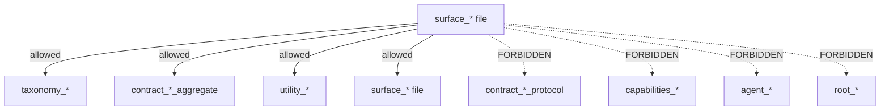

# Design: Simplify Surface Layer Import Rules

**Title:** Simplify Surface Layer Import Rules  
**Author:** GrokBuild  
**Date:** 2026-11-17  
**Status:** Draft  
**Repository:** lint-arwaky (`/home/raka/.agents/skills/architechture/tools`)

## Overview

Simplify the AES102 surface layer import contract so that all `surface_*` files share one import matrix instead of the current three-way split by suffix category. Allowed imports: `taxonomy`, `contract(aggregate)`, `utility`, `surface`. Forbidden imports: `contract(protocol)`, `capabilities`, `agent`, `root`.

## Background & Motivation

### Current State

ARCHITECTURE.md § AES102 Layer Suffix Policy defines three surface sub-categories with different allowed/forbidden matrices:

| Surface sub-category | Allowed imports | Forbidden imports |
|----------------------|-----------------|-------------------|
| `surface(command\|controller\|page)` | `taxonomy`, `contract(aggregate)`, `utility` | `agent`, `capabilities`, `contract(protocol)`, `root` |
| `surface(hook\|store\|action\|screen\|router)` | `taxonomy`, `contract(aggregate)`, `utility` | `agent`, `capabilities`, `contract(protocol)`, `surface(command\|controller\|page\|entry)`, `root` |
| `surface(component\|view\|layout)` | `taxonomy`, `contract(aggregate)`, `utility` | `agent`, `contract`, `capabilities`, `surface(...)`, `root` |

The matrix is complex: three tables, different forbidden lists per sub-category, and a special case that excludes `contract` (bare) from `component|view|layout`.

### Pain Points

1. **Three sub-matrices to memorize** — architects and contributors must check which suffix category a file belongs to before knowing what it may import.
2. **Inconsistent forbidden lists** — `contract(protocol)` is forbidden everywhere, but `contract` (bare) is only forbidden for `component|view|layout`.
3. **No unified `surface` self-import** — `surface(hook|store|action|screen|router)` allows importing `surface(command|controller|page|entry)`, but `surface(command|controller|page)` does not allow importing any `surface` file.

## Goals & Non-Goals

### Goals

1. Single unified import matrix for all `surface_*` files regardless of suffix.
2. Allowed imports: `taxonomy`, `contract(aggregate)`, `utility`, `surface`.
3. Forbidden imports: `contract(protocol)`, `capabilities`, `agent`, `root`.
4. AES201 (forbidden import checker) enforces the simplified matrix.
5. AES703 (structure-rules surface folder check) unaffected.
6. All existing surface-layer fixtures remain valid under the new rule (or are updated).

### Non-Goals

1. Changing file naming suffixes (AES102 suffix policy stays as-is).
2. Changing `contract(aggregate)` vs `contract(protocol)` wiring logic inside capabilities/agent layers.
3. Modifying dispatcher or shared layer import contracts outside AES201 surface enforcement.

## Proposed Design

### 1. Unified AES201 Surface Matrix

Replaces the three-way surface split with one rule:

| Source layer | Allowed imports | Forbidden imports |
|--------------|----------------|-------------------|
| `surface` (any suffix) | `taxonomy`, `contract(aggregate)`, `utility`, `surface` | `contract(protocol)`, `capabilities`, `agent`, `root` |

### 2. File Changes

| File | Change |
|------|--------|
| `ARCHITECTURE.md` | Collapse rows 11–13 of the AES102 table into one `surface` row: allowed `taxonomy, contract(aggregate), utility, surface`; forbidden `contract(protocol), capabilities, agent, root`. |
| `crates/shared/src/import_rules/taxonomy_import_rules_constant.rs` | Update surface forbidden list to `["contract(protocol)", "capabilities", "agent", "root"]`; add `surface` to allowed imports default. |
| `crates/import-rules/src/capabilities_import_forbidden_checker.rs` | Surface branch now allows `surface` self-imports; forbidden list uses simplified matrix. |
| `crates/dispatcher/src/surface_import_action.rs` | No logic change (pass-through). |
| `crates/cli-commands/src/surface_scan_command.rs` | No logic change (CLI glue). |

### 3. Before/After Example

**Before (three surface sub-categories):**
```rust
// surface_auth_command.rs
use taxonomy_vo::UserId;          // ✅ allowed
use contract_user_aggregate::UserAggregate; // ✅ allowed
use utility_output_text_formatter::format; // ✅ allowed
// use contract_user_protocol::UserProtocol; // ❌ forbidden
// use capabilities_user_checker::Checker;   // ❌ forbidden
```

**After (unified surface):**
```rust
// surface_auth_command.rs
use taxonomy_vo::UserId;                      // ✅ allowed
use contract_user_aggregate::UserAggregate;   // ✅ allowed
use utility_output_text_formatter::format;    // ✅ allowed
use surface_user_router::UserRouter;          // ✅ allowed (new)
```

### 4. Mermaid Diagram



### 5. Data Model Changes

None. No schema, migration, or data changes.

### 6. API / Interface Changes

No public API changes. The `IImportRunnerAggregate` contract and `surface_import_action` signature remain unchanged.

### 7. Alternatives Considered

| Alternative | Trade-off |
|-------------|-----------|
| Keep three surface sub-categories (status quo) | Complex, hard to maintain, inconsistent forbidden lists. |
| Allow `surface` self-imports only (this design) | Simple, uniform, matches AES102 intent that surface is the outermost presentation layer. |
| Allow `contract(protocol)` for smart surfaces only | Re-introduces complexity; violates the rule that surface wires DI via aggregates, not protocols. |

### 8. Security & Privacy Considerations

None. This is an architectural boundary rule; no secrets, auth, or data handling changes.

### 9. Observability

AES201 violation output already includes file, line, message, why, fix. No new logging needed.

### 10. Rollout Plan

1. Update `ARCHITECTURE.md` AES102 table (one surface row).
2. Update `taxonomy_import_rules_constant.rs` surface forbidden/allowed lists.
3. Update `capabilities_import_forbidden_checker.rs` surface branch.
4. Update affected test fixtures under `workspaces-bad/` and `workspaces-good/` if any surface file imports a now-forbidden layer.
5. Run `cargo clippy --all-targets -- -D warnings`, `cargo fmt --all -- --check`, `cargo test --workspace`, `lint-arwaky-cli check .` (0 violations).

### 11. Open Questions

None.

### 12. References

- ARCHITECTURE.md § AES102 Layer Suffix Policy (current surface rows 11–13)
- crates/import-rules/FRD.md (AES201 Forbidden import)
- crates/shared/src/import_rules/taxonomy_import_rules_constant.rs
- crates/import-rules/src/capabilities_import_forbidden_checker.rs

## Key Decisions

- **One unified surface matrix.** All `surface_*` files share a single allowed/forbidden matrix, removing the three-way suffix-category split.
- **Surface self-imports allowed.** `surface` is added to the allowed import list for all surface files.
- **Enforcement location.** Update the architectural rules and checkers to recognize the unified `surface` scope.

## PR Plan

### PR 1: Update ARCHITECTURE.md AES102 surface row
- **Files/components affected:** ARCHITECTURE.md
- **Dependencies:** None
- **Description:** Consolidate surface sub-categories into one row with allowed imports taxonomy, contract(aggregate), utility, surface and forbidden imports contract(protocol), capabilities, agent, root.

### PR 2: Simplify AES201 surface rules in configuration
- **Files/components affected:** crates/shared/src/config_system/utility_config_architecture_rules.rs, crates/shared/src/import_rules/taxonomy_import_rules_constant.rs
- **Dependencies:** PR 1
- **Description:** Update surface allowed and forbidden lists in the rule definitions.

### PR 3: Update AES201 surface checker logic
- **Files/components affected:** crates/import-rules/src/capabilities_import_forbidden_checker.rs
- **Dependencies:** PR 2
- **Description:** Enforce the unified surface import matrix and permit surface self-imports.

### PR 4: Verify test fixtures and run CI gates
- **Files/components affected:** workspaces-good/, workspaces-bad/
- **Dependencies:** PR 2, PR 3
- **Description:** Align surface fixtures with the unified matrix and run the verification suite.
