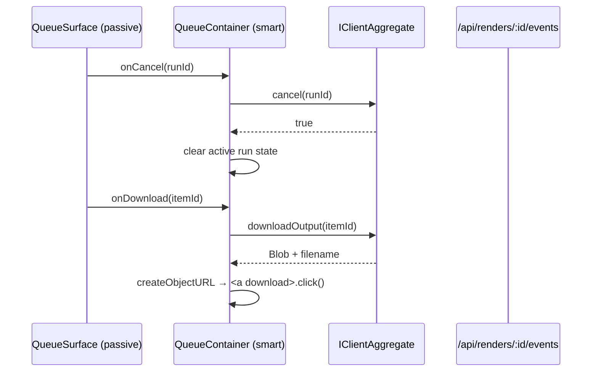

# Design Document: PSD Timelapse Client Integration Surface

| Field | Value |
|-------|-------|
| **Author** | _placeholder_ |
| **Date** | 2026-11-18 |
| **Status** | Draft |
| **Scope** | `packages/client/`, `packages/studio/`, `packages/queue/`, `packages/gallery/`, `packages/root_web_main_entry.ts` |
| **Backend** | `modules/api/` (FastAPI, local profile, loopback only) |

## Overview

PSD Timelapse's web UI ships as vertical feature packages under `packages/`: `client/` (HTTP + SSE transport capabilities, complete and tested), `studio/`, `queue/`, and `gallery/` (passive React surfaces that today render hard-coded mock data), plus a shell hook (`packages/shell/src/surface_client_hook.tsx`) and two smart containers in `packages/root_web_main_entry.ts`. The `client` capability layer is finished — `IClientAggregate` exposes `inspect`, `startRender`, `checkProgress`, `fetchResult`, `cancel`, `retry`, and `watchProgress` over a local FastAPI surface at `http://127.0.0.1:8000/api` — but nothing in the UI consumes it end-to-end: Studio renders a fake layer tree, Queue has no live SSE feed and a no-op download handler, and Gallery displays static demo images with dead play/download callbacks.

This design wires the four packages together: Studio becomes a real inspector + render launcher, Queue tracks a live render over the SSE stream and can cancel and download it, Gallery lists completed runs with working playback and download, and a new "list completed renders" capability closes the last contract gap on the client so Gallery can be data-driven. Every surface stays passive (AES201 row 13 / AES406: no `contract_*`, `capabilities_*`, `agent_*`, or `root_*` imports — data and callbacks flow through props only), all smart logic lives in the `root_web_main_entry.ts` smart containers, and the work is sequenced into seven independently mergeable PRs ending with the `typecheck` / `build` / `lint-arwaky-cli` gate.

## Background & Motivation

**Current state.**

- `packages/shared/src/client/` holds all contracts and taxonomies: `contract_client_aggregate.ts` (`IClientAggregate`, 9 methods), `contract_client_protocol.ts` (5 subsystem protocols), `taxonomy_client_vo.ts` (`PsdDocumentInfoVO`, `LayerMetadataVO`, `LayerBoundsVO`, `ProgressSnapshotVO`, `RenderOutputMetaVO`, `SystemConfigVO`, `SystemHealthVO`), `taxonomy_client_response.ts` (`InspectResponsePayload`, `RunHandleResponsePayload`, `ProgressResponsePayload`, `RunResultResponsePayload`, `OutputMetaResponsePayload`, `ConfigResponsePayload`), `taxonomy_client_constant.ts` (route templates including the already-declared-but-unused `ROUTE_OUTPUT = "/renders/:run_id/output"`), `utility_client_parser.ts`, `utility_client_url.ts`.
- `packages/client/` implements the capabilities: `ClientTransport` (chunked `fetch` + JSON + error-envelope normalization), `ClientInspect`, `ClientRender` (7 lifecycle ops, incl. `getOutputMeta`), `ClientStream` (chunked `fetch` + `ReadableStream` SSE reader against `/api/renders/:run_id/events`, dispatching `state` / `progress` / `terminal`), `ClientSystem`, and `ClientOrchestrator` which composes them into `IClientAggregate` and maps wire payloads to VOs. `root_client_container.ts` exports `createClientAggregate(config?)`.
- `packages/shell/src/surface_client_hook.tsx` provides `ClientProvider`, `useClient()`, `useOptionalClient()`, and `useRenderProgress(runId, client?)` (subscribes `watchProgress`, exposes `{ status, stage, progress, result, error }`).
- `packages/root_web_container.ts` creates the aggregate via `createWebDependencies()`; `packages/root_web_main_entry.ts` mounts the whole app inside `<ClientProvider>`.
- Studio: `surface_studio_layer_panel_component.tsx` renders hard-coded `DEFAULT_LAYERS` (L1–L10) and the fixed file caption `"hoodie_oversize_apparel_design.psd" / "184.2 MB · RGB 16-bit"`; `surface_studio_canvas_component.tsx` has Low/Med/High quality + 720p/1080p state and a RENDER button that fires `onRender({ quality, resolution })` after a 1.2s `setTimeout` fake; `surface_studio_bottom_bar_component.tsx` is an orphaned passive stub (not rendered by `surface_studio_landing_component.tsx`, which inlines its own bottom bar).
- Queue: `surface_queue_component.tsx` is passive with surface-local `RunHandle` / `ProgressSnapshot` / `CompletedItem` types; `QueueContainer` in `root_web_main_entry.ts` already subscribes `watchProgress` for a `localStorage`-tracked active run, wires `onCancel` to `client.cancel`, but passes `onDownload: (_id) => undefined`.
- Gallery: `surface_gallery_component.tsx` is passive with surface-local `GalleryItem` / `GalleryFeatured` types and its own `VideoPlayerModal`; `GalleryRoot` feeds it static `DEMO_GALLERY_*` constants and no-op `onPlay` / `onDownload` / `onRefresh`.

**Pain points.**

1. Studio is decorative: dropping a PSD file only changes the caption text via `File.size`; the layer tree never reflects the document; RENDER never calls the backend.
2. Queue's "download" is inert and the live progress loop only tracks the one `localStorage` run — there is no completed-runs feed and no `GET /output` path in the client layer.
3. Gallery is hard-coded; `PR-PSD-005` ("browse completed renders in a gallery") cannot be satisfied without a data source.
4. `ROUTE_OUTPUT` is declared in `taxonomy_client_constant.ts` and re-exported from `packages/client/src/index.ts`, but no capability fetches the MP4 itself — downloads today have no working target.
5. All gates (`npm run typecheck`, `npm run build`, `lint-arwaky-cli scan packages/`) currently pass against a UI that does none of the above.

## Goals & Non-Goals

### Goals

- G1. Studio file selection / drag-and-drop triggers `client.inspect()`; the layer panel shows real layer names, counts, dimensions, and byte sizes instead of `DEFAULT_LAYERS`.
- G2. Studio RENDER calls `client.startRender(config)` and the page can hand the resulting `runId` to the Queue page.
- G3. Queue displays live SSE progress for the active run, cancels via `client.cancel(runId)`, and downloads the exported MP4 via a new `getOutputBlob(runId)` capability.
- G4. Gallery lists completed renders fetched through the client and supports playback (preview modal with the real MP4) and download.
- G5. New client capability `listCompletedRuns(signal?)` backed by `GET /renders` so G4 has a data source.
- G6. All changes pass `npm run typecheck`, `npm run build`, `npm test -- --run`, and `lint-arwaky-cli scan packages/` with zero AES boundary violations.
- G7. Passive surfaces remain passive: zero `contract_*` / `capabilities_*` / `agent_*` / `root_*` imports in `surface_*` files (AES201 row 13, AES406).

### Non-Goals

- No authentication, hosting profile, or remote transport — the API stays loopback-only (`LOOPBACK_ORIGIN_REGEX`, owner decision recorded in `surface_api_events_controller.py` docstring and `surface_api_controller.py` CORS setup).
- No multi-job backend queue: `PR-PSD-005` enforces one active render at a time; `queued` stays an empty passive section until a backend queue exists (explicit in `packages/queue/DESIGN.md`).
- No `EventSource` — the SSE stream stays a chunked-`fetch`/`ReadableStream` reader (`ClientStream`), because the browser's `EventSource` cannot set custom headers on some targets and the existing contract (`IClientStreamProtocol.subscribeEvents`) already models it.
- No new Python module code beyond the small `modules/api` listing route for G5.
- No re-architecture of `root_web_main_entry.ts`; smart containers stay in that file per the existing AES506 orphan-compliance comments (shell surfaces imported by root).

## Proposed Design

### Architecture

The dependency flow stays strictly downward into the shared contract layer and upward into root:

```mermaid
flowchart TD
  subgraph root["packages/root_web_main_entry.ts (AES root)"]
    QC["QueueContainer (smart)"]
    SC["StudioContainer (smart)"]
    GR["GalleryContainer (smart, new)"]
  end
  subgraph shell["packages/shell/src/surface_client_hook.tsx (surface:hook)"]
    UP["useClient / useOptionalClient / useRenderProgress"]
    CP["ClientProvider"]
  end
  subgraph client["packages/client/ (capabilities + agent)"]
    AGG["ClientOrchestrator → IClientAggregate"]
    R["ClientRender (capabilities)"]
    S["ClientStream (capabilities)"]
    I["ClientInspect (capabilities)"]
    T["ClientTransport (capabilities)"]
    NEW["listCompletedRuns capability (new, in ClientRender or separate capabilities_client_list.ts)"]
  end
  subgraph shared["packages/shared/src/client/ (contract + taxonomy)"]
    C["IClientAggregate / IClientRenderProtocol"]
    X["taxonomy_client_vo / _response / _request / _constant / _error"]
    U["utility_client_parser / utility_client_url"]
  end
  subgraph surfaces["passive surfaces"]
    ST["surface_studio_layer_panel / _canvas / _landing"]
    QQ["surface_queue_component"]
    GG["surface_gallery_component"]
  end
  API["modules/api (FastAPI @ 127.0.0.1:8000/api)"]

  QC -->|useOptionalClient| UP
  SC -->|useOptionalClient| UP
  GR -->|useOptionalClient| UP
  UP --> CP
  CP --> AGG
  AGG --> R
  AGG --> S
  AGG --> I
  R --> T
  NEW --> T
  AGG --> C
  C --> X
  QC -->|props: RunHandle/ProgressSnapshot/CompletedItem + callbacks| QQ
  SC -->|props: layers/meta + onRender| ST
  GR -->|props: GalleryItem[] + onPlay/onDownload| GG
  T -->|fetch /api| API
  S -->|fetch /api/renders/:id/events| API
```

### 1. Inspection models (sequence item 1)

No contract change required. `InspectResponsePayload` already carries `layers: readonly LayerPayload[]` with `name`, `classification`, `reveal_style`, `bounds: LayerBoundsVO`, `visible`; `ClientOrchestrator.mapInspectResponse` collapses it to `PsdDocumentInfoVO` (`has_layers`, `width`, `height`, `layer_count`, `top_level_count`) read from `payload.summary`. The gap: **the orchestrator throws away `payload.layers`** while the surface needs the full layer list.

Decision: `IClientAggregate.inspect` keeps returning `PsdDocumentInfoVO` (aggregate hides capabilities — `ARCHITECTURE.md` AES402 rule). Studio's smart container instead calls the lower-level inspect path by widening the aggregate surface is *not* allowed for passive surfaces; per AES402 the aggregate hides capabilities from Surface, so the smart container needs the layer list **through the aggregate**. Two options:

- **Option A (chosen):** Add `inspectFull(inputPath, signal?): Promise<InspectFullVO>` to `IClientAggregate` where `InspectFullVO = PsdDocumentInfoVO & { readonly layers: readonly LayerPayload[] }`. This is an additive contract change on `contract_client_aggregate.ts`; the orchestrator implements it by calling `this.inspectCapability.inspectPsd(...)` once and returning `{ ...this.mapInspectResponse(payload), layers: payload.layers }`.
- Option B: keep `inspect` and let Studio call `client.inspect` for the caption and a *separate* `listLayers` call — doubles the Scripting `execute` round-trips on the Python side (`surface_api_inspect_controller.py` already runs VALIDATE_PSD, PARSE_PSD, CLASSIFY_LAYERS in one call; splitting would require a new endpoint).

Option A is one extra aggregate method, one new VO in `taxonomy_client_vo.ts`, and no Python change.

### 2. Job models (sequence item 2)

Already complete and tested (`FR-CLIENT-003`, `FR-CLIENT-006`). `RunHandleResponsePayload` / `RunResultResponsePayload` / `ProgressResponsePayload` / `ConfigResponsePayload` exist; `IClientAggregate.startRender` → `RenderExecutionHandle { runId, state, inputPath }`. No change.

### 3. `GET /output/:id` for MP4 blobs (sequence item 3)

Backend already exposes it: `OutputController.register` mounts `GET /renders/{run_id}/output` (`FileResponse`, `video/mp4`, `filename=<basename>`; `409 OUTPUT_UNAVAILABLE` for non-completed runs, `404` for unknown or deleted runs — see `surface_api_output_controller.py`) and `GET /renders/{run_id}/output/meta` (JSON `OutputMetaResponse { available, video_path, size_bytes, state }`). The client has `ROUTE_OUTPUT` and `ROUTE_OUTPUT_META` declared; `ClientRender.getOutputMeta` covers the meta route.

Gap: no capability fetches the MP4 itself. Design:

- Extend `IClientRenderProtocol` with `getOutput(runId: string, signal?: AbortSignal): Promise<Blob>` implemented in `ClientRender` as a raw `fetch` (mirrors how `ClientStream` owns its fetch because the transport is JSON-only and cannot return a `Blob`):

```ts
// in capabilities_client_render.ts
async getOutput(runId: string, signal?: AbortSignal): Promise<Blob> {
  const url = buildApiUrl(this.baseUrl, this.resolveRoute(ROUTE_OUTPUT, runId));
  const response = await fetch(url, { headers: { Accept: "video/mp4" }, signal });
  if (!response.ok) {
    const json: unknown = await response.json().catch(() => null);
    throw normalizeErrorEnvelope(response.status, json);
  }
  return response.blob();
}
```

`ClientRender` needs `baseUrl` like `ClientStream` (add `readonly baseUrl: string` to its deps — `root_client_container.ts` already passes it to `ClientStream`, so wire the same value into `ClientRender`'s constructor).

- Expose on the aggregate: `IClientAggregate.downloadOutput(runId, signal?): Promise<Blob>` → `RenderDownloadVO { readonly blob: Blob; readonly filename: string; readonly sizeBytes: number }` derived from `Content-Disposition` / `blob.size`. Filename defaults to `timelapse_<runId>.mp4` when the header is absent.

Content-Disposition parsing (§3 `GET /output/:id`): `FileResponse` sets `Content-Disposition: attachment; filename="<basename>"` (no quoted-printable encoding needed for ASCII filenames). `ClientRender.getOutput` parses it with a simple regex: `/filename="([^"]*)"/` against `response.headers.get("Content-Disposition")`. Fallback when the header is absent or the regex fails: `timelapse_<runId>.mp4`. No need to handle `filename*=` (RFC 5987) — the Python API always sends a plain ASCII filename.

The `Blob` type is browser-platform; `taxonomy_client_vo.ts` is shared across `node`-environment tests, but `Blob` is declared in the DOM lib and the tsconfig targets `DOM` + `DOM.Iterable`, so it is available; the `node`-environment integration tests can stub it (see Risks).

### 4. SSE stream adapter (sequence item 4)

Already complete: `capabilities_client_stream.ts` implements `IClientStreamProtocol.subscribeEvents` with a chunked `fetch` + `ReadableStream` reader, `parseSseChunk` framing, and `state` / `progress` / `terminal` dispatch (FR-CLIENT-004, tested in `unit_client_stream.test.ts` / `integration_client_flow.test.ts`). The Python side (`surface_api_events_controller.py`) re-emits the current state frame on reconnect and closes after `terminal`. No change; the surfaces consume it through `watchProgress` / `useRenderProgress`.

### 5. Studio PSD inspection integration (sequence item 5)

Passive `surface_studio_layer_panel_component.tsx` gains real data-driven props; the smart container drives it.

```mermaid
sequenceDiagram
  participant L as StudioLayerPanel (passive)
  participant S as StudioContainer (smart, root_web_main_entry.ts)
  participant C as IClientAggregate
  participant A as FastAPI /api/inspect
  L->>S: onPickFile(file)
  S->>S: localPath = file.name (display) ; serverPath = resolveWorkspacePath(file)
  S->>C: inspectFull(serverPath)
  C->>A: POST /inspect {input_path}
  A-->>C: InspectResponsePayload
  C-->>S: InspectFullVO (dimensions, layers[])
  S->>L: props: layers=map(vo), meta=summary, fileMeta={name,sizeMb}
```

Concretely:

- `StudioLayerPanelProps` becomes:

```tsx
export interface StudioLayerRow {
  readonly id: string;          // synthetic, stable ("layer-0"…)
  readonly label: string;       // LayerPayload.name
  readonly visible: boolean;    // LayerPayload.visible
  readonly classification?: string;
}
export interface StudioFileMeta {
  readonly name: string;        // user's file name
  readonly sizeLabel: string;   // "184.2 MB · RGB 16-bit"
  readonly dimensions?: string; // "3000 × 3000"
  readonly layerCount?: number;
}
export interface StudioLayerPanelProps {
  className?: string;
  readonly layers?: readonly StudioLayerRow[];
  readonly fileMeta?: StudioFileMeta;
  readonly onPickFile?: (file: File) => void;   // replaced bare onDropFile
  readonly onSelectLayer?: (layerId: string) => void;
  readonly onReinspect?: () => void;            // refresh button re-calls inspect
}
```

`DEFAULT_LAYERS` and the hard-coded caption stay only as **fallbacks when `layers` / `fileMeta` props are absent**, preserving current demo behavior when the container has no client.

- `StudioContainer` (new, in `root_web_main_entry.ts`) owns `selectedFile: File | null`, `inspectState: { status: "idle" | "loading" | "error" | "ready"; doc?: InspectFullVO }`. On `onPickFile` it stores the file and calls `client.inspectFull(pathOf(file))`. The path it passes to the API must be **server-visible** — see below.

**Server path field (blocking default).** A browser `File.name` is only a basename (e.g. `"hoodie_oversize_apparel_design.psd"`), not an absolute path. The Python inspect endpoint validates `path.is_file()` against the server filesystem (`surface_api_inspect_controller.py:70`), so passing a basename will almost always fail because it resolves against the server's cwd. **Default choice:** Studio shows an editable "server path" text field pre-filled from `File.name` but explicitly labelled as **"absolute path on the server"** with a tooltip explaining the path must exist on the machine running the Python API. The user must type/paste a valid absolute path for inspect/startRender to succeed. This field is the sole input path; the browser file picker is used only for the display caption (`File.name` + `File.size`). An upload endpoint (`POST /api/upload`) is out of scope for this design (deferred — see Open Questions).

- `surface_studio_landing_component.tsx` composes `StudioLayerPanel` + `StudioCanvas` and adds the new `onPickFile` / `onRender` / `onCancelRun` props it needs; `StudioCanvas` receives the active `runId` + progress so its notification bar reflects the real pipeline instead of the 1.2s fake.

### 6. Studio layer and export controls (sequence item 6)

- RENDER wiring: `StudioCanvas.handleRenderClick` currently `setTimeout(..., 1200)`; it becomes `await onRender({ quality, resolution })` where `StudioContainer.onRender` does:

```ts
const handle = await client.startRender(inputPath); // inputPath from the picked file's server path
const runId = handle.runId;
persistActiveRun(runId, inputPath); // existing RUN_KEY localStorage helper
// navigate to queue so the live surface picks it up:
window.location.hash = "#queue";
```

- Quality/Resolution → `startRender` config: the current `StartRenderRequest` is only `{ input_path, output_path? }` and `SystemConfigVO` is server-locked (`surface_api_schema_view.py` documents "the locked output spec"). The Studio's Low/Med/High + 720p/1080p selectors therefore do **not** map 1:1 to a request field today. Design choice: treat the selectors as **UI-passthrough** that (a) derive `output_path` suffix when non-default, and (b) pass through verbatim in a forward-compatible `render_options` bag once the backend adds it. For this design, the settings are forwarded as part of `onRender(settings)` and the container logs/ignores quality today — the backend contract does not accept it yet (flagged in Open Questions; do not invent a wire field).

- `surface_studio_bottom_bar_component.tsx`: retire the orphan stub (AES503-ish risk of an unused surface file). Since the landing component inlines its own bottom bar (the canvas's `<footer>`), the standalone file either gets consumed or removed. Decision: **remove** `surface_studio_bottom_bar_component.tsx` and its imports — it duplicates the canvas footer and is imported nowhere (verified: only the canvas footer exists in the rendered tree). Removal keeps the AES704 test-coverage map honest. (If the reviewer prefers retention, the alternative is wiring it as the single bottom-bar implementation; both are one-line diffs.)

### 7. Queue live run lifecycle (sequence item 7)

- `QueueContainer` already: loads `pt-active-run` from `localStorage`, subscribes `client.watchProgress(activeRunId)` with `watchProgress`'s 5 callbacks, updates `currentStage` / `currentPercent`, wires `handleCancel` → `client.cancel(runId)` + clear. Gaps to close:
  - `onDownload` is `(_id) => undefined` → wire to `client.downloadOutput(runId)` → `URL.createObjectURL(blob)` + anchor-click download, then `revokeObjectURL`.
  - Completed list: today `loadCompletedRuns()` reads a `localStorage` JSON array. Replace/supplement with `client.listCompletedRuns()` (G5) so the surface shows server-truth; keep `localStorage` as an offline cache seed. `CompletedCard` maps `title = basename(item.inputPath)`, which now resolves to the PSD stem recovered from the run directory name (not "unknown").
  - The `watchProgress` "on complete" callback currently does nothing — capture `RenderOutputMetaVO`, push a `CompletedItem` into the `completed` list (id = runId, `outputPath` = meta.video_path, `sizeBytes` = meta.size_bytes), and persist to `localStorage`.
- Surface (`surface_queue_component.tsx`) changes are additive only: `CompletedItem` already has `outputPath` / `sizeBytes`; the download button is `disabled` when `outputPath === undefined` — keep that.



### 8. Gallery completed runs and playback (sequence item 8)

- New smart container `GalleryContainer` in `root_web_main_entry.ts` replacing the demo-data `GalleryRoot` body:

```ts
function GalleryContainer() {
  const client = useOptionalClient();
  const [state, setState] = useState<{ status: "loading" | "ready" | "error"; items: GalleryItem[]; featured?: GalleryFeatured }>({ status: "loading", items: [] });
  const load = useCallback(async () => {
    if (!client) { setState({ status: "ready", items: [] }); return; }
    const runs = await client.listCompletedRuns();
    // map RenderCompletedVO list → GalleryItem[] (id=runId, title=basename(inputPath), meta=durationSeconds ? `${durationSeconds}s` : undefined…)
    // inputPath carries the PSD stem recovered from the run directory name, so title shows the real filename, not "unknown"
    setState({ status: "ready", items: mapped, featured: mapped[0] });
  }, [client]);
  useEffect(() => { void load(); }, [load]);

  const handleDownload = async (id: string) => {
    if (!client) return;
    const { blob, filename } = await client.downloadOutput(id);
    triggerBrowserDownload(blob, filename);
  };
  return createElement(GallerySurface, {
    featured: state.featured ?? null,
    recent: state.items,
    completedCount: state.items.length,
    loading: state.status === "loading",
    onPlay: (id) => { /* open modal with the real video URL */ },
    onDownload: handleDownload,
    onRefresh: () => void load(),
  });
}
```

- Playback: `GallerySurface`'s existing `VideoPlayerModal` currently renders a placeholder image with a `play_circle` glyph. Extend `GalleryItem` with optional `readonly videoUrl?: string` (an object-URL or the `/api` download URL) and change the modal to render `<video src={videoUrl} controls autoPlay>` when present — the studio canvas already proves the modal-video pattern. `onPlay` in the container resolves `videoUrl` lazily via `downloadOutput` + `URL.createObjectURL` on first play (avoids N blobs on page load for large MP4s; storage estimate in Observability).
- `GalleryRoot` (the `ShellLayout` wrapper) swaps `DEMO_GALLERY_*` constants for `createElement(GalleryContainer)`.

### 9. Validation gates (sequence item 9)

Per `packages/package.json` and `.github/workflows/ci.yml`:

```bash
cd packages && npm ci
npm run typecheck      # tsc -p root_tsconfig_entry.json --noEmit
npm run build          # typecheck + vite build
npm test -- --run      # vitest, web-ui CI gate
cd .. && lint-arwaky-cli scan packages/   # zero AES201 row-13 / AES406 violations
```

The validation gates above are enforced by `ci.yml` (`npm test -- --run` runs vitest only; there is **no** `test:count` CI step). `packages/package.json` defines a `test:count` script that references `packages/tests/count-guard.mjs`, but that file does not exist in the repo and is not wired into CI. No test-count guard is part of this design's validation surface. Each PR that adds test files (e.g. the new `listCompletedRuns` + `getOutput` unit tests in `packages/client/tests/`) simply extends the existing vitest run; no baseline bump is required.

## API / Interface Changes

### `packages/shared/src/client/contract_client_aggregate.ts`

```ts
// ADD
inspectFull(inputPath: string, signal?: AbortSignal): Promise<InspectFullVO>;
downloadOutput(runId: string, signal?: AbortSignal): Promise<RenderDownloadVO>;
listCompletedRuns(signal?: AbortSignal): Promise<readonly RenderCompletedVO[]>;
```

```ts
export interface InspectFullVO extends PsdDocumentInfoVO {
  readonly layers: readonly LayerPayload[];   // re-exported from taxonomy_client_response
}
export interface RenderDownloadVO {
  readonly blob: Blob;
  readonly filename: string;
  readonly sizeBytes: number;
}
export interface RenderCompletedVO {
  readonly runId: string;
  readonly state: string;
  readonly inputPath: string;
  readonly durationSeconds: number | null;
}
```

### `packages/shared/src/client/contract_client_protocol.ts`

```ts
export interface IClientRenderProtocol {
  // …existing 7 methods…
  getOutput(runId: string, signal?: AbortSignal): Promise<Blob>;              // NEW
  listCompletedRuns(signal?: AbortSignal): Promise<readonly ListRunsItemResponse[]>; // NEW
}
```

### `packages/client/src/capabilities_client_render.ts`

Constructor gains `baseUrl` (same pattern as `ClientStream`). Adds `getOutput` (raw `fetch` → `Blob`, `normalizeErrorEnvelope` on failure) and `listCompletedRuns` (transport `GET /renders`). `root_client_container.ts` passes `baseUrl` into `ClientRender`'s deps.

### `packages/client/src/agent_client_orchestrator.ts`

```ts
// maps ListRunsItemResponse (wire) → RenderCompletedVO (domain)
listCompletedRuns(signal?: AbortSignal): Promise<readonly RenderCompletedVO[]>;
```

### New Python endpoint: `GET /api/renders` (listing)

`modules/api/src/surface_api_run_controller.py`: add `list_runs` to the existing `RunViewController` class and mount `GET /renders` inside `RunViewController.register()` via `router.add_api_route("/renders", self.list_runs, methods=["GET"])`. No change to `modules/api/src/surface_api_controller.py` is needed — `ApiController.__init__` already calls `RunViewController(orchestrator).register(self.router)` at line 106.

```python
@router.get("/renders", response_model=RunListResponse)
def list_runs(self) -> dict[str, object]:
    """Completed/terminal runs only, newest first. The local workspace has O(1..N)
    finished runs, so a full scan of the JSONL evidence directory is acceptable."""
    items = self._orchestrator.list_runs()
    return {"items": [ListRunsItemResponse.from_vo(item) for item in items]}
```

- New Pydantic model in `surface_api_schema_view.py`: `RunListResponse { items: list[ListRunsItemResponse] }`, where `ListRunsItemResponse` is `{ run_id: str, state: str, input_path: str, duration_s: float | None }`. This maps from `ListRunsItemVO`, **not** `RunResultVO` — see below.
- **New** method `list_runs() -> list[ListRunsItemVO]` on `AgentSystemOrchestrator` (`modules/system/src/agent_system_orchestrator.py`). This is a NEW method — no existing enumeration exists. `get_run_result(run_id)` at line 320 only returns `self._run_state.last_result` (single `RunResultVO | None`); there is no method that enumerates all completed runs across evidence directories.
- **Scan strategy (correcting the "run result JSON files" claim).** The codebase persists no standalone `RunResultVO` JSON file — `RunResultVO` lives only in memory (`_run_state.last_result`). The only on-disk record of a finished run is the JSONL evidence file `capabilities_system_evidence.py` writes to `<run_dir>/log/<run_id>.jsonl` (each line a `RunEvidenceRecordVO`: `timestamp`, `run_id`, `status`, `stage`, `error_code`, `error_detail`, `duration`, `request_id`, `details`). `list_runs()` therefore enumerates runs in two steps:

  1. **Enumerate run directories** under the XDG output dir: `<output_dir>/*/` where each directory matches the per-PSD timestamped layout `<psd-stem>-<YYYY-MM-DD_HHhMMmSSs>/` (built by `capabilities_system_workspace.py` via `RUN_FOLDER_TIMESTAMP_FORMAT = "%Y-%m-%d_%Hh%Mm%Ss"`). The `output_dir` comes from the injected configuration's `SystemConfigVO.output_dir` (default XDG data dir).
  2. **For each run dir**, read `<run_dir>/log/<run_id>.jsonl` and find the terminal record — the last line whose `status` is `"completed"`, `"failed"`, or `"cancelled"` (equivalently `stage` is in `TERMINAL_STAGE_VALUES`). Extract the available fields:
     - `run_id` from the filename (`<run_id>.jsonl`) or the record's `details` dict
     - `state` = the terminal `status` value
     - `input_path` from the `details` dict if present, else `"unknown"` (the input path is not a guaranteed envelope field)
     - `error` reconstructed from `error_code` / `error_detail` when the terminal status is `failed`
     - `video_path` / `total_frames` / `fps` are **not** in the evidence records and are dropped from this view

  Directories with no terminal record (interrupted runs, or runs whose evidence was pruned) are skipped. Results are sorted newest-first by the run directory's mtime or the terminal record's `timestamp`.

  **PSD stem recovery (zero-backend-change note).** The PSD stem is recoverable from the run directory name. `list_runs()` should extract the PSD stem from `<psd-stem>-<timestamp>` and set `input_path = <psd-stem>.psd` (or leave as the directory-name stem) as the display title. This is a zero-backend-change approach that gives Gallery/Queue a real filename instead of `"unknown"`.
- **New lightweight VO** `ListRunsItemVO` in `modules/shared/src/system/taxonomy_system_vo.py`:

  ```python
  @dataclass(frozen=True)
  class ListRunsItemVO:
      run_id: str
      state: str          # "completed" | "failed" | "cancelled"
      input_path: str     # PSD stem extracted from run directory name, or "unknown" if directory name does not match the expected pattern
      duration_s: float | None
  ```

  This is a deliberate reduced view. The gallery/queue surfaces need `id`, `state`, `inputPath`, and optionally `durationSeconds` — all of which `ListRunsItemVO` provides — so there is no reason to reconstruct a full `RunResultVO` (which carries `video_path` / `total_frames` / `frame_rate` / manifest paths the evidence records do not contain). `ListRunsItemResponse` maps from `ListRunsItemVO[]`, NOT from `RunResultVO[]`.
- The new `GET /api/renders` controller calls `self._orchestrator.list_runs()` directly (the same pattern `OutputController` and `RunController` already use for `get_run_result` — they bypass `ISystemAggregate`). `ISystemAggregate` is NOT extended; its single `execute(request: SystemRequestVO) -> SystemResponseVO` entry point (AES402) is preserved.
- CI gate `fixtures/openapi.json` (dumped by `scripts/dump_openapi.py`, diffed in `ci.yml` "Fail on backend schema drift") **must be regenerated in the same PR** as the new endpoint.

### Surface prop contracts (additive, passive)

| Surface | Added props |
|---------|-------------|
| `StudioLayerPanelProps` | `fileMeta?: StudioFileMeta`; `onPickFile?: (file: File) => void`; `onReinspect?: () => void`; `StudioLayerRow` gains `classification?` |
| `StudioCanvasProps` | `runId?: string \| null`; `progress?: { percent: number; stage: string } \| null`; `onRender` becomes `(settings) => Promise<void>` |
| `StudioLandingProps` | `layers?`, `fileMeta?`, `onPickFile?`, `onRender?`, `onReinspect?`, `runId?`, `progress?` |
| `QueueSurfaceProps` | unchanged (callbacks already present; container just implements them) |
| `GalleryItem` / `GallerySurfaceProps` | `GalleryItem.videoUrl?: string`; modal renders `<video>` when set |

## Data Model Changes

| Change | File | Migration |
|--------|------|-----------|
| `InspectFullVO`, `RenderDownloadVO`, `RenderCompletedVO` added | `packages/shared/src/client/taxonomy_client_vo.ts` | additive; no existing consumer breaks |
| `LayerPayload` type re-exported into VO file (or VO imports from response file) | `packages/shared/src/client/taxonomy_client_vo.ts` | `InspectFullVO.layers` typed as `LayerPayload[]` — import from `taxonomy_client_response.js` (taxonomy→taxonomy is allowed, row 2) |
| `ListRunsItemVO` added | `modules/shared/src/system/taxonomy_system_vo.py` | NEW lightweight VO (`run_id`, `state`, `input_path`, `duration_s`); terminal-record scan target for `list_runs()` |
| `RunListResponse` / `ListRunsItemResponse` Pydantic models | `modules/api/src/surface_api_schema_view.py` | additive; `RunListResponse { items: list[ListRunsItemResponse] }`, `ListRunsItemResponse { run_id, state, input_path, duration_s }` |
| `AgentSystemOrchestrator.list_runs()` | `modules/system/src/agent_system_orchestrator.py` | NEW method; enumerates `<output_dir>/*/` run dirs, reads `<run_dir>/log/<run_id>.jsonl`, extracts the terminal record (`status` ∈ completed/failed/cancelled), returns `list[ListRunsItemVO]` newest-first; existing `get_run_result` semantics unchanged |

No stored-schema migrations: the local profile keeps evidence under `$HOME/.local/share/psd-timelapse` (see `.psdtimelapse` symlink); `list_runs` scans existing JSONL evidence files.

## Alternatives Considered

1. **Poll `checkProgress` instead of SSE in Queue/Gallery.** Rejected: `ClientStream` already exists and is tested; the EventsController is purpose-built for this (0.15s server poll, reconnect-safe opening frame). Polling would add 4× the request load for no benefit at local scale.
2. **Add an `EventSource`-based second stream capability.** Rejected: `EventSource` cannot set the `Accept` header reliably cross-browser and cannot be aborted with an `AbortController` on all targets; `ClientStream`'s chunked-`fetch` reader is already implemented, tested, and matches the contract (`subscribeEvents` returns an unsubscribe fn).
3. **Put live-state in a shared Zustand/Jotai store instead of smart containers.** Rejected: `home` uses a `useSyncExternalStore` store (`surface_home_store.ts`) but that package is a marketing page; the AES import matrix gives no store role in studio/queue/gallery, and `root_web_main_entry.ts` already carries the smart-container pattern. Introducing a store package now would require new AES scoping (surface:store is row 12 and would need its own feature folder). Containers-in-root stay consistent with existing `QueueContainer` / `StudioContainer`.
4. **Expose `InspectResponsePayload` directly on the aggregate instead of `InspectFullVO`.** Rejected: AES402 — the aggregate must map wire payloads to VOs; leaking response-payload types into `contract_client_aggregate.ts` would force every surface to depend on the wire format.
5. **Have Gallery download MP4s eagerly on mount (N blobs).** Rejected at scale: at 30–40 MB per render, opening the gallery with 12 completed runs would allocate ~480 MB of `Blob` memory. Lazy object-URL on first play + `revokeObjectURL` on modal close bounds memory to 2× concurrently-open modals.

## Security & Privacy Considerations

- **Transport is loopback-only.** `surface_api_controller.py` installs `CORSMiddleware(allow_origin_regex=LOOPBACK_ORIGIN_REGEX, ...)` — `http://127.0.0.1:*` / `http://localhost:*` — and never a wildcard. The web app (`127.0.0.1:5173`) is the only valid origin; no cross-origin file exfiltration path.
- **No file-system enumeration surface.** `inspect` and `startRender` accept a server-visible `input_path`; the API validates `.psd` suffix + `path.is_file()` (`surface_api_inspect_controller.py`, `SystemErrorCode.INPUT_MISSING` / `INPUT_UNSUPPORTED`). The browser's `File` object never reaches the wire — only the name (display) and a server-resolvable path (see Open Questions).
- **Download endpoint is authenticated by locality.** `GET /renders/{run_id}/output` streams a local file only when the run is `COMPLETED` and the file still exists; `409`/`404` semantics are documented in `surface_api_output_controller.py` ("never a fabricated link, per FRD §FR-006"). No URL is returned to a remote party.
- **Threat model.** Local single-user operator. Residual risk: a malicious browser tab from another origin cannot reach the API (CORS loopback regex), and the SSE stream reuses the same origin. Object-URL blobs (`URL.createObjectURL`) are same-origin only and are revoked after download.
- **Privacy.** Layer names and file paths render verbatim in Studio/Queue/Gallery — acceptable for the local profile (the operator's own files). Do not add analytics/logging of paths (none exists today; keep it that way).

## Observability

- **Logging.** Smart containers log at `console.warn`/`console.error` boundaries only (existing pattern: `StudioContainer` logs `"studio-render: provide inputPath before calling startRender"`). No new logging framework; Python side already logs via `LOGGER_NAME` (`surface_api_controller.py`).
- **Metrics.** Local profile has no APM. Concrete signals to surface: SSE stream status (`connecting/open/closed/error`) already exposed by `watchProgress` callback 1 — Queue's active card should reflect `error` status with the `ServerStreamError` message. Render duration: `RunResultVO.total_frames / fps` gives seconds for the active run's `GET /run/:id/result` response; for completed runs, `ListRunsItemVO.duration_s` (from the evidence record's `duration`) gives seconds — Gallery/Queue display it (`CompletedItem.durationSeconds` already exists).
- **Alerting.** N/A (no hosted profile in P0). The one operational alert that matters locally: the `openapi.json` drift gate in `ci.yml` — any PR touching `modules/api` schemas must regenerate the fixture or CI fails.
- **Storage estimate.** `list_runs` scans the evidence directory: O(1–50) run dirs per workspace, each `ListRunsItemVO` ~200 bytes → <10 KB in memory; each `RunEvidenceRecordVO` JSONL line ~300 bytes → a few KB per run dir. Gallery MP4s: 20–40 MB each (`surface_api_output_controller.py` reads `stat().st_size`); concurrent object-URLs bounded to 2 (playback modal + 1 pending download).

## Rollout Plan

No feature flags: the local profile is single-user; a flag would only gate a demo fallback. Staged rollout via the PR sequence below — each PR leaves `typecheck` + `build` + `test` + `lint-arwaky` green. Each PR’s CI gate passes against main once its prerequisite PRs are merged. PR 1 is strictly first, PR 2 depends on PR 1, PRs 3/4/5/6 depend on PR 2, PR 7 depends on all of 3–6.

1. **PR 1 (backend listing)** lands first: `GET /api/renders` + `list_runs` + OpenAPI fixture regeneration. Purely additive; web UI unaffected.
2. **PR 2 (client capability extension)** adds `getOutput`, `listCompletedRuns`, `inspectFull`, `downloadOutput` to the contract + capabilities + orchestrator + unit tests.
3. **PR 3 (Studio)**, **PR 4 (Queue)**, **PR 5 (Gallery)** are mutually independent after PR 2 and can land in any order.
4. **PR 6 (container wiring)** — GalleryContainer replacement of demo data in `root_web_main_entry.ts` — lands last among UI PRs so demo data is removed only once the live path is tested.
5. **Rollback.** Each PR reverts cleanly: PRs 3–5 are prop-additive (surfaces fall back to mock data when the container passes nothing, because the fallback path is preserved). PR 2 reverts the contract (additive interfaces — no consumers yet at revert time). PR 1 reverts the endpoint.
6. **PR 7 (gate PR)** runs the full sequence: `npm run typecheck`, `npm run build`, `npm test -- --run`, `lint-arwaky-cli scan packages/` and records zero violations.

## Open Questions

1. **Server-visible input path — blocking.** The Python `inspect` endpoint validates `path.is_file()` against the server filesystem, but a browser `File` carries only a basename (e.g. `"hoodie_oversize.psd"`), which resolves against the server's cwd and will almost always fail. **Default choice (blocking, not deferred):** Studio shows an editable "server path" text field pre-filled from `File.name` but explicitly labelled as **"absolute path on the server"** with a tooltip explaining the path must exist on the machine running the Python API. The user must type/paste a valid absolute path for inspect/startRender to succeed. An upload endpoint (`POST /api/upload` multipart) is out of scope for this design (deferred — would write the PSD into the XDG workspace and return the path).
2. **Quality/Resolution selectors vs. locked `SystemConfigVO`.** The backend locks `width/height/fps/codec/crf` via `/config` ("locked output spec" — `surface_api_schema_view.py`). Do Studio's Low/Med/High + 720p/1080p selectors map to future `render_options` fields (backend contract change), or are they purely cosmetic for this milestone? Default assumption: cosmetic passthrough, no wire field (non-goal: backend config change).
3. **`Blob` availability.** Global `Blob` is available in Node ≥18 (Node ≥24 is the project minimum per `packages/package.json` `engines`) — so the claim "global `Blob` since Node ≥24" is conservative but wrong. `unit_client_render.test.ts` runs under jsdom (not node) by default per the vitest config, so `Blob` is available in the test environment regardless.
4. **Bottom-bar stub removal.** `surface_studio_bottom_bar_component.tsx` is orphaned (duplicated by the canvas footer). Remove it, or keep as the single source and extract the canvas footer into it? Default: remove (lower test-coverage burden; `AES704`).
5. **Gallery featured selection rule.** Today's demo hard-codes one featured card. For live data: first item = featured, or most-recent-by-`duration_s`/timestamp? `ListRunsItemVO` has no timestamp — ordering comes from the evidence-dir listing (newest-first by run directory mtime / terminal record timestamp). Default: list order = filesystem order, first = featured.
6. ~~**`test:count` baseline.**~~ **Removed.** `packages/tests/count-guard.mjs` does not exist in the repo; `ci.yml` runs `npm test -- --run` (vitest only) with no `test:count` step. `package.json` has a `test:count` script referencing the missing file, but it is not enforced. No baseline-bump workflow is part of this design.

## Key Decisions

1. **Surfaces stay passive; all wiring lives in `root_web_main_entry.ts` smart containers** (AES201 row 13 / AES406). No new `*_hook.tsx` files in studio/queue/gallery — the existing `QueueContainer` / `StudioContainer` pattern is the sanctioned location, and AES506 orphan compliance is already solved there via shell re-exports.
2. **One additive aggregate method `inspectFull`** rather than leaking `InspectResponsePayload` (AES402: aggregate maps wire → VO). Cost: one new VO, one orchestrator method.
3. **`ClientRender` owns a `baseUrl` and performs the raw `fetch` for `getOutput`** (mirrors `ClientStream`, which bypasses the JSON transport for the same reason — a `Blob` body cannot round-trip through `response.json()`).
4. **SSE stays chunked-`fetch`/`ReadableStream`** (`ClientStream`, FR-CLIENT-004). No `EventSource`, no WebSocket, no polling — the stream re-emits its opening state frame on reconnect (`surface_api_events_controller.py`), so a Queue refresh after a tab sleep needs no special resync.
5. **New `GET /api/renders` listing endpoint** is the minimal backend addition; `RunListResponse { items: ListRunsItemResponse[] }` maps from a NEW lightweight `ListRunsItemVO` (`run_id`, `state`, `input_path`, `duration_s`), NOT from `RunResultVO`. The new `AgentSystemOrchestrator.list_runs()` scans the JSONL evidence records on disk — `<output_dir>/*/log/<run_id>.jsonl`, taking each file's terminal record (`status` ∈ completed/failed/cancelled) — rather than nonexistent standalone result JSON, because `RunResultVO` is memory-only (`_run_state.last_result`) and `video_path`/`total_frames`/`fps` are absent from the evidence envelope. The new endpoint calls `list_runs()` directly (bypassing `ISystemAggregate` — same pattern as `OutputController`/`RunController` calling `get_run_result`). `ISystemAggregate`'s single `execute()` entry point (AES402) is preserved.
6. **Lazy object-URLs in Gallery** (create on play, revoke on close) bounds blob memory; `downloadOutput` returns `Blob + filename + sizeBytes` so both Queue and Gallery share one code path.
7. **Studio input path is user-entered (server-visible absolute path)** — pre-filled from `File.name` but explicitly labelled "absolute path on the server" with a tooltip. The user must type/paste a valid absolute path for inspect/startRender to succeed. This is the default choice (blocking, not deferred); upload endpoint deferred (Open Question 1).
8. **Remove the orphaned `surface_studio_bottom_bar_component.tsx`** rather than duplicate the footer; the canvas's inline footer is the source of truth.
9. **Demo data in `GalleryRoot` is deleted only in the final wiring PR** (PR 6), so every intermediate PR still ships a working page.
10. **`fixtures/openapi.json` regenerates in-lock with PR 1** — the `ci.yml` "Fail on backend schema drift" gate makes this mandatory.

## PR Plan

### PR 1: Add `GET /api/renders` listing endpoint + `AgentSystemOrchestrator.list_runs()`
- **Files/components affected:** `modules/api/src/surface_api_run_controller.py` (`list_runs` method added to existing `RunViewController`, `GET /renders` mounted in `register()` via `router.add_api_route`), `modules/api/src/surface_api_schema_view.py`, `modules/shared/src/system/taxonomy_system_vo.py` (new `ListRunsItemVO`), `modules/system/src/agent_system_orchestrator.py` (new `list_runs()` method), `modules/api/tests/` (new unit test), `fixtures/openapi.json`. Note: `modules/api/src/surface_api_controller.py` is **not** listed — `ApiController.__init__` already calls `RunViewController(orchestrator).register(self.router)` at line 106, so no change is needed there.
- **Dependencies:** None
- **Description:** Backend-only: expose completed/terminal runs as `RunListResponse { items: ListRunsItemResponse[] }` where `ListRunsItemResponse` maps from the new lightweight `ListRunsItemVO`; new `AgentSystemOrchestrator.list_runs()` enumerates `<output_dir>/*/` run directories, reads each `<run_dir>/log/<run_id>.jsonl` evidence file, extracts the terminal record (`status` ∈ completed/failed/cancelled), and returns `list[ListRunsItemVO]` newest-first — there is no standalone result JSON to parse, since `RunResultVO` is memory-only; regenerate the OpenAPI fixture so the CI drift gate passes. `ISystemAggregate` is NOT extended — its single `execute()` entry point is preserved.

### PR 2: Extend client contract with `inspectFull`, `downloadOutput`, `listCompletedRuns`
- **Files/components affected:** `packages/shared/src/client/contract_client_aggregate.ts`, `packages/shared/src/client/contract_client_protocol.ts`, `packages/shared/src/client/taxonomy_client_vo.ts`, `packages/client/src/capabilities_client_render.ts`, `packages/client/src/root_client_container.ts`, `packages/client/src/agent_client_orchestrator.ts`, `packages/client/src/index.ts`, `packages/client/tests/unit_client_render.test.ts`, `packages/client/tests/unit_client_orchestrator.test.ts`, `packages/client/tests/contract_client_conformance.test.ts`
- **Dependencies:** PR 1
- **Description:** Additive contract/capability work: `ClientRender.getOutput` (raw fetch → Blob), `ClientRender.listCompletedRuns` (GET /renders), aggregate `inspectFull` / `downloadOutput` / `listCompletedRuns` + VO mappings + tests.
- **Prerequisite before new unit tests:** `packages/client/tests/fixture_client_mock_server.ts` must be extended in PR 2 with two new routes before the `unit_client_render.test.ts` additions for `getOutput` and `listCompletedRuns` are written:
  - `GET /renders/:run_id/output` → return a small `Buffer` (e.g. `Buffer.from("fake-mp4-bytes")`) with `Content-Type: video/mp4` and `Content-Disposition: attachment; filename="test.mp4"` headers.
  - `GET /renders` → return a JSON array of `ListRunsItemResponse` objects (2 items: one completed, one failed).
  Without these routes the new `unit_client_render.test.ts` additions have nothing to hit.

### PR 3: Studio PSD inspection integration
- **Files/components affected:** `packages/studio/src/surface_studio_layer_panel_component.tsx`, `packages/studio/src/surface_studio_landing_component.tsx`, `packages/studio/src/surface_studio_canvas_component.tsx`, `packages/studio/tests/` (new directory that must be created; contains `unit_studio_layer_panel_component.test.tsx`), `packages/root_web_main_entry.ts` (`StudioContainer` inspect wiring)
- **Dependencies:** PR 2
- **Description:** StudioContainer drives `client.inspectFull()` from file pick/drag-drop; layer panel renders real `LayerPayload`-derived rows and file/dimension metadata; `DEFAULT_LAYERS` remains only the no-client fallback.

### PR 4: Studio RENDER wiring and bottom-bar cleanup
- **Files/components affected:** `packages/studio/src/surface_studio_canvas_component.tsx`, `packages/studio/src/surface_studio_bottom_bar_component.tsx` (removed), `packages/studio/src/surface_studio_landing_component.tsx`, `packages/root_web_main_entry.ts` (`StudioContainer.onRender` → `client.startRender` + `localStorage` active-run persist + hash-navigate to `#queue`), `packages/studio/tests/`
- **Dependencies:** PR 3
- **Description:** RENDER button calls `client.startRender(inputPath)` (removing the 1.2s fake), hands `runId` to the Queue page via `localStorage`; orphaned bottom-bar stub removed.

### PR 5: Queue live run lifecycle
- **Files/components affected:** `packages/queue/src/surface_queue_component.tsx` (additive props), `packages/root_web_main_entry.ts` (`QueueContainer`: `onDownload` → `client.downloadOutput` + object-URL trigger, completed-list seeding from `client.listCompletedRuns()`, `watchProgress` on-complete → persist `CompletedItem`), `packages/queue/tests/unit_queue_component.test.tsx`
- **Dependencies:** PR 2
- **Description:** Wire the passive Queue surface's `onCancel` (already done) and `onDownload` to real client calls, and populate completed runs from the server listing instead of only `localStorage`.

### PR 6: Gallery completed runs, playback, and download
- **Files/components affected:** `packages/gallery/src/surface_gallery_component.tsx` (`GalleryItem.videoUrl?` + `<video>` in modal), `packages/root_web_main_entry.ts` (new `GalleryContainer` with `listCompletedRuns` + lazy `downloadOutput` object-URLs; `GalleryRoot` swaps `DEMO_GALLERY_*` demo constants for the container), `packages/gallery/tests/` (new `unit_gallery_component.test.tsx`)
- **Dependencies:** PR 2
- **Description:** Gallery becomes data-driven: fetch completed renders, render playback modal with the real MP4, trigger downloads through `downloadOutput`.

### PR 7: Gate validation — typecheck, build, tests, arch scan
- **Files/components affected:** `packages/package.json` (verify scripts), `packages/root_tsconfig_entry.json`, `packages/root_config_vite_entry.ts`, `lint_arwaky.config.yaml`
- **Dependencies:** PR 3, PR 4, PR 5, PR 6
- **Description:** Run `npm run typecheck`, `npm run build`, `npm test -- --run`, and `lint-arwaky-cli scan packages/`; fix any residual AES201 row-13 / AES406 / AES704 findings so the merge gate is clean.
