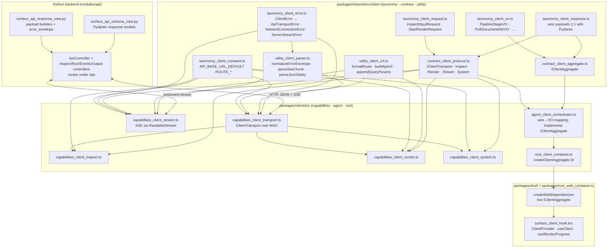
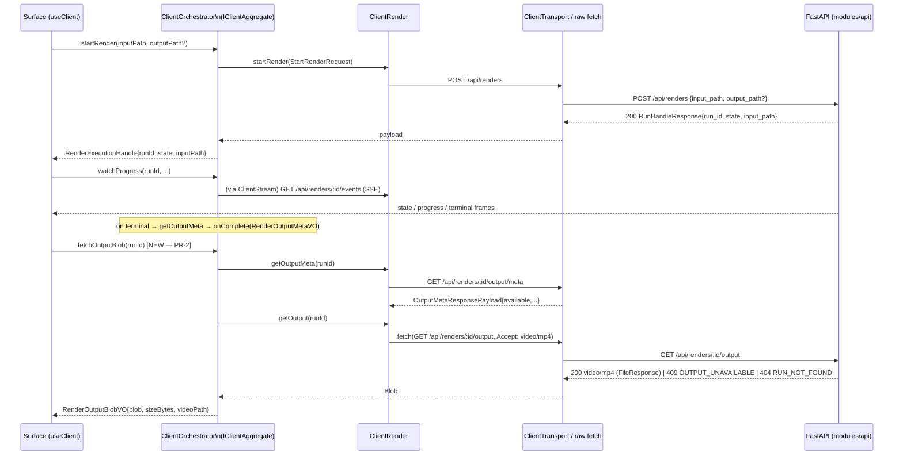
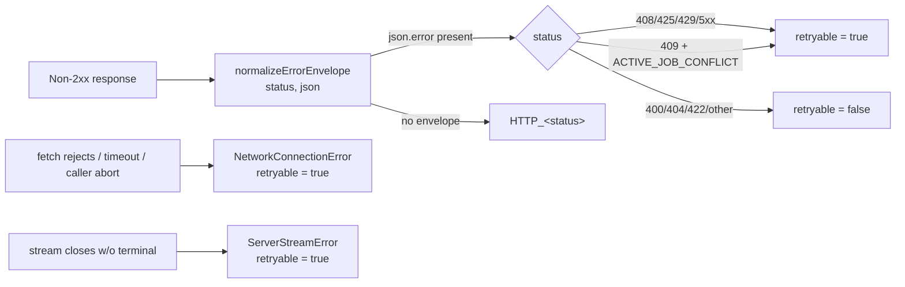

# Design Document: Client Wire Schema & HTTP Transport Adapter (`packages/client/`)

**Document ID:** `design-doc-3fc10111`
**Author:** GrokBuild Systems Architect (placeholder)
**Date:** 2026-11-18
**Status:** Draft
**Covers:** Task 2 (TypeScript schema & wire types) and Task 3 (HTTP transport adapter) as assigned, reconciled against the merged reality of PR #241/#242 (plan `011222b2`).

---

## Overview

The assigned tasks ask for (a) a TypeScript mapping of the Python API schema in `modules/api/src/surface_api_schema_view.py` — inspect/layer-tree, run/progress/config responses, and the standard error envelope — and (b) a `fetch`-based HTTP transport adapter in `packages/client/` covering inspect, start, run status, cancel, and output retrieval. Exploration of the repository shows that **this design has already been implemented and merged**: the wire schema lives in `packages/shared/src/client/` (taxonomy layer), the transport and domain capabilities live in `packages/client/src/`, and the composition root in `packages/root_web_container.ts` feeds a React context (`packages/shell/src/surface_client_hook.tsx`). The Python source of truth exists exactly where the task predicted: `modules/api/src/surface_api_schema_view.py` declares the Pydantic response models, and `modules/api/src/surface_api_response_view.py` builds the payloads and the `{"error": {code, message, stage}}` envelope.

Rather than re-specifying a parallel, simpler client (which would duplicate the shipped feature folder and violate AES orphan rules AES502/AES503/AES505), this document does three things: (1) records the **as-built** architecture and its 1:1 correspondence with the Python schema and route table; (2) reconciles the task's endpoint list (`/start`, `/run/:id`, `/output/:id`) and requested layer fields (`opacity`, `blend_mode`) against the real API (`/api/renders*`, layer payloads without opacity/blend-mode), documenting each divergence and the additive changes needed to close them; and (3) specifies the remaining deltas as small, independently mergeable PRs — most notably the one functional gap found: **no capability or aggregate method retrieves the MP4 blob from `GET /api/renders/{run_id}/output`**, even though the route constant `ROUTE_OUTPUT` exists and the backend streams the file.

## Background & Motivation

### Current state (as-built, verified 2026-11-18)

| Concern | Location | Status |
|---------|----------|--------|
| Python wire schema (source of truth) | `modules/api/src/surface_api_schema_view.py` (Pydantic models), `modules/api/src/surface_api_response_view.py` (payload builders + error envelope) | Shipped |
| Route registration + error taxonomy | `modules/api/src/surface_api_controller.py` (`ApiController`), plus `surface_api_inspect_controller.py`, `surface_api_run_controller.py`, `surface_api_events_controller.py`, `surface_api_output_controller.py` | Shipped |
| OpenAPI snapshot | `fixtures/openapi.json` (12 documented paths, 15 OpenAPI schemas — **13 pinned by the parity test**: 11 response models + `InspectLayerResponse` + `RunErrorDetail` + 2 request models; the 2 FastAPI-generated `HTTPValidationError`/`ValidationError` models are not pinned) | Shipped; pinned by `packages/client/tests/contract_client_schema.test.ts` (`SCHEMA_MAP`, lines 173–186) |
| TS wire schema + VOs + errors + constants | `packages/shared/src/client/taxonomy_client_{response,request,vo,error,constant}.ts` | Shipped |
| TS contracts | `packages/shared/src/client/contract_client_{protocol,aggregate}.ts` | Shipped |
| Stateless parsers/URL helpers | `packages/shared/src/client/utility_client_{parser,url}.ts` | Shipped |
| Fetch transport + domain capabilities + SSE | `packages/client/src/capabilities_client_{transport,inspect,render,stream,system}.ts` | Shipped |
| Orchestrator + DI container + barrel | `packages/client/src/agent_client_orchestrator.ts`, `root_client_container.ts`, `index.ts` | Shipped |
| Surface wiring | `packages/root_web_container.ts` (`createWebDependencies`), `packages/shell/src/surface_client_hook.tsx` (`ClientProvider`, `useClient`, `useOptionalClient`, `useRenderProgress`) | Shipped |
| Test suite | `packages/client/tests/` — 13 files: contract (schema parity, protocol, conformance), unit (transport, inspect, render, stream, system, orchestrator, parser, url, error), integration (mock-server end-to-end), fixture (`fixture_client_mock_server.ts`) | Shipped |

All six FRD requirements (`FR-CLIENT-001` … `FR-CLIENT-006` in `packages/client/FRD.md`) are marked **Done** in `packages/client/BACKLOG.md`.

### Why the task text diverges from the code

The task statement was authored against an assumed API shape (`POST /inspect`, `POST /start`, `GET /run/:id`, `POST /run/:id/cancel`, `GET /output/:id`, layer fields `opacity`/`blend_mode`, error fields `error_code`/`message`/`details`) that does **not** match the shipped backend:

| Task text | Reality (source: `surface_api_controller.py`, `surface_api_schema_view.py`) | Resolution |
|-----------|-----------|------------|
| `POST /start` | `POST /api/renders` → `RunHandleResponse` | Use real route; the constant is `ROUTE_RENDERS` |
| `GET /run/:id` (lifecycle status) | `GET /api/renders/{run_id}` (terminal `RunResultResponse`), `GET /api/renders/{run_id}/progress` (`ProgressResponse`), `GET /api/renders/{run_id}/view` (combined `RunViewResponse`) | The client already models all three; the aggregate's `checkProgress` uses `/view` |
| `POST /run/:id/cancel` | `POST /api/renders/{run_id}/cancel` → `{cancelled: bool}` | Route prefix differs; semantics identical |
| `GET /output/:id` | `GET /api/renders/{run_id}/output` (`video/mp4` via `FileResponse`, 409 `OUTPUT_UNAVAILABLE` when incomplete) + `GET /api/renders/{run_id}/output/meta` | Constant `ROUTE_OUTPUT` exists but **no client method calls it** — this is the real gap (see §Gap G1) |
| Error `{error_code, message, details}` | `{"error": {"code", "message", "stage"}}` (`ErrorDetail`/`ErrorResponse` in `surface_api_schema_view.py`; built by `error_envelope` in `surface_api_response_view.py`) | TS side matches exactly: `ApiErrorEnvelopePayload`, normalized by `normalizeErrorEnvelope` into `ApiTransportError` with `code`, `stage`, `status`, `retryable` |
| Layer fields `opacity`, `blend_mode` | `InspectLayerResponse` = `{name, classification, reveal_style, bounds, visible}`; opacity/blend-mode exist on `LayerVO` (`taxonomy_scripting_vo.py:172-173`) but are not on the wire | **Out of scope — resolved: out of scope** (repo owner decision; see Open Questions 1–2). The in-scope layer fields are **sort order (array position) and `visible`**, both already on the wire — see G3 |
| Canvas dimensions, color mode | `InspectResponse.summary = {has_layers, width, height, layer_count, top_level_count}` — dimensions present; color mode absent and not plumbed through the scripting parser (`PsdInfoVO` carries no color-mode field) | **Out of scope — resolved: out of scope** (repo owner decision; see Open Questions 1–2). Color mode would require new parser work, not just a view addition |

### Pain points this document closes

1. **Documentation drift risk** — the plan/task series describes a hypothetical client that differs from the shipped one; engineers reading only the plan would build a duplicate.
2. **Missing output download** — Task 3's fifth bullet ("`GET /output/:id`: mengambil URL/blob output video MP4") has no implementation; the route constant is exported but unused by any capability (`ROUTE_OUTPUT` appears only in `taxonomy_client_constant.ts`, `index.ts`, and the schema-parity test).
3. **Aggregate `inspect()` loses data** — `ClientOrchestrator.inspect` maps `InspectResponsePayload` to `PsdDocumentInfoVO`, which keeps `{has_layers, width, height, layer_count, top_level_count}` and **discards the per-layer array** (`agent_client_orchestrator.ts:176-187`), so no surface can render a layer tree even though the transport fetches it.
4. **Hardcoded base URL** — `API_BASE_URL_DEFAULT = "http://127.0.0.1:8000/api"` (`taxonomy_client_constant.ts:9`) matches the local loopback profile (`ApiController` binds loopback; CORS allows loopback regex), but there is no env override for the `PSD_TL_ALLOW_ANY_OUTPUT`-style hosted-profile story.

## Goals & Non-Goals

### Goals

- **G-1 (documentation):** Record the as-built schema↔transport mapping between `modules/api/src/surface_api_schema_view.py` and `packages/shared/src/client/taxonomy_client_*.ts`, including the exhaustive field-parity test that pins it.
- **G-2 (Task 3 gap):** Add MP4 output retrieval to the client — a render-capability method that fetches `GET /api/renders/{run_id}/output` as a `Blob` with `Accept: video/mp4`, error-envelope handling for 409/404, surfaced through `IClientAggregate` as a domain method.
- **G-3 (layer tree visibility):** Extend the aggregate surface so consumers can obtain the inspected layer list (`LayerMetadataVO[]`), not just `PsdDocumentInfoVO` summary counts.
- **G-4 (resilience of the contract):** Keep the schema-parity guarantee (`contract_client_schema.test.ts`) green as any field is added; any new wire field lands in Python schema, TS payload, and the parity test in one PR.
- **G-5 (AES compliance):** Every new file/export obeys the AES 7-layer rules (naming AES101/102, import matrix AES201, orphan wiring AES501–AES506) and passes `lint-arwaky-cli scan .`.

### Non-Goals

- **N-1:** Replacing `packages/client/` or `packages/shared/src/client/` with a fresh, simpler client. The existing feature folder is merged, tested, and wired; a parallel implementation would trip AES503/AES505 (orphan capabilities/orchestrator) and AES305 (duplication).
- **N-2:** Changing the backend route shapes (`/api/renders*`) to match the task's hypothetical `/start`, `/run/:id`. The route set is pinned by `unit_api_local_surface.DOCUMENTED_ROUTES` and by the client's schema-parity test.
- **N-3:** Polling-based progress replacing SSE. The SSE capability (`ClientStream`) plus the `watchProgress` orchestration already covers Task 3's "status lifecycle" requirement; polling (`checkProgress` via `/view`) remains the fallback.
- **N-4:** Hosted-profile auth/TLS work. The API is loopback-only by default (DS-API-008, `LOOPBACK_ORIGIN_REGEX`); multi-user auth is out of scope (see Open Questions).
- **N-5:** Adding `opacity`/`blend_mode`/color-mode to the inspect wire. Per the repo owner these are not important for the web client (Open Questions 1–2); the animator manifest already carries per-layer animation data where opacity/blend-mode would matter, and the client's layer-tree feature is about sort order + visibility, which are already on the wire.

## Proposed Design

### Architecture (as-built, to be preserved)



Import direction obeys the AES matrix (ARCHITECTURE.md §Group 2): taxonomy ← utility/contract/capabilities; contracts implemented by capabilities; the agent sees only contracts; surfaces see only `IClientAggregate`; root wires concretes.

### Wire-schema mapping (Task 2, as-built)

Source of truth: `modules/api/src/surface_api_schema_view.py`. TS mirror: `packages/shared/src/client/taxonomy_client_response.ts` (+ `taxonomy_client_request.ts`). Field names stay snake_case on the wire — no transformation layer — so JSON deserializes directly into the payload interfaces.

| Pydantic model (Python) | TS interface | Notes |
|--------------------------|--------------|-------|
| `HealthResponse` | `HealthResponsePayload` | `{status, state}` |
| `ConfigResponse` | `ConfigResponsePayload` | 10 fields: `width, height, fps, codec, crf, preset, pixel_format, output_dir, workspace_dir, cleanup_on_failure` |
| `ErrorDetail` + `ErrorResponse` | `ApiErrorEnvelopePayload` (+ inner inline) | `{"error": {code: string, message: string, stage: string \| null}}` |
| `RunErrorDetail` | `RunErrorDetailPayload` | Terminal-run error; `code` required |
| `InspectLayerResponse` | `LayerPayload` | `{name, classification, reveal_style, bounds: {x,y,width,height}, visible}` — **no opacity/blend_mode** (see Open Questions) |
| `InspectResponse` | `InspectResponsePayload` | `{valid, summary: Record<string, unknown>, layer_count, layers: LayerPayload[]}`; summary carries `{has_layers, width, height, layer_count, top_level_count}` built by `inspect_payload` |
| `RunHandleResponse` | `RunHandleResponsePayload` | `{run_id, state, input_path}` |
| `ProgressResponse` | `ProgressResponsePayload` | `{run_id, stage, current, total, percent, message}`; `stage` typed `PipelineStageVO` |
| `RunResultResponse` | `RunResultResponsePayload` | Terminal evidence incl. `video_path`, `scripting_manifest_path`, `animator_manifest_path`, `total_frames`, `fps`, `error: RunErrorDetailPayload \| null` |
| `RunViewResponse` | `RunViewResponsePayload` | `{run_id, stage, progress, output_path: string \| null, error: RunErrorDetailPayload \| null}` |
| `CancelResponse` | `CancelResponsePayload` | `{cancelled: boolean}` |
| `OutputMetaResponse` | `OutputMetaResponsePayload` | `{available, video_path: string \| null, size_bytes: number \| null, state}` |
| `InspectRequest` (in `surface_api_inspect_controller.py`) | `InspectInputRequest` | `{input_path: string}` |
| `StartRenderRequest` (in `surface_api_controller.py`) | `StartRenderRequest` | `{input_path: string, output_path?: string \| null}` |

Domain VOs consumed by surfaces (`taxonomy_client_vo.ts`): `PipelineStageVO` (union mirroring `taxonomy_pipeline_state_vo.PipelineStage` StrEnum: `idle | validating | planning | animating | compositing | encoding | completed | failed | cancelled`), `RunIdVO`, `LayerClassificationType`, `LayerBoundsVO`, `LayerMetadataVO`, `PsdDocumentInfoVO`, `ProgressSnapshotVO`, `RenderOutputMetaVO`, `SystemConfigVO`, `SystemHealthVO`.

**Parity enforcement.** `packages/client/tests/contract_client_schema.test.ts` reads `fixtures/openapi.json` (12 documented paths, 15 OpenAPI schemas) and asserts, per schema, that `Object.keys(Record<keyof T, true>)` equals the OpenAPI property set (bidirectional exhaustiveness — a field added on either side without the other fails the suite). It pins **13 of the 15 schemas** via `SCHEMA_MAP` (lines 173–186): the 11 response models, `InspectLayerResponse`, `RunErrorDetail`, and the 2 request models (`InspectRequest`, `StartRenderRequest`); the 2 FastAPI-generated validation-error models (`HTTPValidationError`, `ValidationError`) are not pinned. It also asserts 1:1 coverage between the `ROUTE_*` constants and the 12 OpenAPI paths. This is the mechanism that keeps Task 2's "mapping" honest; any PR touching wire fields must keep it green.

### Transport adapter (Task 3, as-built + gap)

`ClientTransport` (`packages/client/src/capabilities_client_transport.ts`) implements `IClientTransportProtocol`:

```typescript
export interface IClientTransportProtocol {
  get<T>(path: string, signal?: AbortSignal): Promise<T>;
  post<T, B = unknown>(path: string, body?: B, signal?: AbortSignal): Promise<T>;
}
```

Behavior (unit-tested in `unit_client_transport.test.ts`):

- URL = `buildApiUrl(baseUrl, path)` with `baseUrl` defaulting to `API_BASE_URL_DEFAULT` (`http://127.0.0.1:8000/api`); headers `Content-Type: application/json`, `Accept: application/json`.
- Timeout composition: `AbortSignal.any([callerSignal, AbortSignal.timeout(TIMEOUT_DEFAULT_MS)])` (10 s default). Caller-abort → `NetworkConnectionError("Request cancelled by caller")`; timeout → `NetworkConnectionError("Request timed out")`; both `retryable = true`.
- 2xx → `response.json()` cast to `T`. Non-2xx → `normalizeErrorEnvelope(status, json)` (utility, AES404-pure): unwraps `{error:{code,message,stage}}`, falls back to `HTTP_<status>`, and derives retryability — `408/425/429/5xx → true`; `409 → true` only for `ACTIVE_JOB_CONFLICT`; else `false`. Returns `ApiTransportError` carrying `code`, `status`, `retryable`, `stage`.
- Network rejection → `NetworkConnectionError` (retryable).

Domain capabilities compose the transport (each implements one contract protocol, "Block 1/2/3" layout per AES403):

| Capability | Protocol | Operations → routes |
|------------|----------|---------------------|
| `ClientInspect` | `IClientInspectProtocol` | `inspectPsd` → `POST /inspect` (empty-path guard → `ClientError("INVALID_INPUT")` before network) |
| `ClientRender` | `IClientRenderProtocol` | `startRender` → `POST /renders`; `getProgress` → `GET /renders/:id/progress`; `getResult` → `GET /renders/:id`; `getView` → `GET /renders/:id/view`; `getOutputMeta` → `GET /renders/:id/output/meta`; `cancelRender` → `POST /renders/:id/cancel`; `retryRender` → `POST /renders/:id/retry` |
| `ClientStream` | `IClientStreamProtocol` | `subscribeEvents` → chunked `fetch` on `GET /renders/:id/events` with `Accept: text/event-stream`; own `AbortController` (no `TIMEOUT_DEFAULT_MS`); parses `state`/`progress`/`terminal` frames via `parseSseChunk`; returns unsubscribe |
| `ClientSystem` | `IClientSystemProtocol` | `getHealth` → `GET /health`; `getConfig` → `GET /config` |

`ClientOrchestrator` (agent layer) implements `IClientAggregate` and maps wire payloads → VOs (`mapInspectResponse`, `mapRunHandleToHandle`, `mapViewToProgressSnapshot`, `mapOutputMetaToVO`, `mapHealthToVO`, `mapConfigToVO`; `watchProgress` composes `ClientStream` + a follow-up `getOutputMeta` on terminal). `createClientAggregate({baseUrl?})` wires everything once; `packages/root_web_container.ts` exposes it as `createWebDependencies()`; `surface_client_hook.tsx` provides it via React context.

### Gap analysis and deltas to propose

| ID | Gap | Severity | Proposed change |
|----|-----|----------|-----------------|
| **G1** | Task 3's fifth bullet (MP4 output retrieval) unimplemented: `ROUTE_OUTPUT` is declared/exported but no capability method fetches `GET /renders/:run_id/output`; the aggregate offers only `fetchResult` → `OutputMetaResponsePayload` (metadata, not the file) | **High** (functional requirement in the task) | Add `getOutput(runId, signal?): Promise<Blob>` to `IClientRenderProtocol` + `ClientRender`, issuing a raw `fetch` with `Accept: video/mp4` (bypasses the JSON transport, like `ClientStream` owns its fetch), mapping 409 `OUTPUT_UNAVAILABLE` / 404 via `normalizeErrorEnvelope`. Surface as `IClientAggregate.fetchOutputBlob(runId): Promise<RenderOutputBlobVO>` where `RenderOutputBlobVO = {blob: Blob, sizeBytes: number, videoPath: string \| null}` derived from `getOutputMeta` + the blob. See PR-2. |
| **G2** | Aggregate `inspect()` drops the layer list: `PsdDocumentInfoVO` has no `layers`, so no surface can render the layer tree the task's Inspect requirement describes | Medium | Add `inspectLayers(inputPath): Promise<LayerMetadataVO[]>` to `IClientAggregate` (mapping `InspectResponsePayload.layers` + `summary` to `LayerMetadataVO[]`, reusing existing `LayerBoundsVO`), implemented in `ClientOrchestrator` from the existing `inspectPsd` payload — no new wire fields, no capability change. Note: surfaces that need the layer list should call `inspectLayers` **instead of** `inspect()`, not in addition to it — each call is a separate `POST /inspect` round-trip (there is no caching layer), so calling both issues two round-trips for the same PSD. See PR-2 and the Risks-table row on unbounded layer arrays. |
| **G3** | The web client's layer-tree feature needs **sort order (z-order / top-to-bottom stacking) and visibility**, not opacity/blend-mode. Sort order is already on the wire as **array position**: `InspectResponsePayload.layers` is an ordered `readonly LayerPayload[]` (`taxonomy_client_response.ts:41-44`), populated in Python by `inspect_payload` (`surface_api_response_view.py:251-271`) iterating `layers` in PSD stacking order. Visibility is already on the wire as `LayerPayload.visible: boolean` (`taxonomy_client_response.ts:38`, built from `layer.is_visible`). The aggregate `inspectLayers` (G2/PR-2) exposes both, and PR-4 uses them to build a **client-side preview only** (reorder + toggle in the browser; does not affect the render — see the PR-4 scope boundary). `opacity`, `blend_mode` (present on `LayerVO` at `taxonomy_scripting_vo.py:172-173` but not on the wire) and `color_mode` (absent from `PsdInfoVO` and the parser entirely — Issue 11) are **out of scope**: the user's layer-tree feature is about letting the user reorder and toggle visibility of layers client-side, not read opacity/blend values. | — | None (covered by G2/PR-2); opacity/blend-mode/color-mode dropped from the plan |
| **G4** | Base URL hardcoded (`API_BASE_URL_DEFAULT`); `createClientAggregate` accepts `baseUrl` override but nothing reads an env/config source | Low | **Deferred — not in this plan.** `ClientContainerConfig.baseUrl` is the override mechanism (PR-2 threads it into `ClientRender` too). An env read (`VITE_API_BASE_URL`) is deliberately excluded; see Open Question 4. No schema impact. |
| **G5** | `mapViewToProgressSnapshot` fabricates `current: payload.progress, total: 100` from `RunViewResponse` (which carries only a percent) — semantically lossy vs. `ProgressResponse` | Low | Document only; switching `checkProgress` to `getProgress` would change observable behavior (view never 404s for terminal runs; progress does). Keep as-is; note in References. |

### Sequence: render lifecycle with the new output download (target state after PR-2)



Note: `watchProgress` is **unchanged** by PR-2 — its terminal callback still receives `RenderOutputMetaVO` (availability metadata only, from `getOutputMeta`; verified at `agent_client_orchestrator.ts:126-138`), not the blob. Callers that want the MP4 invoke `fetchOutputBlob(runId)` as a separate, caller-initiated step after `onComplete` fires.

### Error model (unchanged; restated for completeness)



All three error classes extend `ClientError` (`code`, `retryable`, `status?`, `cause`). Backend codes that appear in the envelope: `REQUEST_INVALID`, `RUN_NOT_FOUND`, `CONTROLLER_ERROR`, `UNSUPPORTED_OPERATION` (transport-level, `ApiErrorCode` StrEnum) plus controller codes `ACTIVE_JOB_CONFLICT`, `INPUT_MISSING`, `INPUT_UNSUPPORTED`, `CONFIG_INVALID`, `VALIDATION_FAILED`, `OUTPUT_UNAVAILABLE` mapped to HTTP by `_STATUS_BY_CODE` (`surface_api_response_view.py:69-76`).

## API / Interface Changes

### New — render protocol (`packages/shared/src/client/contract_client_protocol.ts`)

`RenderOutputBlobVO` is defined in `packages/shared/src/client/taxonomy_client_vo.ts` (the taxonomy layer, alongside the other VOs) and imported by both the aggregate contract and the barrel. The render protocol itself gains one method:

```typescript
export interface IClientRenderProtocol {
  // ...existing 7 methods unchanged...
  /** Fetch the rendered MP4 for a completed run. 409 OUTPUT_UNAVAILABLE / 404 otherwise. */
  getOutput(runId: string, signal?: AbortSignal): Promise<Blob>;
}
```

### New — aggregate (`packages/shared/src/client/contract_client_aggregate.ts`)

```typescript
export interface IClientAggregate {
  // ...existing 9 methods unchanged...

  /** Inspect a PSD and return its full layer list (in addition to inspect()'s summary VO). */
  inspectLayers(inputPath: string, signal?: AbortSignal): Promise<LayerMetadataVO[]>;

  /** Download the completed run's MP4 as a Blob with availability metadata. */
  fetchOutputBlob(runId: string, signal?: AbortSignal): Promise<RenderOutputBlobVO>;
}
```

### New capability method (`packages/client/src/capabilities_client_render.ts`)

```typescript
async getOutput(runId: string, signal?: AbortSignal): Promise<Blob> {
  // Single buildApiUrl call with params: resolves every `:placeholder`
  // atomically (utility_client_url.ts:24-35). The two-step
  // formatRoute-then-buildApiUrl form used by ClientStream.consumeStream
  // (capabilities_client_stream.ts:63-64) is deliberately NOT used here —
  // it silently leaves a second placeholder unsubstituted if a route
  // template ever grows one.
  const url = buildApiUrl(this.baseUrl, ROUTE_OUTPUT, { run_id: runId });
  // No TIMEOUT_DEFAULT_MS: a FileResponse MP4 download is long-lived, so
  // getOutput honors only the caller's AbortSignal — the same exemption
  // ClientStream documents in its header (capabilities_client_stream.ts).
  // normalizeErrorEnvelope still maps 409 OUTPUT_UNAVAILABLE / 404.
  const response = await fetch(url, {
    headers: { Accept: "video/mp4" },
    signal,
  });
  if (!response.ok) {
    let json: unknown = null;
    try { json = await response.json(); } catch { /* non-JSON body */ }
    throw normalizeErrorEnvelope(response.status, json);
  }
  return response.blob();
}
```

Note: `ClientRender` currently receives only `{transport}` (required). PR-2 **extends `RenderDeps` with an optional `baseUrl?: string`** — `{ transport: IClientTransportProtocol; baseUrl?: string }` — and `ClientRender` stores it alongside `transport`, defaulting to `API_BASE_URL_DEFAULT` when absent. This is deliberately *not* identical to `ClientStream`'s constructor pattern (`options?: StreamOptions`, where the whole deps object is optional): `RenderDeps.transport` stays required, and only `baseUrl` is optional. The DI container `root_client_container.ts` must thread the caller-supplied `baseUrl` override into `new ClientRender(...)` (it currently passes only `{ transport }`, line 31) or `getOutput` would silently ignore a custom `baseUrl` while every JSON call honors it — `createClientAggregate` builds `ClientTransport` and `ClientStream` with the override today but not `ClientRender`; PR-2 closes that hole. A unit test in `unit_client_render.test.ts` asserts `getOutput` hits the injected `baseUrl`.

### Orchestrator additions (`packages/client/src/agent_client_orchestrator.ts`)

```typescript
async inspectLayers(inputPath: string, signal?: AbortSignal): Promise<LayerMetadataVO[]> {
  const payload = await this.inspectCapability.inspectPsd({ input_path: inputPath }, signal);
  return payload.layers.map((layer) => ({
    name: layer.name,
    classification: layer.classification,
    reveal_style: layer.reveal_style,
    // Copy bounds by value, matching how every other mapper in this
    // orchestrator (mapRunHandleToHandle, mapOutputMetaToVO, …) builds
    // fresh VOs — never alias the wire payload's nested objects.
    bounds: { x: layer.bounds.x, y: layer.bounds.y, width: layer.bounds.width, height: layer.bounds.height },
    visible: layer.visible,
  }));
}

async fetchOutputBlob(runId: string, signal?: AbortSignal): Promise<RenderOutputBlobVO> {
  const [meta, blob] = await Promise.all([
    this.renderCapability.getOutputMeta(runId, signal),
    this.renderCapability.getOutput(runId, signal),
  ]);
  return { blob, sizeBytes: blob.size, videoPath: meta.video_path };
}
```

No Python changes for PR-1/PR-2 — the wire contract is untouched; only additive TS interfaces and implementations. `contract_client_schema.test.ts` needs no new schema entries (no new wire fields), but `contract_client_protocol.test.ts` / `contract_client_conformance.test.ts` mocks must implement the two new interface members (compile-time enforcement).

The `inspectLayers` mapper copies `bounds` by value (explicit field construction) rather than aliasing `layer.bounds` from the wire payload — every other mapper in `agent_client_orchestrator.ts` (`mapRunHandleToHandle`, `mapOutputMetaToVO`, `mapHealthToVO`, …) builds fresh VO objects, and aliasing would share a nested object with any other consumer of the same `InspectResponsePayload` instance (e.g., a future cache or a surface that calls both `inspect()` and `inspectLayers()`).

### Hypothetical future wire change (not planned; would be a separate initiative with its own design doc)

Two deferred extensions are documented here so their boundaries are explicit, but **neither is part of this plan**:

1. **Full reorder-then-render round-trip (deferred; own future design).** The client-side reorder/visibility preview in PR-4 cannot be applied to the render through the existing flow: `LayerMetadataVO` (`taxonomy_client_vo.ts:37-44`) and `LayerPayload` (`taxonomy_client_response.ts:36-40`) carry no stable layer identifier (`inspect_payload` at `surface_api_response_view.py:251-271` does not serialize `LayerVO.layer_id`, even though `LayerVO` holds `layer_id: LayerId` at `taxonomy_scripting_vo.py:36-41,167-180`), and neither `StartRenderRequest` (`{input_path, output_path?}`) nor `RenderRequestVO` (`taxonomy_system_vo.py:239-252`) accepts per-layer order/visibility overrides. Delivering the round-trip requires a coordinated Python+TS+fixture change: (a) add `layer_id: str` to `InspectLayerResponse` + `inspect_payload` + `LayerPayload` + `LayerMetadataVO` + the parity-test `LAYER_FIELDS` map + regenerated `fixtures/openapi.json`; then (b) a new `StartRenderRequest` field (e.g., `layer_overrides: list[{layer_id, visible, order}] | None`) threaded through the controller into scripting and the system-aggregate plumbing. This is explicitly **out of scope** and gets its own design doc.
2. **Opacity/blend-mode wire fields (not planned).** If a future product need reverses Open Question 1: `LayerVO` already carries `opacity: Opacity` / `blend_mode: BlendMode` (`modules/shared/src/scripting/taxonomy_scripting_vo.py:167-180`) and `inspect_payload` already receives `Sequence[LayerVO]` (`surface_api_response_view.py:243-271`), so the change is exactly `inspect_payload` reading `layer.opacity` / `layer.blend_mode`. The one genuine open decision is whether the wire opacity is the `Opacity` VO's float (0.0–1.0) or `PsdLayerDataVO.opacity`'s int (0–255) — a product/type choice, not a file-location unknown. Color-mode is a different effort entirely: it is not plumbed through the scripting layer at all (`PsdInfoVO` at `taxonomy_scripting_vo.py:147-151` has no color-mode field) and would be the first change to touch the scripting parser layer — it must not share a PR with the opacity/blend-mode addition.

Any such change is a coordinated Python+TS PR because `contract_client_schema.test.ts` fails on any one-sided change.

## Data Model Changes

No persistence or schema migration. The "data model" here is the wire taxonomy:

- **Existing data requirements** (`packages/shared/src/client/DATA.md`): DT-CLIENT-001…005 covering all payload/VO/error types. PR-2 adds DO-024 `RenderOutputBlobVO` (vo, binary handle + metadata) under DT-CLIENT-004 and references it from the FRD's Aggregate API table; no DT renumbering.
- **Storage estimate**: an MP4 render at the default config (1920×1080, `libx264`, crf 23, `yuv420p` per `ConfigResponsePayload` defaults seen in mocks) is on the order of 5–50 MB for a typical timelapse; a `Blob` download holds it in browser memory transiently. Acceptable for the local single-user profile; hosted multi-user would stream instead (Non-Goal N-4).
- **Versioning**: the TS payload interfaces track the Pydantic models 1:1 by convention + test; no explicit version field exists on the wire, and none is proposed (local profile, single deployed pair).

## Alternatives Considered

### Alternative A — Build a fresh, simpler client per the literal task text (rejected)

Create a new minimal `packages/client/` with hand-written types for `/start`, `/run/:id`, `/output/:id`. **Rejected:** duplicates the shipped, tested feature folder; violates AES503 (capabilities must be wired in a container — two containers would fight), AES505 (two orchestrators), AES305 (near-duplicate code); breaks `root_web_container.ts` wiring and the 13-file test suite; and targets routes that do not exist server-side. The plan series (design-doc-2e3f3378, PR #241/#242) already litigated and rejected the stub-based predecessor.

### Alternative B — Keep aggregate JSON-only; download via plain `<a href>`/anchor from the surface (rejected)

Surfaces could construct `GET /api/renders/:id/output` URLs directly from `RenderOutputMetaVO.video_path` (or run id) and let the browser download, skipping the client layer. **Rejected:** surfaces (AES406) must not know route shapes or base URLs; it bypasses the error envelope (a 409 would render as a broken download with no `OUTPUT_UNAVAILABLE` signal); it reintroduces exactly the scattered transport knowledge the client feature exists to prevent. It also fails the task's explicit "mengambil URL/blob output" through the transport adapter.

### Alternative C — Extend `IClientTransportProtocol` with a binary `getBlob` (rejected)

Add `getBlob(path, signal?): Promise<Blob>` to the JSON transport. **Rejected:** it forces every transport mock (`MockTransport` in `contract_client_protocol.test.ts`, `unit_client_render.test.ts` fakes) to implement a method unrelated to their JSON concern, and it muddies the protocol's single responsibility. The `ClientStream` precedent — a capability owning its own `fetch` for a non-JSON content type — is the established pattern; PR-2 follows it.

### Alternative D — Polling instead of SSE for progress (rejected, already decided)

`checkProgress` (GET `/view`) exists as the polling fallback and is used when SSE is unavailable; replacing SSE with polling would lose push semantics, the terminal-event guarantee, and contradict `FR-CLIENT-004`. Retained as fallback only.

## Security & Privacy Considerations

- **Loopback-only default.** `ApiController` binds loopback; CORS allows only `LOOPBACK_ORIGIN_REGEX` (localhost, 127/8, `[::1]`) plus operator-approved extras (`PSD_API_CORS_ORIGINS`); a `*` entry is never installed (DS-API-008). The client's default base URL `http://127.0.0.1:8000/api` matches this posture.
- **Output-path confinement (server-side).** `start_render` rejects non-`.mp4` destinations, directories, and resolved paths outside `output_dir`/`workspace_dir`/XDG data dir unless `PSD_TL_ALLOW_ANY_OUTPUT=1` (`_validated_output_path`, TOCTOU-safe via `resolve_for_write`). The client passes `output_path` through verbatim; it must not attempt client-side path policy (duplication, AES305, and a false sense of security).
- **Hosted-profile information hiding.** Unhandled exceptions return raw text only on loopback; hosted mode returns `Internal error {request_id}` (`unexpected_error_message`). The client treats all envelope messages as untrusted display strings — no `innerHTML` sinks in `surface_client_hook.tsx` or its consumers (React default escaping).
- **Threat model.** Local single-user: the API is an unauthenticated loopback service; any local process can drive renders. Accepted per PRD local-profile scope. The new `fetchOutputBlob` does not widen exposure: it reads the same `FileResponse` stream the backend already serves, gated by the same 409/404 logic; the `Blob` never leaves the browser.
- **SSRF/data exfiltration.** Not applicable: the client is the *caller* to a fixed loopback base URL; `baseUrl` override is a developer-supplied DI config, not user input.
- **Audit.** `X-Request-ID` correlation (RequestController middleware) ties a failed download to the server log line; `ApiTransportError` carries the envelope `code`/`stage` so the UI can surface actionable detail without leaking internals (server strips them in hosted mode).

## Observability

- **Client-side errors:** every failure funnels through `ClientError` subclasses with `code`, `status`, `retryable`, `stage` — surfaces branch on `retryable` for auto-retry UX and on `code` for messaging (`ACTIVE_JOB_CONFLICT` → "render already active", `OUTPUT_UNAVAILABLE` → "render not finished").
- **No metrics/telemetry today** in `packages/client/`; the vitest suite is the regression net (`unit_client_*`, `contract_client_*`, `integration_client_flow.test.ts` against `fixture_client_mock_server.ts`). PR-2 adds: `unit_client_render.test.ts` cases for 200→Blob, 409 `OUTPUT_UNAVAILABLE` → `ApiTransportError` (retryable=false, since 409 is retryable only for `ACTIVE_JOB_CONFLICT` per `normalizeErrorEnvelope`), 404, and non-JSON error body; a conformance-mock update; an integration case extending the mock server with an `/output` route.
- **Server-side** logging (`unhandled-api-error: %s`, `LOGGER_NAME`) is unchanged; download 409/404s are structured envelopes, not 500s, so they do not page.
- **Future (optional):** a `client.debug` logger behind an env flag to trace request/response timings — out of scope here; note only.

## Rollout Plan

- **Feature flags:** none required — PR-2 is purely additive (new interface members + implementations + tests). Existing consumers are untouched until they call the new methods.
- **Staging:**
  1. PR-1 (docs only) merges first; CI green (`npm test -- --run`, `lint-arwaky-cli scan .`).
  2. PR-2 (capability + orchestrator + aggregate) merges next; `tsc` typecheck enforces every `IClientAggregate`/`IClientRenderProtocol` implementer (only `ClientOrchestrator` and the ~6 mocks/factories enumerated in the Risks table) is updated in the same PR.
  3. Surface adoption (e.g., PR-3's studio "Download MP4" button calling `fetchOutputBlob`, or PR-4's client-only layer-tree preview calling `inspectLayers`) is separate surface work, out of this document's core scope.
- **Rollback:** revert PR-2; because the aggregate interface is additive, reverting restores the prior `IClientAggregate` with no dangling references (no persisted state, no wire change). The `Blob`-fetch code path has no side effects server-side beyond a normal GET.
- **Compatibility:** no backend deploy dependency — `GET /api/renders/{run_id}/output` has existed since the API surface shipped (DS-API-007; pinned in `DOCUMENTED_ROUTES` and the OpenAPI fixture).

## Risks

| Risk | Severity | Mitigation |
|------|----------|------------|
| `IClientRenderProtocol`/`IClientAggregate` are implemented by test mocks; adding members breaks compilation of **every `IClientRenderProtocol`/`IClientAggregate` mock** — `contract_client_protocol.test.ts` (`MockRenderProtocol` line 66 + `MockClientAggregate` line 156), `contract_client_conformance.test.ts` (`mockRenderProtocol()` + `mockAggregate()`), `unit_client_orchestrator.test.ts` (`createMockRender()` typed `vi.fn()` factory, lines 39–56), and `unit_client_render.test.ts` (needs a new `global.fetch`-stub test category for the raw-fetch `getOutput` path) | Medium | PR-2 updates all ~6 mocks/factories in the same commit; `npm run typecheck` + vitest run are the gate |
| Binary fetch bypasses `ClientTransport` timeout policy — a stalled download hangs until caller abort | Low | Accepted by design: `getOutput` honors caller abort only (no `TIMEOUT_DEFAULT_MS`), mirroring `ClientStream`'s long-lived exemption (`capabilities_client_stream.ts` header). Callers that need an upper bound pass their own `AbortSignal`; the snippet, Risks row, and Open Question 3 all specify this single behavior |
| `fixtures/openapi.json` drift if a future inspect-schema extension lands one-sided | Medium | `contract_client_schema.test.ts` already fails on drift; any future coordinated Python+TS schema change regenerates the fixture via the documented dump script in the same PR. No such extension is planned in this document (opacity/blend-mode/color-mode are out of scope) |
| Duplicate transport logic between `ClientStream` and `getOutput` (both own raw fetch) | Low | Acceptable per AES305 (two small, distinct bodies — SSE reader vs. blob reader); extracting a shared `fetchRaw` utility would itself be a utility-layer change with marginal benefit |
| `inspectLayers` returns unbounded layer arrays for huge PSDs | Low | Local profile; `inspectLayers` and `inspect()` each issue their own `POST /inspect` (there is no caching layer), so a surface that needs the layer list should call `inspectLayers` **instead of** `inspect()` — not both — to avoid a duplicate round-trip for the same PSD. Document that callers should treat the returned array as read-only. A follow-up backlog item to replace `inspect()` with a combined summary+layers method can be added once surfaces migrate |

## Open Questions

1. **Should `opacity` and `blend_mode` be added to the inspect wire schema (PR-4)?** **Resolved: No — out of scope.** The user has stated opacity and blend mode are not important for the web client; the valuable layer fields are sort order (array position) and visibility, which already exist on `LayerPayload` (`visible: boolean`, ordered `layers` array — see G3). The web client's layer-tree feature is about letting the user reorder and toggle visibility of layers client-side as a **preview** (PR-4), not about reading opacity/blend values. No wire change is planned.
2. **Is color-mode (e.g., RGB/CMYK/GRAYSCALE) required on `InspectResponse.summary`?** **Resolved: No — out of scope**, and it would be a deeper change than opacity/blend-mode in any case: `PsdInfoVO` (`modules/shared/src/scripting/taxonomy_scripting_vo.py:147-151`) carries no color-mode field, and no code under `modules/shared/src/scripting/` reads the PSD color mode (the only mode-like wire value is `ConfigResponse.pixel_format`, which is the render output format, not the source PSD mode). Adding it would be the first change to touch the scripting parser layer — not part of this plan.
3. **Download timeout policy for `getOutput`:** **Resolved — caller-abort only, no `TIMEOUT_DEFAULT_MS`.** A `FileResponse` MP4 download is long-lived, so `getOutput` mirrors `ClientStream`'s documented exemption (`capabilities_client_stream.ts` header): it honors only the caller's `AbortSignal`. The snippet, the Risks-table row, and this question all state the same single behavior; callers needing an upper bound compose their own timeout signal.
4. **Base URL is caller-supplied via DI; no env read is planned.** `API_BASE_URL_DEFAULT = "http://127.0.0.1:8000/api"` (`taxonomy_client_constant.ts:9`) matches the loopback profile, and `ClientContainerConfig.baseUrl` (threaded by `createClientAggregate` into `ClientTransport`, `ClientRender`, and `ClientStream`) is the override mechanism. A `VITE_API_BASE_URL`-style env read in `createWebDependencies()` is deliberately **not** included in this plan (see G4); it can be added later if the hosted-profile story needs it.

## Key Decisions

1. **Do not rewrite — document and extend.** The task's target state is already shipped (PR #241/#242); this design records the as-built mapping and specifies only the deltas (output download, layer-list access), avoiding AES duplication/orphan violations.
2. **Real routes over task-text routes.** `/api/renders*` (with `/view`, `/progress`, `/events`, `/output`, `/output/meta`, `/retry`) is canonical, pinned by `DOCUMENTED_ROUTES` and the schema-parity test; the task's `/start`, `/run/:id`, `/output/:id` shorthand maps onto it.
3. **Wire-format fidelity.** TS payloads mirror Pydantic models 1:1 in snake_case; `PipelineStageVO` is a closed union matching the Python StrEnum; the error envelope is `{"error": {code, message, stage}}` normalized into typed `ClientError` subclasses with server-derived retryability (409+`ACTIVE_JOB_CONFLICT` the only retryable 4xx).
4. **Binary downloads own their fetch**, following the `ClientStream` precedent rather than overloading the JSON transport (Alternative C rejected); errors still flow through `normalizeErrorEnvelope`.
5. **Layer-tree access via a new aggregate method** (`inspectLayers`) reusing the existing inspect call, rather than widening `PsdDocumentInfoVO` and breaking its consumers.
6. **Additive-only interface evolution** — every PR in the plan is independently mergeable and revertible; no wire or server changes are required for PR-1/PR-2.

## PR Plan

### PR-1 — Document the as-built schema↔transport mapping and pin the invariant

- **Title:** `docs(client): record wire-schema and transport mapping design (design-doc-3fc10111)`
- **Affected files:**
  - `packages/client/FRD.md` (add a "Wire schema provenance" note pointing at `modules/api/src/surface_api_schema_view.py` and the parity test; list `ROUTE_OUTPUT` as declared-but-unconsumed)
  - `packages/client/BACKLOG.md` (add FR-CLIENT-007 "Output blob retrieval" and FR-CLIENT-008 "Layer-list access" rows, State: Planned, referencing this design)
  - *No source changes.*
- **Dependencies:** none (documents merged state).
- **Description:** Lands the design doc reference inside the feature folder so future agents find the mapping table (Pydantic model → TS interface) and the gap list without re-deriving it. CI: markdownlint + `lint-arwaky-cli scan .` doc invariants (AES607 BACKLOG qualifier alignment).

### PR-2 — Add MP4 output-blob retrieval and layer-list access to the client aggregate

- **Title:** `feat(client): fetch rendered MP4 blob and expose inspected layer list`
- **Affected files:**
  - `packages/shared/src/client/contract_client_protocol.ts` — add `getOutput(runId, signal?): Promise<Blob>` to `IClientRenderProtocol`
  - `packages/shared/src/client/contract_client_aggregate.ts` — add `RenderOutputBlobVO` to the existing `import type { … } from "./taxonomy_client_vo.js"` block (lines 9–15) alongside `PsdDocumentInfoVO` etc., and add `inspectLayers`, `fetchOutputBlob` to `IClientAggregate`
  - `packages/shared/src/client/taxonomy_client_vo.ts` — add `RenderOutputBlobVO` here (a domain VO wrapping a `Blob` + metadata; by the taxonomy rule "VOs belong in the taxonomy layer," and `contract_client_aggregate.ts` already imports its VOs from `./taxonomy_client_vo.js` at lines 9–15, so placing it anywhere else would invert that import direction and risk a cycle)
  - `packages/client/src/capabilities_client_render.ts` — implement `getOutput` (raw fetch, `Accept: video/mp4`, caller-abort only — no timeout, per Open Question 3; `normalizeErrorEnvelope` on non-2xx); extend `RenderDeps` with optional `baseUrl?: string` and store it on the instance
  - `packages/client/src/root_client_container.ts` — thread the caller-supplied `baseUrl` override into `new ClientRender(...)` (currently `{ transport }` only, line 31) so `getOutput` honors a custom base URL just like every JSON call
  - `packages/client/src/agent_client_orchestrator.ts` — implement `inspectLayers` (map `InspectResponsePayload.layers` → `LayerMetadataVO[]`) and `fetchOutputBlob` (parallel `getOutputMeta` + `getOutput`)
  - `packages/client/src/index.ts` — export `RenderOutputBlobVO` type
  - `packages/client/tests/contract_client_protocol.test.ts`, `contract_client_conformance.test.ts` — extend **two mocks in each file** with the two new members: `contract_client_protocol.test.ts` defines `MockRenderProtocol` (line 66) and `MockClientAggregate` (line 156); `contract_client_conformance.test.ts` defines `mockRenderProtocol()` (line 46) and `mockAggregate()` (line 132)
  - `packages/client/tests/unit_client_render.test.ts` — new **fetch-stub test category** (stub `global.fetch`, not `MockTransport` — `getOutput` bypasses `IClientTransportProtocol` because it returns binary, not JSON): 200 → Blob with correct size; 409 `OUTPUT_UNAVAILABLE` → `ApiTransportError(retryable=false)`; 404; non-JSON error body → `HTTP_<status>` fallback; `getOutput` targets the injected `baseUrl` (assert the called URL — mirroring the existing `transport` baseUrl assertions)
  - `packages/client/tests/unit_client_orchestrator.test.ts` — add `getOutput: vi.fn()` to `createMockRender()` (lines 39–56, the typed `IClientRenderProtocol` factory) or the file stops compiling; `inspectLayers` mapping test; `fetchOutputBlob` composition test
  - `packages/client/tests/fixture_client_mock_server.ts` — serve `GET /renders/:run_id/output` (`video/mp4` bytes) and 409 for incomplete runs
  - `packages/client/tests/integration_client_flow.test.ts` — end-to-end: start → watch → `fetchOutputBlob` returns non-empty Blob
  - `packages/shared/src/client/DATA.md` — add DO-024 `RenderOutputBlobVO` under DT-CLIENT-004
  - `packages/client/FRD.md` — FR-CLIENT-007/008 protocol+aggregate rows (new methods on existing protocols; no new `I*Protocol` files, so AES609 protocol-count parity is preserved — only the method tables grow)
- **Dependencies:** PR-1 (backlog rows) — mergeable independently of PR-3/PR-4.
- **Description:** Closes Task 3's fifth bullet and Task 2's layer-tree requirement without touching the wire contract. The compile-breakage surface is every `IClientRenderProtocol`/`IClientAggregate` mock — 2 in `contract_client_protocol.test.ts` (`MockRenderProtocol`, `MockClientAggregate`), 2 in `contract_client_conformance.test.ts` (`mockRenderProtocol()`, `mockAggregate()`), 1 typed factory in `unit_client_orchestrator.test.ts` (`createMockRender()`), plus a new `global.fetch`-stub test category in `unit_client_render.test.ts` (the raw-fetch `getOutput` path is not exercised by the existing `MockTransport` pattern) — all updated in the same commit. Gate: `npm test -- --run`, `npm run typecheck`, `lint-arwaky-cli scan .` (AES201 import matrix for the new VO import in the aggregate; AES502/505 wiring unchanged since no new files are orphaned).

### PR-3 — (Optional, deferred) Surface adoption: download button in the studio surface

- **Title:** `feat(studio): wire "Download MP4" action to fetchOutputBlob`
- **Affected files:** a smart surface under `packages/studio/src/` (new `surface_*_component.tsx` or hook) consuming `useClient().fetchOutputBlob`; `packages/studio/BACKLOG.md`.
- **Dependencies:** PR-2.
- **Description:** Only if the product wants an in-UI download; the blob URL is created via `URL.createObjectURL` and revoked on unmount. Not required by Tasks 2/3 themselves — listed for completeness of the rollout narrative.

### PR-4 — (Optional) Layer-tree preview in the web client — **preview only; no backend wire change; `startRender` untouched**

- **Title:** `feat(studio): client-side layer-tree preview (reorder + visibility toggle, preview only)`
- **Affected files:**
  - a smart surface under `packages/studio/src/` (new `surface_*_component.tsx` or hook) that fetches the ordered layer list via `inspectLayers` (PR-2), lets the user reorder the array and toggle `LayerPayload.visible` **client-side**, and renders the resulting stack as a preview
  - `packages/studio/BACKLOG.md`
- **Dependencies:** PR-2 (needs `inspectLayers` to obtain the ordered layer list).
- **Description:** Implements the user's layer-tree feature as an honest client-only preview. The web client fetches the PSD's layer list via `inspectLayers` (sort order = `layers` array position, `taxonomy_client_response.ts:41-44`; visibility = `LayerPayload.visible`, `taxonomy_client_response.ts:38`), lets the user reorder the array and toggle visibility **in the browser**, and renders the preview stack. The preview is explicitly **preview only** — it does not affect the render. `startRender` and `StartRenderRequest` (`{input_path, output_path?}`, `surface_api_controller.py:86-90`) are **untouched** by this plan; the backend renders the PSD in its stored stacking order and accepts no client-supplied layer order/visibility overrides (`RenderRequestVO`, `taxonomy_system_vo.py:239-252`, has no `layer_order`/`layer_visibility` field; `inspect_payload` at `surface_api_response_view.py:251-271` does not serialize `LayerVO.layer_id`, so there is no stable handle to map a reordered layer back to its PSD origin anyway). This PR changes no Python schema, no TS wire type, and no fixture. `opacity`, `blend_mode`, and `color_mode` are explicitly **out of scope** (see Open Questions 1–2).
- **Explicitly out of scope (future initiative, own design doc):** the full reorder-then-render round-trip — serializing `layer_id` to the wire (option (b): add `layer_id: str` to `InspectLayerResponse` + `inspect_payload` + `LayerPayload` + `LayerMetadataVO` + the parity-test `LAYER_FIELDS` map + regenerated `fixtures/openapi.json`), plus a new `StartRenderRequest` layer-override field (option (c): `layer_overrides: list[{layer_id, visible, order}] | None` threaded through the controller into scripting and the system-aggregate plumbing) so the user's client-side changes can actually be applied to the render. That is a coordinated Python+TS+fixture change and must be planned separately; it is **not** part of this document.