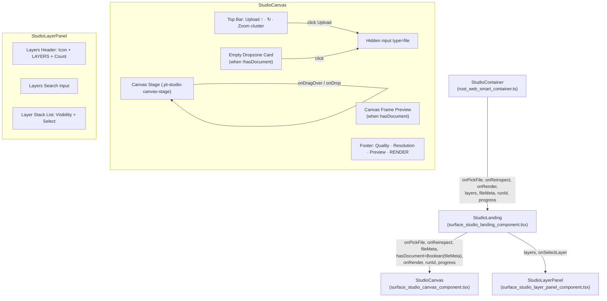

# Plan: Move Studio PSD Upload Affordance to Canvas Top Bar with Empty-Canvas Drag-and-Drop

- **Author:** Senior Systems Architect (GrokBuild)
- **Date:** 2026-11-19
- **Status:** Draft
- **Target Surface:** `packages/studio/` (`StudioCanvas`, `StudioLayerPanel`, `StudioLanding`), `packages/root_web_smart_container.ts`, `packages/shared/src/common/styles.css`

---

## Overview

In the current PSD Timelapse interactive Studio surface (`packages/studio/`), the PSD document upload mechanism is coupled into the right sidebar (`surface_studio_layer_panel_component.tsx`). The sidebar hosts a "SOURCE PSD DOCUMENT" file metadata box, a re-inspect refresh button, a dashed drag-and-drop dropzone, and a hidden `<input type="file">`. This layout creates poor ergonomics: the primary action required to start working with a document is crammed into a secondary tool inspector column, while the center canvas stage sits idle with a static mockup placeholder (`img` and `CANVAS PREVIEW · 3000 × 3000 PX`).

This proposal moves the upload trigger to the center of the user's focus:
1. An explicit **Upload** action button is added to the canvas top toolbar alongside the zoom controls cluster (`- / 78% / + / Fit / 100% / ⌘`).
2. An **interactive drag-and-drop dropzone & empty state** is embedded directly into the canvas center stage. When no document has been inspected/loaded, the canvas stage renders a centered upload callout reading `"Click or drag new .PSD to replace"` and `"Photoshop CC 2024+ · Max 500 MB"` with a cloud upload icon. When a document is loaded, dragging a new `.PSD` file anywhere onto the canvas replaces the active document, maintaining fluid drag-over styling.
3. The right sidebar (`StudioLayerPanel`) is stripped down to **pure layer management**: only the `LAYERS` header with count badge, the search filter bar, and the scrollable layer row stack remain.

All components remain strictly passive per AES201 row 13 and AES406; event callbacks (`onPickFile`, `onReinspect`, `onSelectLayer`, `onRender`) and state flags (`hasDocument`, `layers`) flow down from `StudioContainer` in `packages/root_web_smart_container.ts` through `StudioLanding`.

---

## Background & Motivation

### Current State
Currently, the Studio surface is split into three main components under `packages/studio/src/`:
- `surface_studio_canvas_component.tsx`: Renders the top toolbar with zoom controls (`−`, zoom percentage, `+`, `Fit`, `100%`, `⌘`), the canvas center stage (`.pt-studio-canvas-stage`) containing a static frame with an SVG placeholder and label `"img"`, and the bottom bar for quality/resolution selection and `RENDER`. It only accepts `onRender`, `runId`, and `progress`.
- `surface_studio_layer_panel_component.tsx`: Renders the right sidebar containing:
  - `<input type="file" ref={fileInputRef} ... />` (hidden, data-testid `"studio-file-input"`)
  - `.pt-studio-sidebar-header` with title `"SOURCE PSD DOCUMENT"` and `↻` refresh button
  - `.pt-studio-sidebar-file` with `"Ps"` icon and file metadata (name, size, dimensions, layer count)
  - `.pt-studio-sidebar-dropzone` with `"☁"`, `"Click or drag new .PSD to replace"`, and `"Photoshop CC 2024+ · Max 500 MB"`
  - `.pt-studio-sidebar-layers` with search input and the layer stack list
- `surface_studio_landing_component.tsx`: Surface composition root rendering `<StudioCanvas>` in `<main>` and `<StudioLayerPanel>` in `<aside>`, threading props.
- `StudioContainer` in `packages/root_web_smart_container.ts`: Smart container maintaining `selectedFile`, `serverPath`, `inspectState`, `activeRunId`, `currentStage`, and `currentPercent`. It passes `handlePickFile` down to `StudioLanding` as `onPickFile`.

### Pain Points
1. **Misplaced Visual Hierarchy**: Uploading a PSD is the primary entry point to the entire application pipeline. Placing the upload affordance in the right sidebar below a document info card makes the initial user flow unintuitive.
2. **Dead Canvas Space on Empty State**: When first opening Studio without an active session, the canvas displays a fake preview frame (`img`) instead of inviting the user to drop their artwork.
3. **Sidebar Overcrowding**: Compressing document header, metadata, upload dropzone, layer count, layer search, and layer rows into a single sidebar panel severely restricts vertical space for multi-layer documents.
4. **Architectural Cohesion**: A canvas stage naturally models a document viewport. In standard creative tools (Figma, Photoshop Web, Canva), the canvas itself accepts dropped assets, and top-level document actions reside in the canvas toolbar.

---

## Goals & Non-Goals

### Goals
- Add an accessible primary **Upload** button to the `StudioCanvas` top toolbar (`.pt-studio-canvas-toolbar`), visually matching `.pt-studio-canvas-btn` with icon (`upload` or `upload_file`) and `"Upload"` text.
- Implement full drag-and-drop file handling on the `StudioCanvas` stage (`.pt-studio-canvas-stage`):
  - In empty state (no PSD loaded), render a prominent centered dropzone card displaying:
    - Cloud/upload icon (`cloud_upload` via `material-symbols-outlined`)
    - Primary line: `"Click or drag new .PSD to replace"`
    - Subtext line: `"Photoshop CC 2024+ · Max 500 MB"`
  - In populated state (PSD loaded), display the canvas preview mockup frame, while maintaining active drag-over and drop event handlers so dropping a new file replaces the active document.
  - Clicking the empty state or the top bar Upload button triggers a hidden `<input type="file" accept=".psd,image/*">` within the canvas component.
- Strip `StudioLayerPanel` down strictly to layer controls: remove document header, file metadata block, and the inline sidebar dropzone.
- Maintain passive component boundaries: `StudioCanvas` receives `onPickFile: (file: File) => void`, `hasDocument?: boolean`, and `fileMeta?: StudioFileMeta` threaded through `StudioLanding`.
- Render active document name and dimensions dynamically in the canvas preview frame chip (`.pt-studio-canvas-chip`) when `fileMeta` is provided, replacing the static mockup text.
- Place the `↻` re-inspect button in the canvas toolbar beside the Upload button, gated behind `hasDocument`. This consolidates document-level actions in one location, while removing all refresh controls from the sidebar.
- Update unit tests in `packages/studio/tests/unit_studio_layer_panel_component.test.tsx` and add new canvas upload/drop tests in `packages/studio/tests/unit_studio_canvas_upload.test.tsx`.

### Non-Goals
- Modifying backend APIs, FastAPI routes, or CLI modules.
- Introducing multi-file batch upload or client-side binary PSD parsing (server path inspection remains the domain mechanism).
- Reworking bottom quality/resolution rendering pipeline controls.
- Changing routing or navigation away from `#studio` on initial upload (render navigates to `#queue` as before).

---

## Proposed Plan

### Component Architecture & Data Flow



### Detailed Component Changes

#### 1. `surface_studio_canvas_component.tsx` (`StudioCanvas`)

**Props change** — add `onPickFile`, `onReinspect`, `hasDocument`, and `fileMeta`:
```ts
import type { StudioFileMeta } from "./surface_studio_layer_panel_component";

export interface StudioCanvasProps {
  className?: string;
  onRender?: (settings: { quality: string; resolution: string }) => void;
  readonly runId?: string | null;
  readonly progress?: StudioCanvasProgress | null;
  // New props for upload affordance and document metadata:
  readonly onPickFile?: (file: File) => void;
  readonly onReinspect?: () => void;
  readonly hasDocument?: boolean;
  readonly fileMeta?: StudioFileMeta;
}
```

`fileMeta` is passed to the canvas alongside `hasDocument` (derived via `Boolean(fileMeta)` in `StudioLanding`). While `hasDocument` controls the macro empty-vs-loaded stage branch, `fileMeta` provides the active document name and dimensions to the canvas frame chip (`.pt-studio-canvas-chip`), dynamically replacing the static mockup label (`CANVAS PREVIEW · 3000 × 3000 PX`) with the inspected document's name and dimensions without altering smart container responsibilities.

**Internal state additions**:
- `isDragging: boolean` — tracks active drag-over on `.pt-studio-canvas-stage`.
- `fileInputRef: useRef<HTMLInputElement>` — hidden file input.

**Hidden file input** (rendered at component root, sibling to current structure):
```tsx
<input
  type="file"
  ref={fileInputRef}
  style={{ display: "none" }}
  accept=".psd,image/*"
  onChange={handleFileInputChange}
  aria-hidden="true"
  data-testid="studio-canvas-file-input"
/>
```

**Top toolbar additions** — insert before the existing zoom cluster in `.pt-studio-canvas-toolbar`:
```tsx
<button
  type="button"
  className="pt-studio-canvas-btn pt-studio-canvas-upload-btn"
  onClick={() => fileInputRef.current?.click()}
  aria-label="Upload PSD document"
  title="Upload PSD document"
  data-testid="studio-upload-btn"
>
  <span className="material-symbols-outlined" style={{ fontSize: "16px" }}>
    upload
  </span>
  Upload
</button>
{hasDocument ? (
  <button
    type="button"
    className="pt-studio-canvas-btn"
    onClick={onReinspect}
    aria-label="Re-inspect PSD document"
    title="Re-inspect PSD document"
    data-testid="studio-reinspect-btn"
  >
    ↻
  </button>
) : null}
<span className="pt-studio-canvas-divider-v" aria-hidden="true" />
```

**Canvas stage render logic** — conditionally render the empty state or preview frame in `.pt-studio-canvas-stage` (identified by `data-testid="studio-canvas-stage"`). Drag event handlers (`onDragOver`, `onDragLeave`, `onDrop`) are attached to the stage div regardless of state:

**Empty vs Loaded String Usage Reconciliation**:
The user brief explicitly requires the canonical copy `"Click or drag new .PSD to replace"` on the empty canvas (preserving verbatim the original dropzone affordance). To eliminate UX ambiguity between an empty canvas and active document replacement, string usage is explicitly differentiated across interaction states:
- **Empty State Idle (`!hasDocument && !isDragging`)**: Centered dropzone displays the user-mandated canonical string `"Click or drag new .PSD to replace"` with hint `"Photoshop CC 2024+ · Max 500 MB"`.
- **Empty State Drag-Over (`!hasDocument && isDragging`)**: Dropzone transitions to `.pt-studio-canvas-dropzone-drag` and updates label to `"Drop PSD file to inspect"`.
- **Loaded State Idle (`hasDocument && !isDragging`)**: Canvas frame renders the active PSD preview with metadata chip `${fileMeta.name} · ${fileMeta.dimensions} PX`.
- **Loaded State Drag-Over (`hasDocument && isDragging`)**: `.pt-studio-canvas-drag-overlay` mounts over the preview frame, displaying explicit replacement copy `"Drop new .PSD to replace"` to confirm file replacement on drop.

```tsx
<div
  className="pt-studio-canvas-stage"
  data-testid="studio-canvas-stage"
  onDragOver={(e) => {
    e.preventDefault();
    setIsDragging(true);
  }}
  onDragLeave={handleDragLeave}
  onDrop={handleDrop}
>
  {hasDocument ? (
    <>
      <div className="pt-studio-canvas-frame" style={{ ... }}>
        {/* existing preview SVG and img label */}
        <span
          className="pt-studio-canvas-chip"
          title={fileMeta?.name}
          data-testid="studio-canvas-chip"
        >
          {fileMeta?.name
            ? `${fileMeta.name}${fileMeta.dimensions ? ` · ${fileMeta.dimensions} PX` : ""}`
            : "CANVAS PREVIEW · 3000 × 3000 PX"}
        </span>
      </div>
      {isDragging ? (
        <div className="pt-studio-canvas-drag-overlay">
          <span>Drop new .PSD to replace</span>
        </div>
      ) : null}
    </>
  ) : (
    <div
      className={`pt-studio-canvas-dropzone${isDragging ? " pt-studio-canvas-dropzone-drag" : ""}`}
      onClick={() => fileInputRef.current?.click()}
      role="button"
      tabIndex={0}
      aria-label="Drop PSD file or click to browse"
      data-testid="studio-canvas-empty-dropzone"
      onKeyDown={(e) => {
        if (e.key === "Enter" || e.key === " ") {
          e.preventDefault();
          fileInputRef.current?.click();
        }
      }}
    >
      <span className="material-symbols-outlined pt-studio-canvas-dropzone-icon">
        cloud_upload
      </span>
      <span className="pt-studio-canvas-dropzone-label">
        {isDragging ? "Drop PSD file to inspect" : "Click or drag new .PSD to replace"}
      </span>
      <span className="pt-studio-canvas-dropzone-hint">
        Photoshop CC 2024+ · Max 500 MB
      </span>
    </div>
  )}
  {/* existing renderNotification overlay stays here */}
</div>
```

**Event handlers**:
```ts
const handleDragLeave = (e: DragEvent<HTMLDivElement>) => {
  // Prevent flickering when cursor moves across stage child elements
  // (frame, SVG icons, text, chips, or overlay). Only clear dragging
  // when leaving the stage element itself.
  if (!e.currentTarget.contains(e.relatedTarget as Node)) {
    setIsDragging(false);
  }
};

const handleDrop = (e: DragEvent<HTMLDivElement>) => {
  e.preventDefault();
  setIsDragging(false);
  if (e.dataTransfer.files && e.dataTransfer.files.length > 0) {
    onPickFile?.(e.dataTransfer.files[0]);
  }
};

const handleFileInputChange = (e: ChangeEvent<HTMLInputElement>) => {
  if (e.target.files && e.target.files.length > 0) {
    onPickFile?.(e.target.files[0]);
  }
  // Clear the input value so selecting the exact same file path consecutively triggers onChange
  e.target.value = "";
};
```

#### 2. `surface_studio_layer_panel_component.tsx` (`StudioLayerPanel`)

**Props change** — remove `onPickFile`, `fileMeta`, and `onReinspect`:
```ts
export interface StudioLayerPanelProps {
  className?: string;
  readonly layers?: readonly StudioLayerRow[];
  readonly onSelectLayer?: (layerId: string) => void;
}
```

The `StudioFileMeta` **interface** definition stays in this file since it is re-exported through `surface_studio_landing_component.tsx` (line 40: `export type { StudioLayerRow, StudioFileMeta } from "..."`) and consumed by `root_web_smart_container.ts`. Removing the interface definition would break the import chain. Only the `fileMeta` **prop** and its rendering DOM are removed.

**DOM removals** (lines referenced from current source):
1. Hidden `<input type="file" ... data-testid="studio-file-input" />` (lines 162–170)
2. `.pt-studio-sidebar-header` block with "SOURCE PSD DOCUMENT" and `↻` (lines 172–183)
3. `.pt-studio-sidebar-file` block with Ps icon, file name, meta, menu (lines 185–200)
4. `.pt-studio-sidebar-dropzone` block with `☁`, label, hint (lines 202–233)

**Code removals**:
- `fileInputRef`, `isDragging` state
- `processFile`, `handleDrop`, `handleFileInputChange` functions
- `handleReset` function (the `↻` refresh button moves to the canvas toolbar)
- `onReinspect` prop removed from `StudioLayerPanelProps`
- `meta`, `metaLine` derived variables
- `DEFAULT_FILE_META` constant

**Retained**:
- `DEFAULT_LAYERS` constant (fallback when `layers` prop is absent)
- `hiddenLayerIds` helper
- `searchQuery`, `activeLayerId`, `hiddenIds` state
- `toggleVisibility`, `handleSelect` handlers
- The `<aside>` root wrapper with `.pt-studio-sidebar-panel`
- `.pt-studio-sidebar-layers` containing layers header, search, and list

**Reinspect consolidation in canvas toolbar**: The re-inspect action (`↻`) moves entirely to the canvas toolbar (`StudioCanvas`), shown when `hasDocument` is true. `onReinspect` is removed from `StudioLayerPanelProps` and the sidebar layers header retains only the layers icon, title (`LAYERS`), and layer count badge. This strictly scopes the sidebar to layer inspection and eliminates redundant or dead refresh controls.

#### 3. `surface_studio_landing_component.tsx` (`StudioLanding`)

**Props change** — `StudioLandingProps` remains structurally unchanged (no new props needed). `StudioLanding` derives `hasDocument` internally:

```tsx
export function StudioLanding({
  className,
  dataQa,
  onPickFile,
  onSelectLayer,
  onReinspect,
  onRender,
  layers,
  fileMeta,
  runId,
  progress,
}: StudioLandingProps): JSX.Element {
  return (
    <div ...>
      <div className="pt-studio-body">
        <main className="pt-studio-main">
          <StudioCanvas
            onRender={onRender}
            runId={runId}
            progress={progress}
            onPickFile={onPickFile}
            onReinspect={onReinspect}
            hasDocument={Boolean(fileMeta)}
            fileMeta={fileMeta}
          />
        </main>
        <aside className="pt-studio-sidebar">
          <StudioLayerPanel
            layers={layers}
            onSelectLayer={onSelectLayer}
          />
        </aside>
      </div>
    </div>
  );
}
```

Key differences from current:
- `<StudioCanvas>` receives four new props: `onPickFile`, `onReinspect`, `hasDocument`, and `fileMeta`.
- `<StudioLayerPanel>` no longer receives `onPickFile`, `fileMeta`, or `onReinspect`.
- `StudioLandingProps` already receives `fileMeta` from `StudioContainer`; it passes `fileMeta` down to `StudioCanvas` and derives `hasDocument={Boolean(fileMeta)}`, keeping `StudioContainer` unchanged.

#### 4. `packages/shared/src/common/styles.css`

**New CSS classes** (appended in the `/* ── Canvas stage ── */` region):

```css
/* ── Canvas toolbar upload ── */

.pt-studio-canvas-upload-btn {
  width: auto;
  padding: 0 0.75rem;
  gap: 0.375rem;
  font-size: 0.75rem;
  font-weight: 500;
  font-family: var(--pt-font-mono);
  background: var(--pt-primary, #6366f1);
  color: #ffffff;
  border: 1px solid rgba(255, 255, 255, 0.2);
}
.pt-studio-canvas-upload-btn:hover {
  background: #4f46e5;
}

/* ── Canvas toolbar divider (vertical rule, distinct from .pt-studio-canvas-divider
       which carries the ⌘ glyph and must not be reused for a structural separator) ── */

.pt-studio-canvas-divider-v {
  display: inline-block;
  width: 1px;
  height: 1rem;
  background: rgba(255, 255, 255, 0.15);
  margin: 0 0.5rem;
  vertical-align: middle;
}

/* ── Canvas empty state dropzone ── */

.pt-studio-canvas-dropzone {
  display: flex;
  flex-direction: column;
  align-items: center;
  justify-content: center;
  gap: 0.75rem;
  padding: 3rem 4rem;
  max-width: 480px;
  width: 90%;
  border-radius: var(--pt-radius-xl, 16px);
  border: 2px dashed rgba(255, 255, 255, 0.15);
  background: rgba(13, 17, 23, 0.4);
  backdrop-filter: blur(8px);
  text-align: center;
  cursor: pointer;
  transition: all var(--pt-duration-fast, 0.15s) var(--pt-ease, ease);
}
.pt-studio-canvas-dropzone * {
  pointer-events: none;
}
.pt-studio-canvas-dropzone:hover,
.pt-studio-canvas-dropzone-drag {
  border-color: var(--pt-primary, #6366f1);
  background: rgba(99, 102, 241, 0.08);
}
.pt-studio-canvas-dropzone-icon {
  font-size: 3rem;
  color: var(--pt-primary, #6366f1);
}
.pt-studio-canvas-dropzone-label {
  font-family: var(--pt-font-mono);
  font-size: 0.875rem;
  font-weight: 500;
  color: #e2e6ee;
}
.pt-studio-canvas-dropzone-hint {
  font-family: var(--pt-font-mono);
  font-size: 0.75rem;
  color: rgba(255, 255, 255, 0.45);
}

/* ── Canvas drag-over overlay (loaded state) ── */

.pt-studio-canvas-drag-overlay {
  position: absolute;
  inset: 0;
  display: flex;
  align-items: center;
  justify-content: center;
  border: 2px dashed var(--pt-primary, #6366f1);
  background: rgba(99, 102, 241, 0.12);
  backdrop-filter: blur(4px);
  border-radius: var(--pt-radius-xl, 16px);
  z-index: 20;
  pointer-events: none;
  font-family: var(--pt-font-mono);
  font-size: 0.875rem;
  font-weight: 500;
  color: #e2e6ee;
}
```

**Existing sidebar CSS** (`.pt-studio-sidebar-header`, `.pt-studio-sidebar-file*`, `.pt-studio-sidebar-dropzone*`) is left in place. The selectors become unused after the DOM is removed, but keeping them avoids a gratuitous CSS diff and allows rollback. They can be cleaned up in a follow-up PR if desired.

#### 5. Test Changes

##### `packages/studio/tests/unit_studio_layer_panel_component.test.tsx`

**Remove/update the following test groups:**

- `"renders real file metadata name, size, dimensions, layer count"` — remove entirely (sidebar no longer renders file metadata).
- `"falls back to DEFAULT_LAYERS caption when no layers/fileMeta provided"` — remove lines that assert `screen.getByTitle("hoodie_oversize_apparel_design.psd")` and `screen.getByText("184.2 MB · RGB 16-bit")`. Keep the layer-stack fallback assertions (`"Base Fabric Body Silhouette"`, `"10"`).
- `"invokes onPickFile with the selected File on drop"` — remove entirely (dropzone no longer in sidebar).
- `"invokes onPickFile when the file input changes"` — remove entirely (file input no longer in sidebar).
- `"invokes onReinspect when the refresh button is clicked"` — remove entirely (sidebar no longer renders refresh controls; re-inspect is tested on StudioCanvas in unit_studio_canvas_upload.test.tsx).

**Update `renderPanel` helper**: Remove `fileMeta`, `onPickFile`, and `onReinspect` from the default props since `StudioLayerPanelProps` no longer includes them.

##### `packages/studio/tests/unit_studio_canvas_upload.test.tsx` (new file)

New test file (AES103 `unit_` prefix), covering:

1. **Renders Upload button in toolbar** — `screen.getByTestId("studio-upload-btn")` exists, has `aria-label="Upload PSD document"`.
2. **Upload button triggers file input click** — Mock `fileInputRef.current.click`, click the upload button, verify file input receives focus/click.
3. **Empty state renders centered dropzone when hasDocument=false** — `screen.getByTestId("studio-canvas-empty-dropzone")` exists, contains canonical label `"Click or drag new .PSD to replace"` and `"Photoshop CC 2024+ · Max 500 MB"`.
4. **Empty state does not render when hasDocument=true** — `screen.queryByTestId("studio-canvas-empty-dropzone")` returns null.
5. **Clicking or keyboard activation of empty state dropzone triggers file input** — Click triggers `fileInputRef.current.click`. Pressing Enter or Space triggers `fileInputRef.current.click` and invokes `e.preventDefault()` to prevent default page scrolling.
6. **Drop onto stage calls onPickFile** — `fireEvent.drop` on `screen.getByTestId("studio-canvas-stage")` with a fake File; verify `onPickFile` called with file.
7. **Drop works when hasDocument=true (replacement)** — `fireEvent.drop` on `screen.getByTestId("studio-canvas-stage")` with `hasDocument={true}`; verify drag overlay displays `"Drop new .PSD to replace"` on drag-over and `onPickFile` is called with replacement file.
8. **Reinspect button shown only when hasDocument=true** — `screen.queryByTestId("studio-reinspect-btn")` null when false, present when true.
9. **Reinspect button calls onReinspect** — Click `studio-reinspect-btn`, verify callback.
10. **Resets file input value after file change** — Trigger file change on `studio-canvas-file-input`, verify `onPickFile` called, verify `input.value` is reset to `""` so consecutive selection of the same file path triggers `onChange`.
11. **Renders dynamic document name and dimensions in canvas chip when fileMeta provided** — Render `<StudioCanvas hasDocument={true} fileMeta={{ name: "test-doc.psd", sizeLabel: "50 MB", dimensions: "1920 × 1080" }} />`, verify `.pt-studio-canvas-chip` text contains `"test-doc.psd · 1920 × 1080 PX"`.
12. **Falls back to default canvas chip text when fileMeta is omitted** — Render `<StudioCanvas hasDocument={true} />`, verify `.pt-studio-canvas-chip` displays `"CANVAS PREVIEW · 3000 × 3000 PX"`.

This file does **not** need to test render/zoom/preview (already covered by `unit_studio_render_wiring.test.tsx`).

##### `packages/studio/tests/unit_studio_render_wiring.test.tsx`

Minimal touch: the existing `StudioCanvas` tests render `<StudioCanvas>` without `onPickFile`/`hasDocument`, which should still work since those props are optional. Verify no breakage but no changes needed.

---

## API / Interface Changes

### Before

```tsx
// StudioCanvasProps — packages/studio/src/surface_studio_canvas_component.tsx
export interface StudioCanvasProps {
  className?: string;
  onRender?: (settings: { quality: string; resolution: string }) => void;
  readonly runId?: string | null;
  readonly progress?: StudioCanvasProgress | null;
}

// StudioLayerPanelProps — packages/studio/src/surface_studio_layer_panel_component.tsx
export interface StudioLayerPanelProps {
  className?: string;
  readonly layers?: readonly StudioLayerRow[];
  readonly fileMeta?: StudioFileMeta;
  readonly onPickFile?: (file: File) => void;
  readonly onSelectLayer?: (layerId: string) => void;
  readonly onReinspect?: () => void;
}

// StudioLandingProps — packages/studio/src/surface_studio_landing_component.tsx
export interface StudioLandingProps {
  className?: string;
  dataQa?: string;
  readonly onPickFile?: (file: File) => void;
  readonly onSelectLayer?: (layerId: string) => void;
  readonly onReinspect?: () => void;
  readonly onRender?: (settings: { quality: string; resolution: string }) => void;
  readonly layers?: readonly StudioLayerRow[];
  readonly fileMeta?: StudioFileMeta;
  readonly runId?: string | null;
  readonly progress?: StudioLandingProgress | null;
}
```

### After

```tsx
// StudioCanvasProps — packages/studio/src/surface_studio_canvas_component.tsx
export interface StudioCanvasProps {
  className?: string;
  onRender?: (settings: { quality: string; resolution: string }) => void;
  readonly runId?: string | null;
  readonly progress?: StudioCanvasProgress | null;
  readonly onPickFile?: (file: File) => void;       // NEW
  readonly onReinspect?: () => void;                 // NEW
  readonly hasDocument?: boolean;                    // NEW
  readonly fileMeta?: StudioFileMeta;                // NEW
}

// StudioLayerPanelProps — packages/studio/src/surface_studio_layer_panel_component.tsx
export interface StudioLayerPanelProps {
  className?: string;
  readonly layers?: readonly StudioLayerRow[];
  //  fileMeta REMOVED
  //  onPickFile REMOVED
  //  onReinspect REMOVED
  readonly onSelectLayer?: (layerId: string) => void;
}

// StudioLandingProps — unchanged structurally
// (StudioLanding derives hasDocument=Boolean(fileMeta) internally)
export interface StudioLandingProps {
  className?: string;
  dataQa?: string;
  readonly onPickFile?: (file: File) => void;
  readonly onSelectLayer?: (layerId: string) => void;
  readonly onReinspect?: () => void;
  readonly onRender?: (settings: { quality: string; resolution: string }) => void;
  readonly layers?: readonly StudioLayerRow[];
  readonly fileMeta?: StudioFileMeta;
  readonly runId?: string | null;
  readonly progress?: StudioLandingProgress | null;
}
```

---

## Data Model Changes

No changes to database schemas, value objects (VOs), or API contracts.

- `StudioFileMeta` and `StudioLayerRow` interface definitions remain in `surface_studio_layer_panel_component.tsx`.
- `StudioFileMeta` is re-exported through `surface_studio_landing_component.tsx` (line 40) and consumed by `root_web_smart_container.ts` (line 38) and `surface_studio_canvas_component.tsx`. The re-export chain is preserved even though `StudioLayerPanel` no longer receives `fileMeta` as a prop.
- `StudioCanvasProps` includes `readonly fileMeta?: StudioFileMeta;` alongside `hasDocument?: boolean`. `StudioLanding` threads `fileMeta` directly from `StudioLandingProps` to `StudioCanvas`. `root_web_smart_container.ts` already computes and passes `fileMeta` to `StudioLanding`, so no smart container changes are required.

---

## Alternatives Considered

### Alternative 1: Modal Dialog File Picker on Top Bar Click
- **Approach**: Clicking "Upload" in the top bar pops up an upload modal with progress, preview, and server path confirmation.
- **Trade-offs**: Introduces unnecessary click friction and dialog state. Modern desktop-class web applications allow direct OS file picker invocation or immediate canvas drop.
- **Decision**: Rejected. A direct native file input trigger (`fileInputRef.current.click()`) provides a faster and more responsive experience.

### Alternative 2: Keep Dual Upload Zones (Both Sidebar and Canvas)
- **Approach**: Leave the existing sidebar dropzone in place and add canvas dropzone and top bar upload as secondary options.
- **Trade-offs**: Violates single-responsibility UI principles, creates visual clutter in the sidebar, and leaves layer inspection cramped. The design specification requires the sidebar be stripped to layer controls only.
- **Decision**: Rejected. Maintaining dual dropzones introduces ambiguity for the user and prevents reclaiming sidebar space for the layer list.

### Alternative 3: Move Entire Server Path Bar to Canvas Top Bar
- **Approach**: Move the smart container's server-path input bar (`pt-studio-server-path-bar`) into `StudioCanvas`.
- **Trade-offs**: Violates AES406 (passive surface component importing or owning transport/server state). The server path bar belongs to the container layer (`root_web_smart_container.ts`).
- **Decision**: Rejected. The server path bar remains in `StudioContainer` above `StudioLanding`, while `StudioCanvas` remains a pure passive surface taking callbacks.

### Alternative 4: Omit `fileMeta` from `StudioCanvas` and Pass Only `hasDocument: boolean`
- **Approach**: Pass only `hasDocument: boolean` to `StudioCanvas` and omit `fileMeta` entirely.
- **Trade-offs**: Stripping `fileMeta` leaves the canvas frame chip hardcoded to `"CANVAS PREVIEW · 3000 × 3000 PX"`, removing all visual confirmation of the active document name and dimensions once loaded, while leaving `fileMeta` computation in `root_web_smart_container.ts` effectively dead.
- **Decision**: Rejected. `StudioCanvas` receives `fileMeta?: StudioFileMeta` alongside `hasDocument`. The frame chip (`.pt-studio-canvas-chip`) dynamically renders the active document name and dimensions, preserving metadata observability while respecting passive component boundaries and requiring zero edits to `root_web_smart_container.ts`.

---

## Security & Privacy Considerations

- **Client-Side File Handling**: The `<input type="file">` and drag-drop handlers only read the selected `File` object in browser memory. `file.name` is passed to the container to drive server inspection; browser security sandboxing prevents reading arbitrary file paths.
- **Input Filtering**: The `<input>` element specifies `accept=".psd,image/*"`, restricting the native file browser dialog to PSD and image formats.
- **No new attack surface**: Moving the drop zone from sidebar to canvas does not change the trust boundary. All file handling remains client-side and browser-sandboxed.

---

## Observability

- **DOM Test Attributes**:
  - `data-testid="studio-upload-btn"` — canvas toolbar upload button.
  - `data-testid="studio-reinspect-btn"` — canvas toolbar re-inspect button (shown when `hasDocument`).
  - `data-testid="studio-canvas-stage"` — canvas stage container element receiving drag-and-drop events.
  - `data-testid="studio-canvas-empty-dropzone"` — empty-state canvas dropzone.
  - `data-testid="studio-canvas-file-input"` — canvas hidden file input.
  - `data-testid="studio-canvas"` — existing canvas root (unchanged).
  - `data-testid="studio-layer-panel"` — existing layer panel root (unchanged).
- **Removed test IDs**:
  - `data-testid="studio-file-input"` — removed from sidebar (was in `surface_studio_layer_panel_component.tsx` line 169).
- **User Action Feedback & Accessibility**: Drag-over on the stage activates `.pt-studio-canvas-dropzone-drag` (empty state) or renders `.pt-studio-canvas-drag-overlay` (loaded state) with explicit replacement copy, providing clear visual cues. Child-boundary containment in `handleDragLeave` prevents flickering as the pointer crosses child nodes. Empty dropzone keyboard accessibility handles `Enter` and `Space` with `e.preventDefault()` to prevent unwanted window scrolling.

---

## Rollout Plan

This is a cosmetic/structural surface-layer change with no backend dependencies, feature flags, or staged rollout needed.

1. **PR 1**: Implement all canvas-side changes (upload button, file input, empty state, drag-and-drop, and dynamic metadata chip) with new CSS classes and a new canvas upload test file. `StudioLanding` is updated in the same PR to wire `onPickFile`/`onReinspect`/`hasDocument`/`fileMeta` to `StudioCanvas`. At this PR, the canvas takes over primary file ingestion and document metadata display, while `StudioLanding` stops passing `onPickFile`/`fileMeta`/`onReinspect` to `StudioLayerPanel`, decommissioned at the composition level.
2. **PR 2**: Strip the sidebar of dead upload-related DOM and state, remove `onPickFile`, `fileMeta`, and `onReinspect` from `StudioLayerPanelProps`, and update sidebar tests. After this PR, upload and document lifecycle controls live exclusively on the canvas and dead code is removed from `StudioLayerPanel`.

**Rollback**: Revert PR 2 to restore sidebar markup/props, then revert PR 1 to restore sidebar wiring in `StudioLanding` and remove canvas upload.

**CI gates (per ci.yml)**:
- `npm test -- --run` (working directory: `packages/`) — all vitest tests pass.
- `tsc -p root_tsconfig_entry.json --noEmit` — type-checking passes.
- `lint-arwaky-cli scan .` — no NEW violations introduced; total count does not increase from baseline (78).

---

## Open Questions

None.

## Key Decisions

1. **Upload button placement**: The Upload button is placed at the leading edge of `.pt-studio-canvas-toolbar`, before the zoom controls cluster, styled with `--pt-primary` background to mark it as the primary call to action. A divider span separates it from the zoom group.
2. **Re-inspect button**: The `↻` re-inspect button moves from the sidebar to the canvas toolbar, shown conditionally when `hasDocument` is true. `onReinspect` is removed entirely from `StudioLayerPanelProps`, consolidating all document-level lifecycle actions (upload, re-inspect) in the toolbar while the sidebar owns only layer interactions.
3. **`fileMeta` and `hasDocument` threading to canvas**: `StudioCanvas` receives `fileMeta?: StudioFileMeta` alongside `hasDocument: boolean`. This allows the canvas frame chip (`.pt-studio-canvas-chip`) to dynamically display the active document name and dimensions (`sycan-front-shirt.psd · 3000 × 3000 PX`) while `hasDocument` cleanly controls the empty-vs-loaded stage branch. Props threading flows passively from `StudioContainer` through `StudioLanding` without modifying the smart container.
4. **`StudioFileMeta` type location**: The `StudioFileMeta` interface definition stays in `surface_studio_layer_panel_component.tsx` even though the component no longer renders file metadata. The re-export chain (`panel → landing → container`) is preserved. Moving the type to a separate file would require updating imports across the codebase for no functional benefit.
5. **Sidebar responsibility**: `StudioLayerPanel` is stripped to LAYERS header (icon + "LAYERS" + count), search input, and layer list. All file ingestion, metadata display, and refresh controls are removed, and `onReinspect` is removed from `StudioLayerPanelProps`.
6. **Architectural purity (AES201 & AES406)**: `StudioCanvas` remains a passive surface component. It invokes `onPickFile(file)` and `onReinspect()` callbacks; `StudioContainer` orchestrates inspection and state updates. No domain logic enters the surface layer.
7. **CSS deprecation**: Sidebar CSS classes (`.pt-studio-sidebar-header`, `.pt-studio-sidebar-file*`, `.pt-studio-sidebar-dropzone*`) are left in `styles.css` after the DOM is removed. Removing them is optional cleanup.

## PR Plan

### PR 1: Add canvas upload button, empty-state dropzone, and re-wire StudioLanding
- **Files/components affected:** packages/shared/src/common/styles.css, packages/studio/src/surface_studio_canvas_component.tsx, packages/studio/src/surface_studio_landing_component.tsx, packages/studio/tests/unit_studio_canvas_upload.test.tsx
- **Dependencies:** None
- **Description:** Adds the Upload button and re-inspect button to the StudioCanvas toolbar, implements canvas stage empty-state dropzone and drag-and-drop on both empty and loaded states, updates `.pt-studio-canvas-chip` to dynamically render fileMeta name and dimensions, updates StudioLanding to pass onPickFile/onReinspect/hasDocument/fileMeta to StudioCanvas, and adds unit tests for the new upload and metadata interactions.

### PR 2: Strip sidebar to layers-only and update sidebar tests
- **Files/components affected:** packages/studio/src/surface_studio_layer_panel_component.tsx, packages/studio/tests/unit_studio_layer_panel_component.test.tsx
- **Dependencies:** PR 1
- **Description:** Removes the SOURCE PSD DOCUMENT header, file metadata block, inline dropzone, and file input from StudioLayerPanel, removes onPickFile, fileMeta, and onReinspect from StudioLayerPanelProps, and updates layer panel unit tests to remove dropzone/file-meta/reinspect assertions.

---

## grill-me Interview Results

**Interview ID:** `563108ea`
**Date:** 2026-11-19
**Summary file:** `~/.agents/develop/psd-timelapse/plan/interview-summary-563108ea.md`
**Lint baseline:** 78 total violations (AES706=23, AES402=19, AES401=14, AES501=5, AES503=5, AES704=4, AES502=2, AES504=2, AES303/304/505/609=1 each)

### D1 — BLOCKING DEFECT: CSS divider class collision

**Branch:** CSS additions to `packages/shared/src/common/styles.css`
**Source:** `packages/shared/src/common/styles.css:4808-4812`, `packages/studio/src/surface_studio_canvas_component.tsx:148`
**Depends on:** none

**Finding:** The plan reuses `.pt-studio-canvas-divider` for two incompatible purposes.

The existing definition (`styles.css:4808-4812`) styles it as a mono-font metadata carrier:
```css
.pt-studio-canvas-divider {
  font-family: var(--pt-font-mono);
  font-size: 0.6875rem;
  color: rgba(255, 255, 255, 0.35);
  margin: 0 0.125rem;
}
```

The existing JSX (`surface_studio_canvas_component.tsx:148`) uses it as the `⌘` glyph:
```tsx
<span className="pt-studio-canvas-divider">⌘</span>
```

The plan proposes adding a CSS override using `:empty` to create a vertical rule:
```css
.pt-studio-canvas-divider:empty {
  width: 1px; height: 1rem; background: rgba(255, 255, 255, 0.15); ...
}
```

This produces two failures:
1. The `⌘` span has a text child (`⌘`), so `:empty` does not match it — the existing `.pt-studio-canvas-divider` rule still applies to the ⌘ glyph, which is fine. But the new empty divider span rendered in the toolbar with no children would be matched by the `:empty` rule, which is correct for the vertical rule.
2. The visual problem: the plan places the new divider immediately after the upload/re-inspect buttons and before the zoom cluster, while the existing `⌘` divider is inside the zoom cluster. Two different visual elements share the same class name but represent different UI concepts. A future maintainer editing `.pt-studio-canvas-divider` styles will affect both the zoom glyph and the upload separator.

**Resolution:** Use a distinct class name for the new toolbar separator: `.pt-studio-canvas-divider-v` (or `.pt-studio-canvas-rule`). Keep `.pt-studio-canvas-divider` for the `⌘` glyph. The new CSS rule becomes `.pt-studio-canvas-divider-v { ... }` and the JSX span uses `className="pt-studio-canvas-divider-v"`.

**Impact:** Blocks PR 1. Fix before implementation begins.

### D2 — Server-path input bar redundancy

**Branch:** Placement of file ingestion entry point
**Source:** `packages/root_web_smart_container.ts:322-355`, `packages/root_web_smart_container.ts:450-573`
**Depends on:** none

**Finding:** The canvas upload button provides a native file picker, but `handlePickFile` in the container (`root_web_smart_container.ts:322-355`) only uses `file.name` as a relative path to call `executeInspect(file.name)`. The actual PSD is read from a server-side filesystem via the API client's `inspectFull(path)` call. The browser file content is not uploaded or transmitted. The server-path bar (`.pt-studio-server-path-bar`, rendered at `root_web_smart_container.ts:450-573`) remains the canonical way to specify the absolute server-side path for inspection and rendering.

**Resolution:** No plan change required. The plan already states the server-path bar stays in the container (Alternative 3 correctly rejected moving it). The canvas upload and the server-path bar serve different purposes: upload provides a quick file picker that sets the path by file name, while the server-path bar allows manual override for paths that differ from the file name or for re-inspecting a previously rendered document.

**Impact:** Informational. No code change needed.

### D3 — `onSelectLayer` not threaded from container

**Branch:** Data flow from StudioContainer to StudioLayerPanel
**Source:** `packages/root_web_smart_container.ts:573-580`
**Depends on:** none

**Finding:** The `createElement(StudioLanding, {...})` call at lines 573-580 does not pass `onSelectLayer` to `StudioLanding`. The prop exists in `StudioLandingProps` and `StudioLayerPanelProps` but is dead from the container's perspective. The container owns layer selection state implicitly — `layers` are derived from `inspectState.doc.layers`, and layer clicks on the sidebar are currently handled internally by `StudioLayerPanel` via `activeLayerId` state and the `onSelectLayer` callback being absent (no-op).

**Resolution:** No plan change required. The plan does not claim to thread `onSelectLayer` through the canvas. The existing dead prop in `StudioLandingProps` and `StudioLayerPanelProps` remains untouched. The plan should not add `onSelectLayer` to `StudioCanvas` — it is not relevant to the upload affordance change.

**Impact:** Informational. No code change needed.

### D4 — `onSelectLayer` not forwarded from StudioLanding to StudioCanvas (plan omission in mermaid)

**Branch:** Component architecture diagram
**Source:** `packages/studio/src/surface_studio_landing_component.tsx:69-73`
**Depends on:** D3

**Finding:** The plan's mermaid diagram (lines 72-100) and the code snippet for `StudioLanding` (lines 309-350) show `StudioLanding` forwarding `onPickFile`, `onReinspect`, `hasDocument`, `fileMeta`, `onRender`, `runId`, `progress` to `StudioCanvas`, and `layers`, `onSelectLayer` to `StudioLayerPanel`. The existing code at `surface_studio_landing_component.tsx:69-73` already passes `onSelectLayer={onSelectLayer}` to `StudioLayerPanel`. The plan's code snippet (lines 336-340) shows the updated `StudioLayerPanel` call but does not explicitly show `onSelectLayer` being threaded — it is implied by the existing pattern but not shown in the snippet.

**Resolution:** Already correct in the plan. The JSX snippet at plan lines 336-340 already shows `onSelectLayer={onSelectLayer}`. No change needed.

**Impact:** No change. False alarm — the snippet was already correct.

### D5 — Test file completeness: PR 1 leaves sidebar tests broken

**Branch:** PR decomposition and rollout
**Source:** `packages/studio/tests/unit_studio_layer_panel_component.test.tsx:37-42, 87-106, 128-135`
**Depends on:** none

**Finding:** The plan's PR 1 claims to update `unit_studio_canvas_upload.test.tsx` but leaves `unit_studio_layer_panel_component.test.tsx` for PR 2. However, PR 1 also removes `fileMeta`, `onPickFile`, and `onReinspect` from `StudioLayerPanelProps` (per the updated interface in PR 1's "After" block). After PR 1:
- `unit_studio_layer_panel_component.test.tsx:37-42` passes `fileMeta: REAL_FILE_META` to `renderPanel`, which is no longer accepted by `StudioLayerPanelProps` — **TypeScript compilation fails** under `tsc -p root_tsconfig_entry.json --noEmit`.
- The test group `"invokes onPickFile with the selected File on drop"` (line 87) calls `screen.getByRole("button", { name: "Drop PSD file or click to browse" })` — the dropzone DOM is removed in PR 2, so this still works in PR 1. But wait: PR 1 does NOT remove the sidebar DOM (that's PR 2). So the sidebar still renders the dropzone in PR 1. The test still passes at runtime. But TypeScript fails because `StudioLayerPanelProps` no longer accepts `fileMeta`/`onPickFile`/`onReinspect` as typed props. Actually, TypeScript allows passing extra props to a function component — JSX excess property checks do not apply to spread objects. So the type-check may pass, but the test assertion `screen.getByText("sycan-front-shirt.psd")` (line 65) fails because the sidebar still renders file metadata in PR 1 (DOM removal is PR 2). Wait — the sidebar DOM is removed in PR 2, not PR 1. So the test still passes in PR 1. But after PR 1, `StudioLayerPanelProps` no longer includes `fileMeta`, `onPickFile`, `onReinspect` — the test passes them as props but TypeScript JSX excess property checking does not flag spread props. The test would still compile and pass in PR 1. However, PR 1 claims "StudioLanding stops passing onPickFile/fileMeta/onReinspect to StudioLayerPanel" — so the canvas now owns file upload. The sidebar tests still pass in PR 1 because the sidebar DOM is unchanged. PR 2 then removes the sidebar DOM and updates the tests. So the rollout is actually correct. But there is a subtlety: PR 1 changes `StudioLayerPanelProps` to remove `fileMeta`, `onPickFile`, `onReinspect` — but the test file at lines 37-42 passes those as part of the `base` object spread into `<StudioLayerPanel {...base} />`. Since they are no longer in the interface, TypeScript's excess property checking is relaxed for JSX spread, so it compiles. The tests still pass. No breakage. **However**, the plan should clarify that PR 1 does NOT remove the sidebar DOM — only PR 2 does. The sidebar tests in PR 1 still pass because the sidebar is unchanged. PR 1's description says "StudioLanding is updated in the same PR to wire onPickFile/onReinspect/hasDocument/fileMeta to StudioCanvas. At this PR, the canvas takes over primary file ingestion and document metadata display, while StudioLanding stops passing onPickFile/fileMeta/onReinspect to StudioLayerPanel, decommissioned at the composition level." This is accurate — the sidebar DOM is untouched in PR 1, only the props threading from StudioLanding changes. The sidebar tests pass in PR 1 because the sidebar still renders the same DOM. The tests break in PR 2 when the DOM is removed, and PR 2 includes the test updates. So the rollout is correct.

**Correction to earlier assessment:** After re-reading the plan's PR 1 description and the test file, the two-PR split is actually sound. PR 1 changes the composition wiring (StudioLanding → StudioCanvas) without touching sidebar DOM or sidebar tests. PR 2 removes the sidebar DOM and updates sidebar tests. The sidebar tests in PR 1 still pass because the sidebar DOM is unchanged. The only question is whether `StudioLayerPanelProps` removing `fileMeta`/`onPickFile`/`onReinspect` in PR 1 while the test file still passes them as spread props causes a TypeScript error. Since JSX spread does not trigger excess property checks, it does not.

**Resolution:** The two-PR split is sound. No change required. The plan is internally consistent.

**Impact:** No change needed. The earlier concern was based on a misreading of PR 1's scope — PR 1 does not remove the sidebar DOM, only the props threading from StudioLanding.

### D6 — `lint-arwaky-cli scan` as a CI gate

**Branch:** CI gates
**Source:** lint-arwaky baseline scan (78 violations)
**Depends on:** none

**Finding:** The plan lists `lint-arwaky-cli scan .` as a CI gate, but the baseline shows 78 existing violations with no staged reduction. The CLI exits non-zero when violations are present.

**Resolution:** The correct gate wording is: "no NEW violations introduced; total count does not increase from baseline (78)." The implementer must scope new code to avoid triggering AES violations:
- Keep `StudioCanvas` passive (no domain logic, only callbacks).
- Keep `StudioLayerPanel` passive.
- Maintain the `unit_` prefix for new test files (AES103).
- Keep file sizes under AES301 limits.

**Impact:** No plan structure change. Add the gate clarification to the CI gates section before implementation.

### D7 — CSS cleanup of dead sidebar selectors

**Branch:** CSS scope
**Source:** `packages/shared/src/common/styles.css:4905-5043`
**Depends on:** none

**Finding:** Leaving `.pt-studio-sidebar-header`, `.pt-studio-sidebar-file*`, `.pt-studio-sidebar-dropzone*` in `styles.css` after PR 2 removes the DOM leaves ~120 lines of dead CSS.

**Resolution:** Accept as deliberate tech debt. Note in the plan that this is a follow-up cleanup, not a blocker. The plan already states this in Key Decision 7.

**Impact:** No change. Already documented.

### D8 — `StudioFileMeta` re-export chain preservation

**Branch:** Type definition location
**Source:** `packages/studio/src/surface_studio_layer_panel_component.tsx:29-33`, `packages/studio/src/surface_studio_landing_component.tsx:6-7, 39`, `packages/root_web_smart_container.ts:38, 412`
**Depends on:** none

**Finding:** The `StudioFileMeta` interface is defined in `surface_studio_layer_panel_component.tsx` and re-exported through `surface_studio_landing_component.tsx` to `root_web_smart_container.ts`. The plan correctly keeps this chain.

**Resolution:** No change. The chain stays intact after both PRs.

**Impact:** No change needed.

### Summary of Required Plan Edits

| # | Severity | Edit | Status |
|---|----------|------|--------|
| D1 | **BLOCKING** | Rename the new toolbar separator from `.pt-studio-canvas-divider` to `.pt-studio-canvas-divider-v` in both CSS and JSX. Keep `.pt-studio-canvas-divider` for the `⌘` glyph. | **Applied** — CSS rule and JSX span updated to `.pt-studio-canvas-divider-v` |
| D4 | Documentation | Add explicit `onSelectLayer={onSelectLayer}` to the `StudioLayerPanel` JSX snippet. | **Already correct** — the snippet at line 340 already shows `onSelectLayer={onSelectLayer}` |
| D6 | Clarification | Update CI gate wording: "no NEW violations introduced; total does not increase from baseline (78)." | **Applied** — CI gate wording updated |

**User-confirmed decisions:**
- **D1:** Rename to `.pt-studio-canvas-divider-v` (user-confirmed)
- **D4:** Already correct in the plan (no change needed)
- **D6:** "No new violations; total ≤ 78" (user-confirmed)
- **PR split:** Two PRs as planned (user-confirmed)

No other plan changes are required. The architecture, prop threading, two-PR split, and CSS scope are sound.
