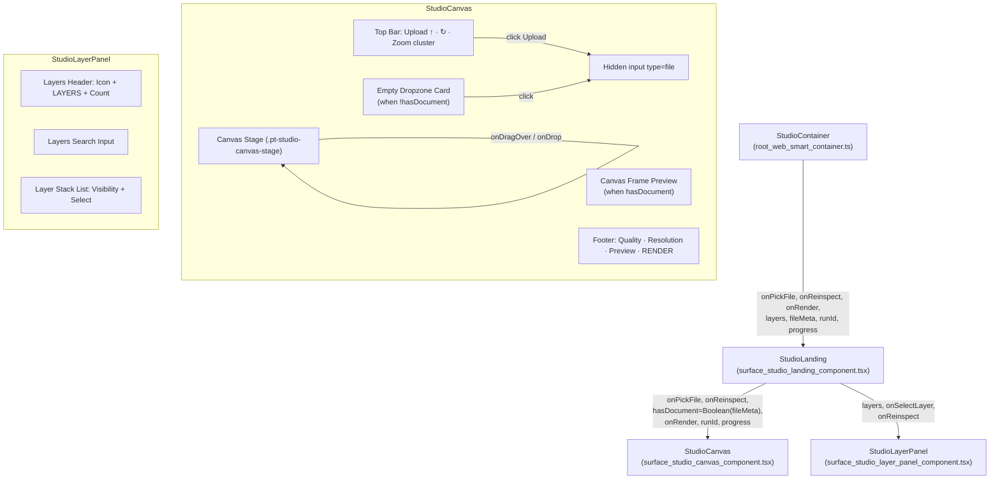

# Plan: Move Studio PSD Upload Affordance to Canvas Top Bar with Empty-Canvas Drag-and-Drop

- **Author:** Senior Systems Architect (GrokBuild)
- **Date:** 2026-11-19
- **Status:** Draft
- **Target Surface:** `packages/studio/` (`StudioCanvas`, `StudioLayerPanel`, `StudioLanding`), `packages/root_web_smart_container.ts`, `packages/shared/src/common/styles.css`

---

## Overview

In the current PSD Timelapse interactive Studio surface (`packages/studio/`), the PSD document upload mechanism is coupled into the right sidebar (`surface_studio_layer_panel_component.tsx`). The sidebar hosts a "SOURCE PSD DOCUMENT" file metadata box, a re-inspect refresh button, a dashed drag-and-drop dropzone, and a hidden `<input type="file">`. This layout creates poor ergonomics: the primary action required to start working with a document is crammed into a secondary tool inspector column, while the center canvas stage sits idle with a static mockup placeholder (`img` and `CANVAS PREVIEW · 3000 × 3000 PX`).

This proposal moves the upload trigger to the center of the user's focus:
1. An explicit **Upload** action button is added to the canvas top toolbar alongside the zoom controls cluster (`- / 78% / + / Fit / 100% / ⌘`).
2. An **interactive drag-and-drop dropzone & empty state** is embedded directly into the canvas center stage. When no document has been inspected/loaded, the canvas stage renders a centered upload callout reading `"Click or drag new .PSD to replace"` and `"Photoshop CC 2024+ · Max 500 MB"` with a cloud upload icon. When a document is loaded, dragging a new `.PSD` file anywhere onto the canvas replaces the active document, maintaining fluid drag-over styling.
3. The right sidebar (`StudioLayerPanel`) is stripped down to **pure layer management**: only the `LAYERS` header with count badge, the search filter bar, and the scrollable layer row stack remain.

All components remain strictly passive per AES201 row 13 and AES406; event callbacks (`onPickFile`, `onReinspect`, `onSelectLayer`, `onRender`) and state flags (`hasDocument`, `layers`) flow down from `StudioContainer` in `packages/root_web_smart_container.ts` through `StudioLanding`.

---

## Background & Motivation

### Current State
Currently, the Studio surface is split into three main components under `packages/studio/src/`:
- `surface_studio_canvas_component.tsx`: Renders the top toolbar with zoom controls (`−`, zoom percentage, `+`, `Fit`, `100%`, `⌘`), the canvas center stage (`.pt-studio-canvas-stage`) containing a static frame with an SVG placeholder and label `"img"`, and the bottom bar for quality/resolution selection and `RENDER`. It only accepts `onRender`, `runId`, and `progress`.
- `surface_studio_layer_panel_component.tsx`: Renders the right sidebar containing:
  - `<input type="file" ref={fileInputRef} ... />` (hidden, data-testid `"studio-file-input"`)
  - `.pt-studio-sidebar-header` with title `"SOURCE PSD DOCUMENT"` and `↻` refresh button
  - `.pt-studio-sidebar-file` with `"Ps"` icon and file metadata (name, size, dimensions, layer count)
  - `.pt-studio-sidebar-dropzone` with `"☁"`, `"Click or drag new .PSD to replace"`, and `"Photoshop CC 2024+ · Max 500 MB"`
  - `.pt-studio-sidebar-layers` with search input and the layer stack list
- `surface_studio_landing_component.tsx`: Surface composition root rendering `<StudioCanvas>` in `<main>` and `<StudioLayerPanel>` in `<aside>`, threading props.
- `StudioContainer` in `packages/root_web_smart_container.ts`: Smart container maintaining `selectedFile`, `serverPath`, `inspectState`, `activeRunId`, `currentStage`, and `currentPercent`. It passes `handlePickFile` down to `StudioLanding` as `onPickFile`.

### Pain Points
1. **Misplaced Visual Hierarchy**: Uploading a PSD is the primary entry point to the entire application pipeline. Placing the upload affordance in the right sidebar below a document info card makes the initial user flow unintuitive.
2. **Dead Canvas Space on Empty State**: When first opening Studio without an active session, the canvas displays a fake preview frame (`img`) instead of inviting the user to drop their artwork.
3. **Sidebar Overcrowding**: Compressing document header, metadata, upload dropzone, layer count, layer search, and layer rows into a single sidebar panel severely restricts vertical space for multi-layer documents.
4. **Architectural Cohesion**: A canvas stage naturally models a document viewport. In standard creative tools (Figma, Photoshop Web, Canva), the canvas itself accepts dropped assets, and top-level document actions reside in the canvas toolbar.

---

## Goals & Non-Goals

### Goals
- Add an accessible primary **Upload** button to the `StudioCanvas` top toolbar (`.pt-studio-canvas-toolbar`), visually matching `.pt-studio-canvas-btn` with icon (`upload` or `upload_file`) and `"Upload"` text.
- Implement full drag-and-drop file handling on the `StudioCanvas` stage (`.pt-studio-canvas-stage`):
  - In empty state (no PSD loaded), render a prominent centered dropzone card displaying:
    - Cloud/upload icon (`cloud_upload` via `material-symbols-outlined`)
    - Primary line: `"Click or drag new .PSD to replace"`
    - Subtext line: `"Photoshop CC 2024+ · Max 500 MB"`
  - In populated state (PSD loaded), display the canvas preview mockup frame, while maintaining active drag-over and drop event handlers so dropping a new file replaces the active document.
  - Clicking the empty state or the top bar Upload button triggers a hidden `<input type="file" accept=".psd,image/*">` within the canvas component.
- Strip `StudioLayerPanel` down strictly to layer controls: remove document header, file metadata block, and the inline sidebar dropzone.
- Maintain passive component boundaries: `StudioCanvas` receives `onPickFile: (file: File) => void` and `hasDocument?: boolean` threaded through `StudioLanding`.
- Place the `↻` re-inspect button in the canvas toolbar beside the Upload button, gated behind `hasDocument`. This consolidates document-level actions in one location.
- Update unit tests in `packages/studio/tests/unit_studio_layer_panel_component.test.tsx` and add new canvas upload/drop tests in `packages/studio/tests/unit_studio_canvas_upload.test.tsx`.

### Non-Goals
- Modifying backend APIs, FastAPI routes, or CLI modules.
- Introducing multi-file batch upload or client-side binary PSD parsing (server path inspection remains the domain mechanism).
- Reworking bottom quality/resolution rendering pipeline controls.
- Changing routing or navigation away from `#studio` on initial upload (render navigates to `#queue` as before).

---

## Proposed Plan

### Component Architecture & Data Flow



### Detailed Component Changes

#### 1. `surface_studio_canvas_component.tsx` (`StudioCanvas`)

**Props change** — add `onPickFile`, `onReinspect`, `hasDocument`:
```ts
export interface StudioCanvasProps {
  className?: string;
  onRender?: (settings: { quality: string; resolution: string }) => void;
  readonly runId?: string | null;
  readonly progress?: StudioCanvasProgress | null;
  // New props for upload affordance:
  readonly onPickFile?: (file: File) => void;
  readonly onReinspect?: () => void;
  readonly hasDocument?: boolean;
}
```

`fileMeta` is **not** passed to the canvas. The canvas doesn't render file metadata — it only needs `hasDocument` (a boolean) to switch between empty and loaded states. `StudioLanding` derives `hasDocument` from `Boolean(fileMeta)` internally.

**Internal state additions**:
- `isDragging: boolean` — tracks active drag-over on `.pt-studio-canvas-stage`.
- `fileInputRef: useRef<HTMLInputElement>` — hidden file input.

**Hidden file input** (rendered at component root, sibling to current structure):
```tsx
<input
  type="file"
  ref={fileInputRef}
  style={{ display: "none" }}
  accept=".psd,image/*"
  onChange={handleFileInputChange}
  aria-hidden="true"
  data-testid="studio-canvas-file-input"
/>
```

**Top toolbar additions** — insert before the existing zoom cluster in `.pt-studio-canvas-toolbar`:
```tsx
<button
  type="button"
  className="pt-studio-canvas-btn pt-studio-canvas-upload-btn"
  onClick={() => fileInputRef.current?.click()}
  aria-label="Upload PSD document"
  title="Upload PSD document"
  data-testid="studio-upload-btn"
>
  <span className="material-symbols-outlined" style={{ fontSize: "16px" }}>
    upload
  </span>
  Upload
</button>
{hasDocument ? (
  <button
    type="button"
    className="pt-studio-canvas-btn"
    onClick={onReinspect}
    aria-label="Re-inspect PSD document"
    title="Re-inspect PSD document"
    data-testid="studio-reinspect-btn"
  >
    ↻
  </button>
) : null}
<span className="pt-studio-canvas-divider" />
```

**Canvas stage render logic** — conditionally render the empty state or preview frame in `.pt-studio-canvas-stage`. Drag event handlers (`onDragOver`, `onDragLeave`, `onDrop`) are attached to the stage div regardless of state:

```tsx
<div
  className="pt-studio-canvas-stage"
  onDragOver={(e) => { e.preventDefault(); setIsDragging(true); }}
  onDragLeave={() => setIsDragging(false)}
  onDrop={handleDrop}
>
  {hasDocument ? (
    <>
      <div className="pt-studio-canvas-frame" style={{ ... }}>
        {/* existing preview content */}
      </div>
      {isDragging ? (
        <div className="pt-studio-canvas-drag-overlay" />
      ) : null}
    </>
  ) : (
    <div
      className={`pt-studio-canvas-dropzone${isDragging ? " pt-studio-canvas-dropzone-drag" : ""}`}
      onClick={() => fileInputRef.current?.click()}
      role="button"
      tabIndex={0}
      aria-label="Drop PSD file or click to browse"
      data-testid="studio-canvas-empty-dropzone"
      onKeyDown={(e) => {
        if (e.key === "Enter" || e.key === " ") fileInputRef.current?.click();
      }}
    >
      <span className="material-symbols-outlined pt-studio-canvas-dropzone-icon">
        cloud_upload
      </span>
      <span className="pt-studio-canvas-dropzone-label">
        {isDragging ? "Drop PSD file to inspect" : "Click or drag new .PSD to replace"}
      </span>
      <span className="pt-studio-canvas-dropzone-hint">
        Photoshop CC 2024+ · Max 500 MB
      </span>
    </div>
  )}
  {/* existing renderNotification overlay stays here */}
</div>
```

**Event handlers**:
```ts
const handleDrop = (e: DragEvent<HTMLDivElement>) => {
  e.preventDefault();
  setIsDragging(false);
  if (e.dataTransfer.files && e.dataTransfer.files.length > 0) {
    onPickFile?.(e.dataTransfer.files[0]);
  }
};

const handleFileInputChange = (e: ChangeEvent<HTMLInputElement>) => {
  if (e.target.files && e.target.files.length > 0) {
    onPickFile?.(e.target.files[0]);
  }
};
```

#### 2. `surface_studio_layer_panel_component.tsx` (`StudioLayerPanel`)

**Props change** — remove `onPickFile` and `fileMeta`:
```ts
export interface StudioLayerPanelProps {
  className?: string;
  readonly layers?: readonly StudioLayerRow[];
  readonly onSelectLayer?: (layerId: string) => void;
  readonly onReinspect?: () => void;
}
```

The `StudioFileMeta` **interface** definition stays in this file since it is re-exported through `surface_studio_landing_component.tsx` (line 40: `export type { StudioLayerRow, StudioFileMeta } from "..."`) and consumed by `root_web_smart_container.ts`. Removing the interface definition would break the import chain. Only the `fileMeta` **prop** and its rendering DOM are removed.

**DOM removals** (lines referenced from current source):
1. Hidden `<input type="file" ... data-testid="studio-file-input" />` (lines 162–170)
2. `.pt-studio-sidebar-header` block with "SOURCE PSD DOCUMENT" and `↻` (lines 172–183)
3. `.pt-studio-sidebar-file` block with Ps icon, file name, meta, menu (lines 185–200)
4. `.pt-studio-sidebar-dropzone` block with `☁`, label, hint (lines 202–233)

**Code removals**:
- `fileInputRef`, `isDragging` state
- `processFile`, `handleDrop`, `handleFileInputChange` functions
- `handleReset` function (the `↻` refresh button moves to the canvas toolbar)
- `meta`, `metaLine` derived variables
- `DEFAULT_FILE_META` constant

**Retained**:
- `DEFAULT_LAYERS` constant (fallback when `layers` prop is absent)
- `hiddenLayerIds` helper
- `searchQuery`, `activeLayerId`, `hiddenIds` state
- `toggleVisibility`, `handleSelect` handlers
- `onReinspect` prop (remains available; the layers header or canvas can invoke it)
- The `<aside>` root wrapper with `.pt-studio-sidebar-panel`
- `.pt-studio-sidebar-layers` containing layers header, search, and list

**Reinspect in sidebar layers header**: The `onReinspect` callback is optionally wired to a small refresh icon in the layers header row (beside the count badge), providing secondary access to re-inspect without cluttering the layer list itself. This is lower priority; the primary `↻` is in the canvas toolbar.

#### 3. `surface_studio_landing_component.tsx` (`StudioLanding`)

**Props change** — `StudioLandingProps` remains structurally unchanged (no new props needed). `StudioLanding` derives `hasDocument` internally:

```tsx
export function StudioLanding({
  className,
  dataQa,
  onPickFile,
  onSelectLayer,
  onReinspect,
  onRender,
  layers,
  fileMeta,
  runId,
  progress,
}: StudioLandingProps): JSX.Element {
  return (
    <div ...>
      <div className="pt-studio-body">
        <main className="pt-studio-main">
          <StudioCanvas
            onRender={onRender}
            runId={runId}
            progress={progress}
            onPickFile={onPickFile}
            onReinspect={onReinspect}
            hasDocument={Boolean(fileMeta)}
          />
        </main>
        <aside className="pt-studio-sidebar">
          <StudioLayerPanel
            layers={layers}
            onSelectLayer={onSelectLayer}
            onReinspect={onReinspect}
          />
        </aside>
      </div>
    </div>
  );
}
```

Key differences from current:
- `<StudioCanvas>` receives three new props: `onPickFile`, `onReinspect`, `hasDocument`.
- `<StudioLayerPanel>` no longer receives `onPickFile` or `fileMeta`.
- `StudioLandingProps` does **not** need a `hasDocument` prop; it derives the boolean from `fileMeta`, keeping `StudioContainer` unchanged.

#### 4. `packages/shared/src/common/styles.css`

**New CSS classes** (appended in the `/* ── Canvas stage ── */` region):

```css
/* ── Canvas toolbar upload ── */

.pt-studio-canvas-upload-btn {
  width: auto;
  padding: 0 0.75rem;
  gap: 0.375rem;
  font-size: 0.75rem;
  font-weight: 500;
  font-family: var(--pt-font-mono);
  background: var(--pt-primary, #6366f1);
  color: #ffffff;
  border: 1px solid rgba(255, 255, 255, 0.2);
}
.pt-studio-canvas-upload-btn:hover {
  background: #4f46e5;
}

/* ── Canvas empty state dropzone ── */

.pt-studio-canvas-dropzone {
  display: flex;
  flex-direction: column;
  align-items: center;
  justify-content: center;
  gap: 0.75rem;
  padding: 3rem 4rem;
  max-width: 480px;
  width: 90%;
  border-radius: var(--pt-radius-xl, 16px);
  border: 2px dashed rgba(255, 255, 255, 0.15);
  background: rgba(13, 17, 23, 0.4);
  backdrop-filter: blur(8px);
  text-align: center;
  cursor: pointer;
  transition: all var(--pt-duration-fast, 0.15s) var(--pt-ease, ease);
}
.pt-studio-canvas-dropzone:hover,
.pt-studio-canvas-dropzone-drag {
  border-color: var(--pt-primary, #6366f1);
  background: rgba(99, 102, 241, 0.08);
}
.pt-studio-canvas-dropzone-icon {
  font-size: 3rem;
  color: var(--pt-primary, #6366f1);
}
.pt-studio-canvas-dropzone-label {
  font-family: var(--pt-font-mono);
  font-size: 0.875rem;
  font-weight: 500;
  color: #e2e6ee;
}
.pt-studio-canvas-dropzone-hint {
  font-family: var(--pt-font-mono);
  font-size: 0.75rem;
  color: rgba(255, 255, 255, 0.45);
}

/* ── Canvas drag-over overlay (loaded state) ── */

.pt-studio-canvas-drag-overlay {
  position: absolute;
  inset: 0;
  border: 2px dashed var(--pt-primary, #6366f1);
  background: rgba(99, 102, 241, 0.06);
  border-radius: var(--pt-radius-xl, 16px);
  z-index: 20;
  pointer-events: none;
}
```

**Existing sidebar CSS** (`.pt-studio-sidebar-header`, `.pt-studio-sidebar-file*`, `.pt-studio-sidebar-dropzone*`) is left in place. The selectors become unused after the DOM is removed, but keeping them avoids a gratuitous CSS diff and allows rollback. They can be cleaned up in a follow-up PR if desired.

#### 5. Test Changes

##### `packages/studio/tests/unit_studio_layer_panel_component.test.tsx`

**Remove/update the following test groups:**

- `"renders real file metadata name, size, dimensions, layer count"` — remove entirely (sidebar no longer renders file metadata).
- `"falls back to DEFAULT_LAYERS caption when no layers/fileMeta provided"` — remove lines that assert `screen.getByTitle("hoodie_oversize_apparel_design.psd")` and `screen.getByText("184.2 MB · RGB 16-bit")`. Keep the layer-stack fallback assertions (`"Base Fabric Body Silhouette"`, `"10"`).
- `"invokes onPickFile with the selected File on drop"` — remove entirely (dropzone no longer in sidebar).
- `"invokes onPickFile when the file input changes"` — remove entirely (file input no longer in sidebar).
- `"invokes onReinspect when the refresh button is clicked"` — remove or relocate to canvas tests (sidebar may retain a secondary refresh but the primary is in canvas).

**Update `renderPanel` helper**: Remove `fileMeta` from the default props since `StudioLayerPanelProps` no longer has `fileMeta` or `onPickFile`.

##### `packages/studio/tests/unit_studio_canvas_upload.test.tsx` (new file)

New test file (AES103 `unit_` prefix), covering:

1. **Renders Upload button in toolbar** — `screen.getByTestId("studio-upload-btn")` exists, has `aria-label="Upload PSD document"`.
2. **Upload button triggers file input click** — Mock `fileInputRef.current.click`, click the upload button, verify file input receives focus/click.
3. **Empty state renders centered dropzone when hasDocument=false** — `screen.getByTestId("studio-canvas-empty-dropzone")` exists, contains `"Click or drag new .PSD to replace"` and `"Photoshop CC 2024+ · Max 500 MB"`.
4. **Empty state does not render when hasDocument=true** — `screen.queryByTestId("studio-canvas-empty-dropzone")` returns null.
5. **Clicking empty state dropzone triggers file input** — Same as #2 but click target is the dropzone.
6. **Drop onto stage calls onPickFile** — `fireEvent.drop` on `.pt-studio-canvas-stage` with a fake File; verify `onPickFile` called with file.
7. **Drop works when hasDocument=true (replacement)** — Same drop test but with `hasDocument={true}`.
8. **Reinspect button shown only when hasDocument=true** — `screen.queryByTestId("studio-reinspect-btn")` null when false, present when true.
9. **Reinspect button calls onReinspect** — Click `studio-reinspect-btn`, verify callback.

This file does **not** need to test render/zoom/preview (already covered by `unit_studio_render_wiring.test.tsx`).

##### `packages/studio/tests/unit_studio_render_wiring.test.tsx`

Minimal touch: the existing `StudioCanvas` tests render `<StudioCanvas>` without `onPickFile`/`hasDocument`, which should still work since those props are optional. Verify no breakage but no changes needed.

---

## API / Interface Changes

### Before

```tsx
// StudioCanvasProps — packages/studio/src/surface_studio_canvas_component.tsx
export interface StudioCanvasProps {
  className?: string;
  onRender?: (settings: { quality: string; resolution: string }) => void;
  readonly runId?: string | null;
  readonly progress?: StudioCanvasProgress | null;
}

// StudioLayerPanelProps — packages/studio/src/surface_studio_layer_panel_component.tsx
export interface StudioLayerPanelProps {
  className?: string;
  readonly layers?: readonly StudioLayerRow[];
  readonly fileMeta?: StudioFileMeta;
  readonly onPickFile?: (file: File) => void;
  readonly onSelectLayer?: (layerId: string) => void;
  readonly onReinspect?: () => void;
}

// StudioLandingProps — packages/studio/src/surface_studio_landing_component.tsx
export interface StudioLandingProps {
  className?: string;
  dataQa?: string;
  readonly onPickFile?: (file: File) => void;
  readonly onSelectLayer?: (layerId: string) => void;
  readonly onReinspect?: () => void;
  readonly onRender?: (settings: { quality: string; resolution: string }) => void;
  readonly layers?: readonly StudioLayerRow[];
  readonly fileMeta?: StudioFileMeta;
  readonly runId?: string | null;
  readonly progress?: StudioLandingProgress | null;
}
```

### After

```tsx
// StudioCanvasProps — packages/studio/src/surface_studio_canvas_component.tsx
export interface StudioCanvasProps {
  className?: string;
  onRender?: (settings: { quality: string; resolution: string }) => void;
  readonly runId?: string | null;
  readonly progress?: StudioCanvasProgress | null;
  readonly onPickFile?: (file: File) => void;       // NEW
  readonly onReinspect?: () => void;                 // NEW
  readonly hasDocument?: boolean;                    // NEW
}

// StudioLayerPanelProps — packages/studio/src/surface_studio_layer_panel_component.tsx
export interface StudioLayerPanelProps {
  className?: string;
  readonly layers?: readonly StudioLayerRow[];
  //  fileMeta REMOVED
  //  onPickFile REMOVED
  readonly onSelectLayer?: (layerId: string) => void;
  readonly onReinspect?: () => void;
}

// StudioLandingProps — unchanged structurally
// (StudioLanding derives hasDocument=Boolean(fileMeta) internally)
export interface StudioLandingProps {
  className?: string;
  dataQa?: string;
  readonly onPickFile?: (file: File) => void;
  readonly onSelectLayer?: (layerId: string) => void;
  readonly onReinspect?: () => void;
  readonly onRender?: (settings: { quality: string; resolution: string }) => void;
  readonly layers?: readonly StudioLayerRow[];
  readonly fileMeta?: StudioFileMeta;
  readonly runId?: string | null;
  readonly progress?: StudioLandingProgress | null;
}
```

---

## Data Model Changes

No changes to database schemas, value objects (VOs), or API contracts.

- `StudioFileMeta` and `StudioLayerRow` interface definitions remain in `surface_studio_layer_panel_component.tsx`.
- `StudioFileMeta` is re-exported through `surface_studio_landing_component.tsx` (line 40) and consumed by `root_web_smart_container.ts` (line 38). The re-export chain is preserved even though `StudioLayerPanel` no longer receives `fileMeta` as a prop.
- `StudioCanvasProps` does **not** include `fileMeta`. The canvas only knows `hasDocument: boolean`, which `StudioLanding` derives from `Boolean(fileMeta)`.

---

## Alternatives Considered

### Alternative 1: Modal Dialog File Picker on Top Bar Click
- **Approach**: Clicking "Upload" in the top bar pops up an upload modal with progress, preview, and server path confirmation.
- **Trade-offs**: Introduces unnecessary click friction and dialog state. Modern desktop-class web applications allow direct OS file picker invocation or immediate canvas drop.
- **Decision**: Rejected. A direct native file input trigger (`fileInputRef.current.click()`) provides a faster and more responsive experience.

### Alternative 2: Keep Dual Upload Zones (Both Sidebar and Canvas)
- **Approach**: Leave the existing sidebar dropzone in place and add canvas dropzone and top bar upload as secondary options.
- **Trade-offs**: Violates single-responsibility UI principles, creates visual clutter in the sidebar, and leaves layer inspection cramped. The design specification requires the sidebar be stripped to layer controls only.
- **Decision**: Rejected. Maintaining dual dropzones introduces ambiguity for the user and prevents reclaiming sidebar space for the layer list.

### Alternative 3: Move Entire Server Path Bar to Canvas Top Bar
- **Approach**: Move the smart container's server-path input bar (`pt-studio-server-path-bar`) into `StudioCanvas`.
- **Trade-offs**: Violates AES406 (passive surface component importing or owning transport/server state). The server path bar belongs to the container layer (`root_web_smart_container.ts`).
- **Decision**: Rejected. The server path bar remains in `StudioContainer` above `StudioLanding`, while `StudioCanvas` remains a pure passive surface taking callbacks.

### Alternative 4: Pass `fileMeta` to `StudioCanvas` instead of `hasDocument`
- **Approach**: Pass the full `StudioFileMeta` object to `StudioCanvas` so the canvas can display file name, dimensions, etc.
- **Trade-offs**: Creates unnecessary data coupling. The canvas does not render file metadata; it only needs a boolean to switch between empty and loaded render paths.
- **Decision**: Rejected. Minimal interface principle: `hasDocument: boolean` is sufficient. If the canvas needs to display file metadata in a future iteration, `fileMeta` can be added then.

---

## Security & Privacy Considerations

- **Client-Side File Handling**: The `<input type="file">` and drag-drop handlers only read the selected `File` object in browser memory. `file.name` is passed to the container to drive server inspection; browser security sandboxing prevents reading arbitrary file paths.
- **Input Filtering**: The `<input>` element specifies `accept=".psd,image/*"`, restricting the native file browser dialog to PSD and image formats.
- **No new attack surface**: Moving the drop zone from sidebar to canvas does not change the trust boundary. All file handling remains client-side and browser-sandboxed.

---

## Observability

- **DOM Test Attributes**:
  - `data-testid="studio-upload-btn"` — canvas toolbar upload button.
  - `data-testid="studio-reinspect-btn"` — canvas toolbar re-inspect button (shown when `hasDocument`).
  - `data-testid="studio-canvas-empty-dropzone"` — empty-state canvas dropzone.
  - `data-testid="studio-canvas-file-input"` — canvas hidden file input.
  - `data-testid="studio-canvas"` — existing canvas root (unchanged).
  - `data-testid="studio-layer-panel"` — existing layer panel root (unchanged).
- **Removed test IDs**:
  - `data-testid="studio-file-input"` — removed from sidebar (was in `surface_studio_layer_panel_component.tsx` line 169).
- **User Action Feedback**: Drag-over on the stage activates `.pt-studio-canvas-dropzone-drag` (empty state) or renders `.pt-studio-canvas-drag-overlay` (loaded state), providing clear visual cues.

---

## Rollout Plan

This is a cosmetic/structural surface-layer change with no backend dependencies, feature flags, or staged rollout needed.

1. **PR 1**: Implement all canvas-side changes (upload button, file input, empty state, drag-and-drop) with new CSS classes and a new canvas upload test file. `StudioLanding` is updated in the same PR to wire `onPickFile`/`onReinspect`/`hasDocument` to `StudioCanvas`. At this PR, both the sidebar and canvas accept dropped PSD files (duplicated, temporarily).
2. **PR 2**: Strip the sidebar of upload-related DOM, remove `onPickFile`/`fileMeta` from `StudioLayerPanelProps`, and update sidebar tests. After this PR, upload lives exclusively on the canvas.

**Rollback**: Revert PR 2 to restore sidebar upload, then revert PR 1 to remove canvas upload.

**CI gates (per ci.yml)**:
- `npm test -- --run` (working directory: `packages/`) — all vitest tests pass.
- `tsc -p root_tsconfig_entry.json --noEmit` — type-checking passes.
- `lint-arwaky-cli scan .` — AES architecture scan passes.

---

## Open Questions

None.

## Key Decisions

1. **Upload button placement**: The Upload button is placed at the leading edge of `.pt-studio-canvas-toolbar`, before the zoom controls cluster, styled with `--pt-primary` background to mark it as the primary call to action. A divider span separates it from the zoom group.
2. **Re-inspect button**: The `↻` re-inspect button moves from the sidebar to the canvas toolbar, shown conditionally when `hasDocument` is true. This consolidates all document-level actions (upload, re-inspect) in the toolbar while the sidebar owns only layer interactions.
3. **`hasDocument` vs `fileMeta`**: The canvas receives `hasDocument: boolean` instead of the full `StudioFileMeta` object. This minimizes data coupling — the canvas switching logic only needs a boolean, and `StudioLanding` derives it from `Boolean(fileMeta)`. No new prop is needed on `StudioLandingProps` or `StudioContainer`.
4. **`StudioFileMeta` type location**: The `StudioFileMeta` interface definition stays in `surface_studio_layer_panel_component.tsx` even though the component no longer renders file metadata. The re-export chain (`panel → landing → container`) is preserved. Moving the type to a separate file would require updating imports across the codebase for no functional benefit.
5. **Sidebar responsibility**: `StudioLayerPanel` is stripped to LAYERS header (icon + "LAYERS" + count), search input, and layer list. All file ingestion, metadata display, and refresh controls are removed.
6. **Architectural purity (AES201 & AES406)**: `StudioCanvas` remains a passive surface component. It invokes `onPickFile(file)` and `onReinspect()` callbacks; `StudioContainer` orchestrates inspection and state updates. No domain logic enters the surface layer.
7. **CSS deprecation**: Sidebar CSS classes (`.pt-studio-sidebar-header`, `.pt-studio-sidebar-file*`, `.pt-studio-sidebar-dropzone*`) are left in `styles.css` after the DOM is removed. Removing them is optional cleanup.

## PR Plan

### PR 1: Add canvas upload button, empty-state dropzone, and re-wire StudioLanding
- **Files/components affected:** packages/shared/src/common/styles.css, packages/studio/src/surface_studio_canvas_component.tsx, packages/studio/src/surface_studio_landing_component.tsx, packages/studio/tests/unit_studio_canvas_upload.test.tsx
- **Dependencies:** None
- **Description:** Adds the Upload button and re-inspect button to the StudioCanvas toolbar, implements canvas stage empty-state dropzone and drag-and-drop on both empty and loaded states, updates StudioLanding to pass onPickFile/onReinspect/hasDocument to StudioCanvas, and adds unit tests for the new upload interactions.

### PR 2: Strip sidebar to layers-only and update sidebar tests
- **Files/components affected:** packages/studio/src/surface_studio_layer_panel_component.tsx, packages/studio/tests/unit_studio_layer_panel_component.test.tsx
- **Dependencies:** PR 1
- **Description:** Removes the SOURCE PSD DOCUMENT header, file metadata block, inline dropzone, and file input from StudioLayerPanel, removes onPickFile and fileMeta from StudioLayerPanelProps, and updates layer panel unit tests to remove dropzone/file-meta assertions.
