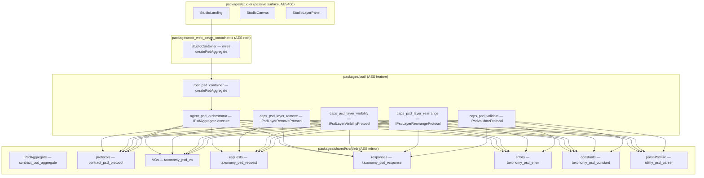
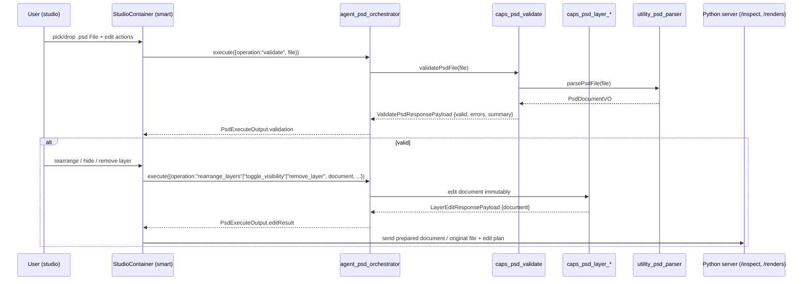
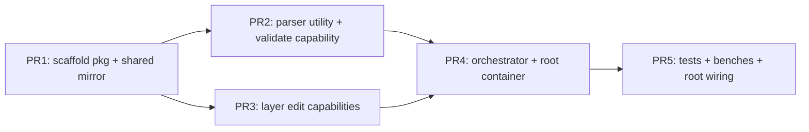

# Plan — New TypeScript package `packages/psd/` (PSD adapter)

**Title:** Plan document for `packages/psd/` — client-side PSD parse, validate, and simple layer-edit adapter package  
**Author:** @raka (placeholder)  
**Date:** 2026-11-20  
**Status:** Draft  
**PLAN_ID:** 56d10c44  
**default_branch:** main  
**Repo:** /home/raka/Project/psd-timelapse  

---

## Overview

PSD Timelapse converts layered Photoshop documents into MP4 timelapse renders. Today the web UI can pick a `.psd` file, send its server path to the Python API via `packages/client/` (HTTP transport + SSE), and inspect the resulting layer list — but there is no client-side package that parses an uploaded PSD file in the browser, validates it before it is sent to the Python server, or prepares/previews a PSD with simple layer edits (rearrange/sort, hide/show visibility, remove layer).

This plan introduces a new TypeScript feature package `packages/psd/` modeled on the existing AES TypeScript package `packages/client/` (see `packages/client/FRD.md`, `packages/client/BACKLOG.md`, and `ARCHITECTURE.md` AES 7-layer model). `packages/psd/` follows the existing single-workspace pattern used by `packages/client/`: there is **no per-member `package.json` or `tsconfig.json`**. The workspace `packages/package.json` (`"name": "psd-web"`) is unchanged, and `packages/psd/` is registered through `packages/root_tsconfig_entry.json` (`@psd/*` path + `psd/src`, `psd/tests`, `psd/benches` in `include`) and `packages/root_config_vite_entry.ts` (`@psd` alias). The package owns client-side PSD document handling: parse a user-uploaded `File`, validate it, apply in-memory layer edits, and expose a prepared/preview document plus an optional serialized blob ready to send to the Python server. The `packages/studio/` surface remains passive and will call into this package through its smart container (`StudioContainer` in `packages/root_web_smart_container.ts`) in a later PR.

The package delivers exactly three AES layer pieces:
- `agent_psd_orchestrator` — agent layer orchestrator (single `execute` dispatch over `IPsdAggregate`).
- `capabilities_psd_<namefeature>` — capabilities layer (validate, layer sort/rearrange, visibility/hide, remove layer).
- `root_psd_container` — root layer composition container wiring all capabilities into the `IPsdAggregate` facade.

It also adds the required `shared/src/psd/` mirror (taxonomy + contract + utility), `FRD.md`/`BACKLOG.md` doc pair, tests, and benches per AES702/AES704.

---

## Background & Motivation

### Current state

- `packages/client/` owns the web UI transport boundary: HTTP (`IClientTransportProtocol`), inspect (`IClientInspectProtocol`), render lifecycle (`IClientRenderProtocol`), SSE stream (`IClientStreamProtocol`), system (`IClientSystemProtocol`), composed by `ClientOrchestrator implements IClientAggregate` and wired by `createClientAggregate` in `packages/client/src/root_client_container.ts`.
- `packages/shared/src/client/` holds the mirrored contract/taxonomy/utility for the client transport layer (`contract_client_protocol.ts`, `contract_client_aggregate.ts`, `taxonomy_client_vo.ts`, `taxonomy_client_request.ts`, `taxonomy_client_response.ts`, `taxonomy_client_error.ts`, `taxonomy_client_constant.ts`, `utility_client_parser.ts`, `utility_client_url.ts`, barrel `index.ts`).
- `packages/studio/` is a passive surface layer: `surface_studio_landing_component.tsx` (`StudioLanding`), `surface_studio_canvas_component.tsx` (`StudioCanvas`, file pick/drag-drop `accept=".psd,image/*`), `surface_studio_layer_panel_component.tsx` (`StudioLayerRow { id, label, visible, classification? }`, visibility toggle, select, empty state "No PSD imported yet."). `StudioContainer` in `packages/root_web_smart_container.ts` owns `selectedFile`, `serverPath`, `inspectState`, calls `client.inspectFull(serverPath)`, maps `InspectFullVO.layers` into `StudioLayerRow[]`, and `handleRender` calls `startRender` then `persistActiveRun` and routes to `#queue`.
- The Python side already parses/validates PSD: `modules/scripting/src/capabilities_psdtools_adapter.py` (`validate_psd`, `get_psd_info`, `load_psd_for_input`) behind `modules/shared/src/scripting/contract_psd_reader_protocol.py` (`IPsdInputProtocol`), with errors `PsdParseError`/`PsdValidationError` in `modules/shared/src/scripting/taxonomy_scripting_error.py`.

### Pain points

1. No client-side validation occurs before a PSD path is sent to the Python server; invalid/corrupt files round-trip to the API only to be rejected (cf. `InspectController` rejecting non-`.psd` / missing files with 400).
2. No client-side PSD document model exists in TypeScript; layer metadata only arrives as wire `LayerPayload[]` after server inspection.
3. Studio's layer reorder/hide/remove UI needs (rearrange sort, hide/visibility, remove layer) have no backing capability — there is nothing to call from the smart container.
4. No preview/prepare step exists: the user cannot rearrange/hide/remove layers locally and see a prepared PSD before submitting to the render pipeline.

### Why now

The studio page already has passive layer reorder/hide/remove UI affordances (`⋮` menu per row, visibility `👁`/`Ø` toggle, search, empty state). Wiring them requires a client-side PSD adapter that can mutate an in-memory document and expose the result. `packages/psd/` is that adapter, following the same AES conventions the codebase already enforces via `lint-arwaky`.

---

## Goals & Non-Goals

### Goals

1. Create `packages/psd/` as an AES-compliant TypeScript feature package (vertical slice, not layered folders).
2. Deliver three AES layer pieces: `agent_psd_orchestrator`, `capabilities_psd_*` (validate + three layer edits), `root_psd_container`.
3. Mirror `shared/src/psd/` with taxonomy, contract (protocol + aggregate), utility, and barrel `index.ts` per AES702 (`shared/src/<feature>/` mirror).
4. Support: parse user-uploaded `File` into an in-memory `PsdDocumentVO`; validate before sending to the Python server; apply rearrange/sort, toggle visibility, remove layer edits immutably; expose a prepared/preview document and optional serialized `Blob`.
5. Follow AES101/AES102 naming, AES201 import matrix, AES301/AES302 line limits, AES403 capability block structure, AES405 agent discipline, AES406 surface discipline, AES503/AES505 orphan wiring, AES702 feature health, AES704 test+bench coverage, AES705 member-root placement, AES706 PR-ID folder mapping. Feature folders carry `FRD.md` + `BACKLOG.md` only (AES702); `DESIGN.md` is surface-only (AES703) and is not required for `packages/psd/`. This matches `packages/client/`, which has only `FRD.md` + `BACKLOG.md`.
6. Add vitest tests (`packages/psd/tests/`, AES103 prefixes) and benches (`packages/psd/benches/`, `bench_` prefix).
7. Add `FRD.md` + `BACKLOG.md` doc pair with FR ids prefixed `FR-PSD-...`.
8. Keep `packages/studio/` passive: studio does not import psd capabilities/contract/agent in this plan; integration via smart container is future work.

### Non-Goals

- Modifying Python server endpoints or the FastAPI surface (`modules/api/src/surface_api_controller.py`).
- Wiring `packages/psd/` into `StudioContainer`/`root_web_smart_container.ts` (deferred to a later PR).
- Changing `packages/client/` transport or adding routes to it.
- Persistent storage, migration, or server-side schema changes (client-side in-memory only).
- Full PSD read/write fidelity (parse targets the document model needed for inspect/validate/preview; round-trip byte fidelity is a future concern).
- A production-grade general-purpose PSD parser if a suitable dependency is unavailable (see Open Questions).

---

## Proposed Plan

### Package layout (AES702 vertical slice)

```
packages/psd/
├── FRD.md
├── BACKLOG.md
├── src/
│   ├── index.ts                                  (barrel)
│   ├── agent_psd_orchestrator.ts                 (agent: IPsdAggregate impl)
│   ├── root_psd_container.ts                     (root: createPsdAggregate)
│   ├── capabilities_psd_validate.ts              (capabilities: validate)
│   ├── capabilities_psd_layer_rearrange.ts       (capabilities: sort/rearrange)
│   ├── capabilities_psd_layer_visibility.ts      (capabilities: hide/show)
│   └── capabilities_psd_layer_remove.ts          (capabilities: remove layer)
├── tests/
│   ├── unit_psd_validate.test.ts
│   ├── unit_psd_layer_rearrange.test.ts
│   ├── unit_psd_layer_visibility.test.ts
│   ├── unit_psd_layer_remove.test.ts
│   ├── unit_psd_orchestrator.test.ts
│   ├── contract_psd_protocol.test.ts
│   ├── contract_psd_schema.test.ts
│   ├── integration_psd_flow.test.ts
│   └── smoke_psd_aggregate.test.ts
└── benches/
    └── bench_psd_parse.ts
```

**Package-config note (single-workspace pattern).** `packages/psd/` does **not** carry its own `package.json` or `tsconfig.json`. Verified on this host: `ls packages/client/` shows only `BACKLOG.md`, `FRD.md`, `src/`, `tests/` — no per-member `package.json`/`tsconfig.json` exists anywhere under `packages/`. All TypeScript packages share the single workspace `packages/package.json` (`"name": "psd-web"`, unchanged) and the single `packages/root_tsconfig_entry.json` (`include` + `paths`). To register the new package, add the `@psd/*` path alias and the `psd/src`, `psd/tests`, `psd/benches` `include` entries to `packages/root_tsconfig_entry.json`, and the `@psd` alias to `packages/root_config_vite_entry.ts`.

`packages/shared/src/psd/` mirror:

```
packages/shared/src/psd/
├── index.ts                                      (barrel)
├── taxonomy_psd_vo.ts                            (PsdDocumentVO, LayerVO, PsdExecuteInput/Output, PsdFileInfoVO, PsdEditOperationVO, error VOs)
├── taxonomy_psd_request.ts                       (ValidatePsdRequest, RearrangeLayersRequest, ToggleVisibilityRequest, RemoveLayerRequest)
├── taxonomy_psd_response.ts                      (ValidatePsdResponsePayload, LayerEditResponsePayload)
├── taxonomy_psd_error.ts                         (PsdError, PsdParseError, PsdValidationError)
├── taxonomy_psd_constant.ts                      (MAX_PSD_FILE_SIZE_BYTES, MAX_LAYER_COUNT, PSD_MAGIC_BYTES)
├── contract_psd_protocol.ts                      (IPsdValidateProtocol, IPsdLayerRearrangeProtocol, IPsdLayerVisibilityProtocol, IPsdLayerRemoveProtocol)
├── contract_psd_aggregate.ts                     (IPsdAggregate)
└── utility_psd_parser.ts                         (parsePsdFile, serializePsdDocument — stateless)
```

### Mermaid: package & layer architecture



### Mermaid: data flow (parse → validate → edit → preview)



### Detailed design

#### shared/src/psd/taxonomy_psd_vo.ts (taxonomy)
Domain VOs for the psd feature. Imports only taxonomy (AES201 row 1–4).

```ts
export interface PsdFileInfoVO {
  readonly name: string;
  readonly sizeBytes: number;
  readonly type: string;
}
export interface LayerBoundsVO {
  readonly x: number;
  readonly y: number;
  readonly width: number;
  readonly height: number;
}
export interface LayerVO {
  readonly id: string;            // synthetic stable id, e.g. "layer-0"
  readonly name: string;
  readonly visible: boolean;
  readonly bounds: LayerBoundsVO;
  readonly classification?: string;
}
export interface PsdDocumentVO {
  readonly width: number;
  readonly height: number;
  readonly layerCount: number;
  readonly layers: readonly LayerVO[];
  readonly colorMode?: string;
  readonly sourceFile?: PsdFileInfoVO;
}
export type PsdEditOperationVO =
  | "validate"
  | "rearrange_layers"
  | "toggle_visibility"
  | "remove_layer";
export interface PsdExecuteInput {
  readonly operation: PsdEditOperationVO;
  readonly file?: File;
  readonly document?: PsdDocumentVO;
  readonly layerId?: string;
  readonly visible?: boolean;
  readonly fromIndex?: number;
  readonly toIndex?: number;
}
export interface PsdExecuteOutput {
  readonly operation: PsdEditOperationVO;
  readonly validation?: PsdValidationVO;
  readonly document?: PsdDocumentVO;
  readonly editResult?: PsdEditResultVO;
  readonly blob?: Blob;
}
export interface PsdValidationVO {
  readonly valid: boolean;
  readonly errors: readonly string[];
  readonly summary: Record<string, unknown>;
  readonly layerCount: number;
}
export interface PsdEditResultVO {
  readonly ok: boolean;
  readonly editedLayerId?: string;
  readonly layerCount: number;
}
```

Taxonomy files are not subject to the "max 3" type-declaration cap that applies to capabilities/agent; each interface is grouped here by role while staying focused.

**Smart-container mapping obligation (deferred PR).** `LayerVO` carries `name` (the raw PSD layer name) plus a synthetic `id`, while `StudioLayerRow` (`packages/studio/src/surface_studio_layer_panel_component.tsx`) carries `label` (not `name`) plus `id`. The future smart-container PR must map `LayerVO.name → StudioLayerRow.label` while preserving the synthetic `id` — exactly as `StudioContainer` already does for inspected layers at `packages/root_web_smart_container.ts` line 477 (`id: layer.name, label: layer.name`). This plan keeps studio passive and untouched; the obligation is recorded here so the deferred wiring PR does not discover a field-name mismatch.

#### shared/src/psd/contract_psd_protocol.ts (contract/protocol)
Mandatory import of taxonomy; allowed taxonomy+contract.

```ts
import type { PsdDocumentVO, PsdFileInfoVO, LayerVO } from "./taxonomy_psd_vo.js";

export interface IPsdValidateProtocol {
  validatePsdFile(file: File): Promise<PsdValidationVO>;
  validatePsdDocument(document: PsdDocumentVO): PsdValidationVO;
}

export interface IPsdLayerRearrangeProtocol {
  rearrangeLayers(document: PsdDocumentVO, fromIndex: number, toIndex: number): PsdDocumentVO;
}

export interface IPsdLayerVisibilityProtocol {
  toggleVisibility(document: PsdDocumentVO, layerId: string, visible: boolean): PsdDocumentVO;
}

export interface IPsdLayerRemoveProtocol {
  removeLayer(document: PsdDocumentVO, layerId: string): PsdDocumentVO;
}
```

#### shared/src/psd/contract_psd_aggregate.ts (contract/aggregate)

```ts
import type { PsdExecuteInput, PsdExecuteOutput } from "./taxonomy_psd_vo.js";

export interface IPsdAggregate {
  execute(input: PsdExecuteInput): Promise<PsdExecuteOutput>;
}
```

#### shared/src/psd/utility_psd_parser.ts (utility)
AES404: stateless standalone functions only; imports only taxonomy.

```ts
import type { PsdDocumentVO, LayerVO, LayerBoundsVO } from "./taxonomy_psd_vo.js";

export const PSD_MAGIC_BYTES = new Uint8Array([0x38, 0x42, 0x50, 0x53]); // "8BPS"

export function parsePsdFile(file: File): Promise<PsdDocumentVO> { ... }
export function serializePsdDocument(document: PsdDocumentVO): Promise<Blob> { ... }
export function validateMagicBytes(bytes: Uint8Array): boolean { ... }
```

**Extension + magic-byte validation.** `parsePsdFile` (and the validate capability's `validatePsdFile`) checks both the file extension and the magic bytes, mirroring the Python side:
- **Extension check:** reject any file whose `name` does not end in `.psd` (case-insensitive) with `PsdValidationError` carrying `code: "INVALID_EXTENSION"` and `retryable: false`, mirroring the Python `CapabilitiesPsdToolsAdapter.validate_psd` message: `"Unsupported file extension. Only .psd is supported: <path>"`. This matters because the studio canvas picker uses `accept=".psd,image/*"` (`surface_studio_canvas_component.tsx`), which lets non-PSD images through the picker — the extension check is the first gate before magic-byte parsing.
- **Magic-byte check:** reject bytes not starting with `8BPS` with `PsdValidationError` (`INVALID_FORMAT`).

**Parse strategy (main-thread v1, async signature).** v1 runs on the main thread with an async `Promise<PsdDocumentVO>` signature kept stable so a future Web Worker offload does not change the call contract. Profiling trigger: if `bench_psd_parse.ts` shows parse p95 > 500 ms on a 100 MB fixture, open a worker-offload PR.

#### capabilities_psd_validate.ts (capabilities)
AES403: Block 1 declaration, Block 2 protocol impl precedes Block 3 inherent helpers. Max 3 type declarations. Implements `IPsdValidateProtocol`. Never imports other capabilities. Imports taxonomy + contract(protocol) + utility.

#### capabilities_psd_layer_rearrange.ts / capabilities_psd_layer_visibility.ts / capabilities_psd_layer_remove.ts
Same 3-block structure, each implementing exactly one protocol.

#### agent_psd_orchestrator.ts (agent)
AES405: implements `IPsdAggregate`; depends on contract(aggregate) mandatory + contract(protocol) + utility; ≥2 injected protocol subsystems (validate + at least one layer-edit protocol); no business calculation, no I/O, no computation, stateless, no free fns, max 3 type declarations, no `any`.

Single `execute(input)` dispatches on `input.operation` and delegates to injected protocols, mapping wire/request shapes to `PsdExecuteOutput`. **Dispatch shape:** a `switch (operation)` with one `case` per operation returning `this.<protocol>.<method>(...)` — no module-level dispatch table and no module-level free functions (AES405 sub-check 10 `check_agent_free_fn`). This mirrors `packages/client/src/agent_client_orchestrator.ts` line 69 (`switch (operation)`).

#### root_psd_container.ts (root)
`createPsdAggregate(config?)` constructs the four capabilities and the orchestrator, returns `IPsdAggregate`. No business logic. Wires all capabilities → satisfies AES503/AES505 orphan rules.

#### package.json / tsconfig / vite / root wiring
- `packages/psd/` follows the single-workspace pattern: **no per-member `package.json` or `tsconfig.json`** (verified: `packages/client/` has neither; see Issue 1 resolution). The workspace `packages/package.json` (`"name": "psd-web"`) is unchanged.
- Add `@psd/*` path alias + `psd/src`, `psd/tests`, `psd/benches` `include` entries to `packages/root_tsconfig_entry.json`.
- Add `@psd` alias to `packages/root_config_vite_entry.ts`.
- `FRD.md` + `BACKLOG.md` (FR ids `FR-PSD-001…`; PR id candidate `PR-PSD-016`, see Open Questions).

#### Shared-layer doc-pair registration (AES701 / AES608)

The `packages/shared/src/psd/` mirror is not self-documenting; AES701 (shared folder purity) requires the shared layer to carry a `DATA.md` + `BACKLOG.md` doc pair, and AES608 (`DT-<NAME>-NNN` format) requires new shared data shapes to be registered as `DT-PSD-*` entries. PR1 therefore also edits the two shared docs, mirroring the existing `DT-SHARED-001` table shape (`ID | Field | Type | Description`) in `packages/shared/DATA.md` and the `DT-SHARED-001` backlog block (`ID | Data Ref | Work Item | Priority | State | Actual Condition | Owner | Dependencies | Updated`) in `packages/shared/BACKLOG.md`.

New `DT-PSD-*` entries to add to `packages/shared/DATA.md` (continuing after `DT-SHARED-005`):

- **DT-PSD-001: PSD domain value objects** — `PsdDocumentVO`, `LayerVO`, `LayerBoundsVO`, `PsdFileInfoVO`, `PsdValidationVO`, `PsdEditResultVO`, `PsdEditOperationVO` (vo).
- **DT-PSD-002: PSD aggregate dispatch envelope** — `PsdExecuteInput`, `PsdExecuteOutput` (vo), `IPsdAggregate` (aggregate).
- **DT-PSD-003: PSD requests and responses** — `ValidatePsdRequest`, `RearrangeLayersRequest`, `ToggleVisibilityRequest`, `RemoveLayerRequest` (request); `ValidatePsdResponsePayload`, `LayerEditResponsePayload` (response).
- **DT-PSD-004: PSD error taxonomy and constants** — `PsdError` (base, retryable flag), `PsdParseError`, `PsdValidationError` (error); `PSD_MAGIC_BYTES`, `MAX_PSD_FILE_SIZE_BYTES`, `MAX_LAYER_COUNT` (constant).
- **DT-PSD-005: PSD subsystem protocols** — `IPsdValidateProtocol`, `IPsdLayerRearrangeProtocol`, `IPsdLayerVisibilityProtocol`, `IPsdLayerRemoveProtocol` (protocol).

Matching `DT-PSD-001`…`DT-PSD-005` blocks to add to `packages/shared/BACKLOG.md` (each `State: Planned`, `Dependencies: None` for 001/002, chained for 003–005), plus the `DT-PSD-*` rows to the backlog's `Progress Overview`. `packages/shared/BACKLOG.md` `Last Updated` bumped to 2026-11-20.

### Mermaid: PR dependency graph



> PR3 (layer-edit capabilities) depends only on PR1; PR2 is a soft dependency (needed only by the validate capability's tests, not by the edit capabilities).

---

## API / Interface Changes

### New public surface (`packages/psd/`)

| Module | Export | Kind |
|--------|--------|------|
| `packages/psd/src/root_psd_container.ts` | `createPsdAggregate(config?)` | function |
| `packages/psd/src/agent_psd_orchestrator.ts` | `PsdOrchestrator`, `PsdOrchestratorDeps` | class + type |
| `packages/psd/src/capabilities_psd_validate.ts` | `PsdValidate` | class |
| `packages/psd/src/capabilities_psd_layer_rearrange.ts` | `PsdLayerRearrange` | class |
| `packages/psd/src/capabilities_psd_layer_visibility.ts` | `PsdLayerVisibility` | class |
| `packages/psd/src/capabilities_psd_layer_remove.ts` | `PsdLayerRemove` | class |
| `packages/psd/src/index.ts` | barrel re-export of all above | barrel |

### New shared contract (`packages/shared/src/psd/`)

| Module | Export | Kind |
|--------|--------|------|
| `contract_psd_aggregate.ts` | `IPsdAggregate` | interface |
| `contract_psd_protocol.ts` | `IPsdValidateProtocol`, `IPsdLayerRearrangeProtocol`, `IPsdLayerVisibilityProtocol`, `IPsdLayerRemoveProtocol` | interfaces |
| `taxonomy_psd_vo.ts` | `PsdDocumentVO`, `LayerVO`, `PsdExecuteInput`, `PsdExecuteOutput`, `PsdValidationVO`, `PsdEditResultVO`, … | types |
| `taxonomy_psd_request.ts` | `ValidatePsdRequest`, `RearrangeLayersRequest`, `ToggleVisibilityRequest`, `RemoveLayerRequest` | types |
| `taxonomy_psd_response.ts` | `ValidatePsdResponsePayload`, `LayerEditResponsePayload` | types |
| `taxonomy_psd_error.ts` | `PsdError`, `PsdParseError`, `PsdValidationError` | classes |
| `taxonomy_psd_constant.ts` | `PSD_MAGIC_BYTES`, `MAX_PSD_FILE_SIZE_BYTES`, `MAX_LAYER_COUNT` | const |
| `utility_psd_parser.ts` | `parsePsdFile`, `serializePsdDocument`, `validateMagicBytes` | functions |
| `index.ts` | barrel re-export | barrel |

### No changes to existing APIs

`packages/client/*`, `packages/shared/src/client/*`, `packages/studio/*`, `packages/root_web_*.ts`, `modules/api/*` are untouched in this plan. Studio integration (smart container wiring `createPsdAggregate`) is a later PR and not part of this API surface.

---

## Data Model Changes

No persistent schema or migration. All changes are in-memory TypeScript VOs under `packages/shared/src/psd/`:

- `PsdDocumentVO` — in-memory parsed PSD (width, height, layers[]).
- `LayerVO` — single layer with id, name, visible, bounds, optional classification.
- `PsdExecuteInput` / `PsdExecuteOutput` — aggregate dispatch envelope mirroring `ClientExecuteInput`/`ClientExecuteOutput`.
- `PsdValidationVO` — validation result (valid, errors, summary, layerCount).
- `PsdEditResultVO` — edit result (ok, editedLayerId, layerCount).
- Error VOs follow the `ClientError` pattern (`code`, `retryable`, `status`, `cause`) via `PsdError` base.

Storage estimate: a parsed document model is small (KB) even for a multi-hundred-MB PSD because only layer metadata (name, bounds, visibility) is retained, not pixel data. Parse latency target: < 2 s for a ≤ 500 MB PSD on the main thread (offload to a Web Worker if profiling shows jank — future work).

---

## Alternatives Considered

### Alternative A (chosen): New dedicated `packages/psd/` feature package

Client-side parse/validate/edit following the AES 7-layer model, mirroring `packages/client/`.

**Pros:**
- Follows existing AES conventions exactly (suffix policy, import matrix, block structure, orphan wiring, doc pair, tests/benches).
- Vertical slice: client-side validation happens before any server round-trip, satisfying the core goal ("validate that PSD before it is sent to the Python server").
- Preview/prepare edits happen in-memory with zero server latency; studio can wire via smart container later without touching passive surfaces.
- Low blast radius: no existing files modified except root tsconfig/vite alias registration.

**Cons:**
- Requires a PSD parsing strategy in the browser (no psd library currently in `node_modules`); see Open Question 1.
- Adds a new package to maintain.

### Alternative B: Extend `packages/client/` with psd capabilities

Add `capabilities_client_psd_validate.ts` etc. to `packages/client/src/`.

**Pros:** No new package; reuses existing `shared/src/client/` barrel.

**Cons:**
- `packages/client/` is the HTTP transport/SSE boundary, not a document-editing domain; adding parse/edit capabilities there conflates transport with document modeling and violates vertical slicing (AES702 feature-folder health — a feature folder should own its own capabilities+agent+root).
- Bloats the client aggregate's `execute` operation union with non-transport operations.
- Rejected.

### Alternative C: Server-only validation/editing via Python (`modules/scripting/`)

Keep all PSD handling on the Python server; add new `/psd-validate`/`/psd-edit` FastAPI endpoints; client only sends file and receives results.

**Pros:** Reuses battle-tested `psd_tools` parsing (`capabilities_psdtools_adapter.py`); no browser parser needed.

**Cons:**
- Violates the explicit goal to validate before sending to the Python server and to preview edits locally.
- Every edit (hide/reorder/remove) incurs a network round-trip; poor preview UX.
- Requires modifying `modules/api/src/surface_api_controller.py` and adding routes — out of scope.
- Rejected for v1; server-side remains the source of truth for the final render.

---

## Security & Privacy Considerations

| Threat | Severity | Mitigation |
|--------|----------|------------|
| Malicious/corrupt PSD triggers parser DoS or excessive memory | High | Cap `MAX_PSD_FILE_SIZE_BYTES` (default 500 MB, matching studio empty-state hint) and `MAX_LAYER_COUNT`; validate magic bytes `8BPS` before full parse; surface `PsdParseError` with retryable=false. |
| Arbitrary file read via path traversal | Medium | `packages/psd/` operates on browser `File` objects only, never on filesystem paths; no path-based APIs exposed. |
| XSS via layer names rendered in Studio layer panel | Medium | Sanitize/escape layer `name`/`classification` when mapping to `StudioLayerRow` in the smart container (future PR); `LayerVO.name` treated as untrusted text. |
| Prototype pollution via crafted layer names (`__proto__`, `constructor`, `toString`) | Low | Sanitize `LayerVO.name`/`LayerVO.classification` with a `sanitizeName()` utility mirroring Python `sanitize_name` (`modules/shared/src/scripting/utility_scripting_geometry.py` line 18, used in `capabilities_psdtools_adapter.py` line 213). Never use layer names as plain-object keys; use a `Map` or prefix keys so `__proto__`/`constructor`/`toString` cannot pollute object prototypes. |
| Sensitive design content leaves the client unintentionally | Low | PSD content is only transmitted to the configured local API (`http://127.0.0.1:8000/api` default) after explicit user render action; no third-party telemetry. |
| No auth model in scope | Low | Local tool; auth is owned by the Python API surface, not this package. |

Error taxonomy mirrors `packages/shared/src/client/taxonomy_client_error.ts` (`ClientError` base with `retryable` flag) so callers never inspect status codes to decide retry eligibility.

---

## Observability

- **Logging:** client-side structured log messages via `console` with a `psd` namespace (e.g. `psd:parse start sizeBytes=...`, `psd:validate valid=false errors=...`). No TS logging utility currently exists in `packages/shared/`; a dedicated utility can be added later. Avoid logging pixel data or layer content; log counts and error codes only.
- **Metrics (client-side, aggregated by the embedding app if desired):** parse latency (ms), validation pass/fail rate, edit operation counts (rearrange/toggle/remove), layer count distribution. Targets: parse p95 < 2 s for ≤ 500 MB; validation failure rate < 1% on well-formed uploads. **Profiling trigger:** if `bench_psd_parse.ts` shows parse p95 > 500 ms on a 100 MB fixture, open a worker-offload PR. v1 is main-thread with an async `Promise<PsdDocumentVO>` signature kept stable so worker offload does not change the contract.
- **Alerting:** none owned by this package; surfaced to the user as `PsdError` with `code` and `message` via the studio error path.
- **Errors:** `PsdError` base (retryable flag), `PsdParseError`, `PsdValidationError` — matches Python `PsdParseError`/`PsdValidationError` naming for cross-stack consistency.

---

## Rollout Plan

- **Feature flags:** none required for the package itself (it is an internal, un-wired library). When `StudioContainer` wires `createPsdAggregate` in a later PR, gate behind a studio feature flag defaulting off.
- **Staged rollout:** PR1–PR5 merge to `main` (package exists, tested, not yet called by UI). Studio integration PR follows, enabled by flag.
- **Rollback:** remove `packages/psd/`, revert `root_tsconfig_entry.json`/`root_config_vite_entry.ts` alias registration; no data migration or server change to reverse.
- **Verification:** `npm test -- --run` (vitest over `packages/psd/tests/`), `uv run ruff check modules/` unchanged, `lint-arwaky-cli scan .` passes for the new package (AES rules).

---

## References

- [PRD.md](/home/raka/Project/psd-timelapse/PRD.md) — product scope; PSD → MP4 flow, validate document and map layers.
- [ROADMAP.md](/home/raka/Project/psd-timelapse/ROADMAP.md) — PR-PSD-001…015; candidate PR-PSD-016 for this package.
- [ARCHITECTURE.md](/home/raka/Project/psd-timelapse/ARCHITECTURE.md) — AES101–AES706 rules cited throughout.
- [CONTRIBUTING.md](/home/raka/Project/psd-timelapse/CONTRIBUTING.md) — setup and ship conventions.
- [packages/client/FRD.md](/home/raka/Project/psd-timelapse/packages/client/FRD.md) and [packages/client/BACKLOG.md](/home/raka/Project/psd-timelapse/packages/client/BACKLOG.md) — doc pair template to mirror.
- [packages/client/src/agent_client_orchestrator.ts](/home/raka/Project/psd-timelapse/packages/client/src/agent_client_orchestrator.ts) — agent orchestrator pattern to mirror.
- [packages/client/src/capabilities_client_inspect.ts](/home/raka/Project/psd-timelapse/packages/client/src/capabilities_client_inspect.ts) — 3-block capability pattern.
- [packages/client/src/root_client_container.ts](/home/raka/Project/psd-timelapse/packages/client/src/root_client_container.ts) — container wiring pattern.
- [packages/shared/src/client/contract_client_aggregate.ts](/home/raka/Project/psd-timelapse/packages/shared/src/client/contract_client_aggregate.ts) — `IClientAggregate` shape.
- [packages/shared/src/client/contract_client_protocol.ts](/home/raka/Project/psd-timelapse/packages/shared/src/client/contract_client_protocol.ts) — protocol interface shape.
- [packages/shared/src/client/taxonomy_client_vo.ts](/home/raka/Project/psd-timelapse/packages/shared/src/client/taxonomy_client_vo.ts) — VO shape (ClientExecuteInput/Output, LayerPayload).
- [packages/shared/src/client/taxonomy_client_request.ts](/home/raka/Project/psd-timelapse/packages/shared/src/client/taxonomy_client_request.ts) — request shape.
- [packages/shared/src/client/taxonomy_client_response.ts](/home/raka/Project/psd-timelapse/packages/shared/src/client/taxonomy_client_response.ts) — response shape (LayerPayload, InspectResponsePayload).
- [packages/shared/src/client/taxonomy_client_error.ts](/home/raka/Project/psd-timelapse/packages/shared/src/client/taxonomy_client_error.ts) — error taxonomy pattern.
- [packages/shared/src/client/index.ts](/home/raka/Project/psd-timelapse/packages/shared/src/client/index.ts) — barrel pattern.
- [packages/studio/src/surface_studio_layer_panel_component.tsx](/home/raka/Project/psd-timelapse/packages/studio/src/surface_studio_layer_panel_component.tsx) — `StudioLayerRow` integration target.
- [packages/studio/src/surface_studio_canvas_component.tsx](/home/raka/Project/psd-timelapse/packages/studio/src/surface_studio_canvas_component.tsx) — file pick/drag-drop target.
- [packages/studio/src/surface_studio_landing_component.tsx](/home/raka/Project/psd-timelapse/packages/studio/src/surface_studio_landing_component.tsx) — `StudioLanding` composition target.
- [packages/root_web_smart_container.ts](/home/raka/Project/psd-timelapse/packages/root_web_smart_container.ts) — `StudioContainer` smart-container target.
- [packages/root_web_container.ts](/home/raka/Project/psd-timelapse/packages/root_web_container.ts) — `createWebDependencies` wiring target.
- [packages/root_tsconfig_entry.json](/home/raka/Project/psd-timelapse/packages/root_tsconfig_entry.json) — path aliases + include to extend.
- [packages/root_config_vite_entry.ts](/home/raka/Project/psd-timelapse/packages/root_config_vite_entry.ts) — vite alias to extend.
- [modules/scripting/src/capabilities_psdtools_adapter.py](/home/raka/Project/psd-timelapse/modules/scripting/src/capabilities_psdtools_adapter.py) — Python PSD reference (`validate_psd`, `get_psd_info`).
- [modules/shared/src/scripting/contract_psd_reader_protocol.py](/home/raka/Project/psd-timelapse/modules/shared/src/scripting/contract_psd_reader_protocol.py) — `IPsdInputProtocol` reference.
- [modules/shared/src/scripting/taxonomy_scripting_error.py](/home/raka/Project/psd-timelapse/modules/shared/src/scripting/taxonomy_scripting_error.py) — `PsdParseError`/`PsdValidationError` reference.

---

## Open Questions

1. **PSD parsing library (decision gate — must be resolved before PR2 starts):** No PSD parser exists in `node_modules` (checked `@adobe` and `psd-*` — absent). Decide: add a browser PSD parsing dependency, or write a minimal `parsePsdFile` in `utility_psd_parser.ts` supporting the subset needed (header, layer count, names, bounds, visibility) and fall back to server inspection for full fidelity. Owner: @raka; deadline: before PR2 is scheduled. Until resolved, PR2 scope is reduced to `validateMagicBytes` + `validatePsdDocument` only and `parsePsdFile` is deferred to PR2a (which depends on this decision). Parser unit tests follow `packages/client/tests/unit_client_parser.test.ts` as the pattern.
2. **v1 output shape:** Is a serialized PSD `Blob` (for sending a modified file to the server) in scope, or is v1 limited to the in-memory `PsdDocumentVO` preview plus an "edit plan" sent alongside the original file?
3. **PR / FR id:** `packages/client/` is `PR-PSD-004`; the next candidate is `PR-PSD-016` (after `PR-PSD-015: system`). Confirm the FR id prefix `FR-PSD-...` and the assigned PR number with the roadmap owner before creating `FRD.md`/`BACKLOG.md`.
4. **Studio wiring:** Exactly how `StudioContainer` exposes psd edit actions (new props on `StudioLanding`/`StudioCanvas`/`StudioLayerPanel`, or a separate edit toolbar) is deferred; this plan keeps studio passive and untouched.
5. **Error mapping:** Whether `PsdError` maps directly to UI error display or is adapted through the existing `ClientError`/`ApiTransportError` envelope when the prepared document is eventually sent to the server.

---

## Key Decisions

1. **Mirror `packages/client/` exactly:** `packages/psd/` follows the same AES layout, 3-block capability structure, orchestrator/container split, test-prefix convention, and FRD/BACKLOG doc pair. Rationale: consistency with the only existing TS feature package and the lint rules enforced by `lint-arwaky-cli`.
2. **Four capabilities, one protocol each:** `validate`, `layer_rearrange`, `layer_visibility`, `layer_remove`, each in its own file implementing exactly one protocol (AES403 single-protocol per capability; avoids CapabilityMultiProtocol).
3. **Agent depends on contracts only:** `agent_psd_orchestrator` depends on `IPsdAggregate` (mandatory) and the protocols, never concrete capabilities (AES405); the container injects protocol-typed instances (AES503/AES505 orphan compliance).
4. **Client-side in-memory document model:** edits are immutable transformations on `PsdDocumentVO`; preview is synchronous in the UI; serialization to `Blob` is optional/v1-deferred. Rationale: satisfies "prepare/preview" and "validate before send" without network round-trips per edit.
5. **Studio stays passive:** `packages/studio/` imports nothing from `packages/psd/` in this plan; the smart container (`root_web_smart_container.ts`) is the only layer allowed to import the psd aggregate (AES406).
6. **No server changes:** Python API (`modules/api/`, `modules/scripting/`) untouched; validation is additive client-side gating before the existing `/inspect`/`/renders` flow.

---

## Revision Summary

This revision pass addressed all 12 review issues (1 critical, 2 major, 9 minor):

- **Issue 1 (critical, single-workspace pattern):** Removed `packages/psd/package.json` and `packages/psd/tsconfig.json` from the layout, package-config section, and PR1. Added an explicit note that `packages/psd/` follows the existing single-workspace pattern (`@psd/*` alias in `root_config_vite_entry.ts`; `@psd/*` path + `psd/src|tests|benches` in `root_tsconfig_entry.json`; workspace `packages/package.json` unchanged), verified against `ls packages/client/`.
- **Issue 2 (major, shared doc pair):** Added a "Shared-layer doc-pair registration" subsection specifying new `DT-PSD-001..005` entries in `packages/shared/DATA.md` and matching `DT-PSD-*` blocks in `packages/shared/BACKLOG.md`, mirroring the `DT-SHARED-001` table shape; added both files to PR1's file list.
- **Issue 3 (major, parser decision gate):** Made Open Question 1 a hard decision gate with owner/deadline; added a "Decision required" callout to PR2's description with the fallback (`validateMagicBytes` + `validatePsdDocument` only, `parsePsdFile` deferred to PR2a).
- **Issue 4 (minor, extension check):** Added a case-insensitive `.psd` extension check to `parsePsdFile`/validate capability rejecting with `PsdValidationError` code `INVALID_EXTENSION` (mirroring the Python message), noting the studio canvas `accept=".psd,image/*"`.
- **Issue 5 (minor, smoke test name):** Renamed `smoke_psd_transport.test.ts` → `smoke_psd_aggregate.test.ts` in the layout and PR5 file list.
- **Issue 6 (minor, field mapping):** Added a "Smart-container mapping obligation" note that the future smart-container PR maps `LayerVO.name → StudioLayerRow.label` (referencing `root_web_smart_container.ts` line 477).
- **Issue 7 (minor, switch dispatch):** Confirmed the orchestrator uses `switch (operation)` dispatch with no module-level dispatch table or free fns (AES405 sub-check 10), referencing `packages/client/src/agent_client_orchestrator.ts` line 69.
- **Issue 8 (minor, main-thread + profiling trigger):** Stated v1 is main-thread with a stable async `Promise<PsdDocumentVO>` signature; added profiling trigger "if parse p95 > 500 ms on a 100 MB fixture, open a worker-offload PR" referencing `bench_psd_parse.ts` (in both the parser section and Observability).
- **Issue 9 (minor, PR3 dependency):** Fixed PR3's dependency to `PR 1` only (matching the Mermaid), noting PR2 is a soft dependency.
- **Issue 10 (minor, test count guard):** Added expected test count (≥ 30 assertions across 9 files) and a note that `packages/tests/count-guard.mjs` is referenced by `packages/package.json` line 15 `test:count` but does not exist on disk, so PR5 must create it or the assertion counts are the completion criterion.
- **Issue 11 (minor, DESIGN.md):** Added a one-line note that feature folders carry `FRD.md` + `BACKLOG.md` only (AES702); `DESIGN.md` is surface-only (AES703), not required for `packages/psd/`, matching `packages/client/`.
- **Issue 12 (minor, prototype pollution):** Added a security table row for prototype pollution via crafted layer names (`__proto__`, `constructor`, `toString`), referencing Python `sanitize_name` (`utility_scripting_geometry.py` line 18, used in `capabilities_psdtools_adapter.py` line 213) and mandating a `sanitizeName()` utility with `Map`/prefix keys.

---

## PR Plan

### PR 1: Scaffold packages/psd/ package plus shared/src/psd/ mirror
- **Files/components affected:** packages/psd/FRD.md, packages/psd/BACKLOG.md, packages/shared/src/psd/taxonomy_psd_vo.ts, packages/shared/src/psd/contract_psd_protocol.ts, packages/shared/src/psd/contract_psd_aggregate.ts, packages/shared/src/psd/utility_psd_parser.ts, packages/shared/src/psd/taxonomy_psd_error.ts, packages/shared/src/psd/taxonomy_psd_request.ts, packages/shared/src/psd/taxonomy_psd_response.ts, packages/shared/src/psd/taxonomy_psd_constant.ts, packages/shared/src/psd/index.ts, packages/shared/DATA.md (add DT-PSD-001..005), packages/shared/BACKLOG.md (add DT-PSD-001..005 blocks), packages/root_tsconfig_entry.json (add @psd/* alias + psd/src|tests|benches include), packages/root_config_vite_entry.ts (add @psd alias)
- **Dependencies:** None
- **Description:** Create the psd package skeleton with shared taxonomy/contract/utility mirror, FRD/BACKLOG doc pair, DATA.md/BACKLOG.md DT-PSD registration, and root tsconfig/vite alias registration. No per-member package.json/tsconfig.json (single-workspace pattern).

### PR 2: Add PSD parser utility and validate capability
- **Files/components affected:** packages/shared/src/psd/utility_psd_parser.ts, packages/shared/src/psd/taxonomy_psd_error.ts, packages/shared/src/psd/taxonomy_psd_constant.ts, packages/psd/src/capabilities_psd_validate.ts
- **Dependencies:** PR 1
- **Description:** Add stateless PSD parser/validation utility and the validate capability implementing `IPsdValidateProtocol`. **Decision required:** this PR is gated on Open Question 1 (parser strategy) — if no browser PSD dependency is approved, scope reduces to `validateMagicBytes` + `validatePsdDocument` only and `parsePsdFile` is deferred to PR2a (which depends on the dependency decision).

### PR 3: Add layer-edit capabilities (rearrange, visibility, remove)
- **Files/components affected:** packages/psd/src/capabilities_psd_layer_rearrange.ts, packages/psd/src/capabilities_psd_layer_visibility.ts, packages/psd/src/capabilities_psd_layer_remove.ts, packages/shared/src/psd/taxonomy_psd_request.ts, packages/shared/src/psd/taxonomy_psd_response.ts
- **Dependencies:** PR 1
- **Description:** Add three layer-edit capabilities each implementing one protocol (rearrange/sort, toggle visibility, remove layer). PR2 is a soft dependency only (the edit capabilities operate on `PsdDocumentVO`, not on the parser); this matches the Mermaid dependency graph.

### PR 4: Add agent orchestrator and root composition container
- **Files/components affected:** packages/psd/src/agent_psd_orchestrator.ts, packages/psd/src/root_psd_container.ts, packages/psd/src/index.ts
- **Dependencies:** PR 1, PR 2, PR 3
- **Description:** Add the `IPsdAggregate` orchestrator dispatching on operation and the `createPsdAggregate` container wiring all capabilities (AES503/AES505 orphan compliance).

### PR 5: Add tests, benches, and smoke coverage
- **Files/components affected:** packages/psd/tests/unit_psd_validate.test.ts, packages/psd/tests/unit_psd_layer_rearrange.test.ts, packages/psd/tests/unit_psd_layer_visibility.test.ts, packages/psd/tests/unit_psd_layer_remove.test.ts, packages/psd/tests/unit_psd_orchestrator.test.ts, packages/psd/tests/contract_psd_protocol.test.ts, packages/psd/tests/contract_psd_schema.test.ts, packages/psd/tests/integration_psd_flow.test.ts, packages/psd/tests/smoke_psd_aggregate.test.ts, packages/psd/benches/bench_psd_parse.ts
- **Dependencies:** PR 4
- **Description:** Add vitest unit/contract/integration/smoke tests (AES103 prefixes; `smoke_psd_aggregate` proves the aggregate boots and responds — the package does no transport) and a `bench_psd_parse.ts` bench for AES704 coverage. **Test count:** ~9 files with an expected ≥ 30 assertions total (validate: ≥4, rearrange: ≥4, visibility: ≥4, remove: ≥4, orchestrator: ≥4, protocol contract: ≥3, schema contract: ≥3, integration: ≥3, smoke: ≥1). **Count guard:** `packages/tests/count-guard.mjs` is referenced by `packages/package.json` line 15 `test:count` but does **not exist on disk** (verified). PR5 must either create `packages/tests/count-guard.mjs` with an inventory that includes `packages/psd/tests/` or update the existing inventory once the guard is introduced; until then `test:count` is a no-op and the assertion counts above are the completion criterion.