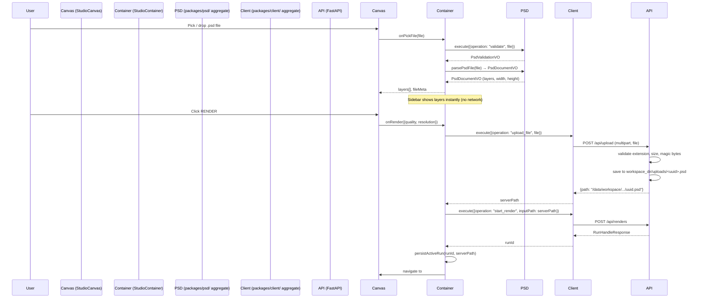

# Plan: Wire `packages/psd/` into StudioContainer for Client-Side PSD Preview & Server Upload on Render

**Author:** [Author placeholder — @raka]
**Date:** 2026-11-20
**Status:** Draft

## Overview

`packages/psd/` (merged in PR #301) ships a complete client-side PSD adapter — `createPsdAggregate()`, four capabilities (`validate`, `layer_rearrange`, `layer_visibility`, `layer_remove`), an orchestrator, and shared taxonomy/contracts under `packages/shared/src/psd/`. It was deliberately not wired into any smart container in that PR; the FRD explicitly says "integration via smart container is future work" (`packages/psd/FRD.md`, `Feature Overview`).

The current Studio page is broken in its primary use case: `StudioContainer.handlePickFile()` in `packages/root_web_smart_container.ts` calls `inspectFull(client, file.name)`, which issues `POST /api/inspect` with the **browser** file name (`design.psd`) as `input_path`. The Python `InspectController` (`modules/api/src/surface_api_inspect_controller.py`) then does `Path("design.psd").is_file()` on the server, which fails, returns 400, and the layers panel shows "No PSD imported yet." Users must manually type an absolute server path to see any layer data.

This plan closes the loop: StudioContainer uses `createPsdAggregate()` from `packages/psd/` to parse and validate the picked/dropped `.psd` file **in the browser** (no network round-trip for preview), and adds a new `POST /api/upload` multipart endpoint on the Python side so that when the user clicks RENDER, StudioContainer uploads the original `File` to the server, receives the server-side path, and calls `startRender(serverPath)` as before. The server-path input field is simplified: it is no longer required for inspection (it never was in the user's mental model), but remains editable for advanced users who already have a server-side path. The existing manual-path `inspect_full` flow continues to work unchanged.

## Background & Motivation

### Current state

- `packages/root_web_smart_container.ts` `StudioContainer` (lines 347–662) owns `selectedFile`, `serverPath`, `inspectState`, and the render lifecycle.
- `handlePickFile(file: File)` (line 422) calls `setServerPath(file.name)` then `executeInspect(file.name)` — sending a browser file name to the server.
- `InspectController.inspect_input` (`modules/api/src/surface_api_inspect_controller.py` line 62) checks `path.is_file()` on the server; the browser file name never exists there, so it returns 400 with `INPUT_MISSING`.
- The studio surfaces (`surface_studio_canvas_component.tsx`, `surface_studio_layer_panel_component.tsx`, `surface_studio_landing_component.tsx`) are pure passive surfaces that receive props and render them. They need **no changes** — only the smart container changes.
- `packages/psd/` already provides everything needed on the client side: `createPsdAggregate()`, `PsdOrchestrator.execute({operation: "validate", file})` returns `PsdValidationVO` (with `valid`, `errors`, `summary`, `layerCount`), and `parsePsdFile(file)` returns `PsdDocumentVO` with `layers: LayerVO[]`.
- The Python API has no multipart/upload endpoint yet. All existing routes are JSON request/response (`/api/inspect`, `/api/renders`, etc.).

### Pain points

1. **User must know the server filesystem layout.** A designer using the Studio page in a browser cannot know that `/absolute/path/on/server/design.psd` is required. The default (file name) silently fails.
2. **No instant feedback.** Even if the user typed a correct server path, the layers panel waits on a network round-trip. A 500 MB PSD takes seconds to parse on the server; the user sees "Inspecting..." with no progress.
3. **No client-side validation.** A corrupt or non-PSD file is only caught after upload, wasting bandwidth and time.
4. **Broken render flow.** Clicking RENDER with a browser file name in the path field fails the same way as inspect — the server never has the file.

### Why now

PR #301 landed the full client-side PSD adapter but explicitly deferred StudioContainer integration. The Studio page is the user-facing surface that motivated the adapter's existence. Until this plan lands, `packages/psd/` is dead code from the user's perspective — no surface consumes it. This plan wires it end-to-end and delivers the promised "instant layers, server upload only on render" UX.

## Goals & Non-Goals

### Goals

1. **Client-side preview/validate:** when the user picks or drops a `.psd` file, StudioContainer uses `createPsdAggregate()` to validate the file in the browser and parse it into a `PsdDocumentVO`. Layers appear in the sidebar panel **instantly**, no network round-trip.
2. **Server upload only on Render:** when the user clicks RENDER, StudioContainer uploads the original `File` via a new `POST /api/upload` endpoint, receives the server-side path, then calls `startRender(serverPath)` as before.
3. **New Python `POST /api/upload` multipart endpoint** that accepts a file, enforces size/type limits, saves it to the configured workspace directory, and returns `{path: string}`.
4. **Client upload capability** following the `packages/client/` 3-block pattern: new `capabilities_client_upload.ts`, `IClientUploadProtocol` in `contract_client_protocol.ts`, `upload_file` operation in the orchestrator, route constant `ROUTE_UPLOAD`, request/response types.
5. **Backward compatibility:** the existing manual server-path `inspect_full` flow continues to work for advanced users who type a valid absolute path and click Inspect.
6. **Tests for all new code** (AES704): Python upload endpoint unit tests, TypeScript client upload capability tests, StudioContainer client-side-psd wiring tests.
7. **AES compliance:** follow AES101/102 naming, AES201 import matrix, AES301/302 line limits, AES403 capability block structure, AES405 agent discipline, AES503/505 orphan wiring, AES702 feature health, AES704 test+bench coverage.

### Non-Goals

- **Full-fidelity PSD parsing.** `packages/psd/` currently does a minimal parse (header + layer count from bytes 10–11, placeholder layer names "Layer 1".."Layer N"). Real layer names, bounds, and classification from the PSD layer records are deferred to a future "full fidelity parse" PR (Open Question 1 in `utility_psd_parser.ts`). This plan wires the adapter as-is; richer parse is a separate effort.
- **Pixel preview in the canvas.** The canvas continues to show the existing SVG placeholder icon. No in-browser rasterization of the PSD.
- **Web Worker offload.** `parsePsdFile` is async (returns `Promise<PsdDocumentVO>`) but runs on the main thread. The async signature is kept stable so a future Web Worker migration does not change call sites; offload itself is out of scope.
- **Changes to passive surfaces.** `packages/studio/src/` (canvas, layer panel, landing) is unchanged. The canvas already has the file picker and drop handlers wired to `onPickFile`.
- **Replace the manual server-path flow.** The server-path input + Inspect button remain, re-labelled. Advanced users who already have a file on the server can continue to type a path and inspect server-side without uploading.
- **Server-side layer edits.** The `rearrange`, `toggle_visibility`, `remove` capabilities in `packages/psd/` operate on an in-memory `PsdDocumentVO`. Persisting edits back to the server (or to the uploaded file before render) is not in scope — the RENDER flow uploads the **original** file unchanged.

## Proposed Plan

### High-level flow



### 1. Client-side PSD wiring in StudioContainer

**File:** `packages/root_web_smart_container.ts`

**Import addition** (top of file, after existing imports):

```ts
import { createPsdAggregate } from "./psd/src/root_psd_container.js";
import type { IPsdAggregate } from "./shared/src/psd/contract_psd_aggregate.js";
import type { PsdDocumentVO } from "./shared/src/psd/taxonomy_psd_vo.js";
```

The `IPsdAggregate` import is type-only; the `createPsdAggregate` call creates one instance per StudioContainer mount (stored in a `useMemo` or `useRef` to avoid re-creating on every render).

**State changes:**

- `selectedFile: File | null` — unchanged.
- `psdDoc: PsdDocumentVO | null` — new; populated from client-side parse, replaces the `inspectState.doc` role for the "picked file" path. The `inspectState` shape is retained for the manual server-path inspect flow.
- `serverPath: string` — unchanged, but no longer prefilled from `file.name`. It pre-fills only from `loadActiveRun()?.inputPath` (server-side resume) and is **no longer set** by `handlePickFile`. The field label changes from "absolute path on the server" to "server path (optional, for manual inspect)".

**`handlePickFile` rewrite:**

```ts
function handlePickFile(file: File) {
  setSelectedFile(file);
  setPsdDoc(null);
  if (!psdAggregate) {
    setInspectState({
      status: "error",
      error: new Error("PSD aggregate not available"),
    });
    return;
  }
  setInspectState({ status: "loading" });
  psdAggregate
    .execute({ operation: "validate", file })
    .then((out) => {
      if (!out.validation?.valid) {
        setInspectState({
          status: "error",
          error: new Error(
            out.validation?.errors?.join("; ") || "Invalid PSD file",
          ),
        });
        return;
      }
      return parsePsdFile(file).then((doc) => {
        setPsdDoc(doc);
        setInspectState({ status: "ready", doc: undefined });
      });
    })
    .catch((err: unknown) => {
      setInspectState({
        status: "error",
        error: err instanceof Error ? err : new Error(String(err)),
      });
    });
}
```

`parsePsdFile` is imported from `./shared/src/psd/utility_psd_parser.js` (or re-exported via `./psd/src/index.js`). Note: the psd aggregate's `execute({operation: "validate", file})` calls `validatePsdFile` which validates extension + magic bytes and returns `PsdValidationVO`, but does **not** return the parsed document. The `parsePsdFile` utility is the document-producing step. The orchestrator's `doValidate` does not call `parsePsdFile` internally; we call it explicitly. This mirrors the pattern in `integration_psd_flow.test.ts`.

**`layers` derivation rewrite:**

```ts
const layers: readonly StudioLayerRow[] | undefined = useMemo(() => {
  if (psdDoc) {
    return psdDoc.layers.map((layer) => ({
      id: layer.id,
      label: layer.name,
      visible: layer.visible,
      classification: layer.classification,
    }));
  }
  if (inspectState.doc) {
    return inspectState.doc.layers.map((layer) => ({
      id: layer.name,
      label: layer.name,
      visible: layer.visible,
      classification: layer.classification,
    }));
  }
  return undefined;
}, [psdDoc, inspectState.doc]);
```

**`fileMeta` derivation rewrite:** prefer `psdDoc.sourceFile` for name/size, `psdDoc.width/height` for dimensions, `psdDoc.layerCount` for layer count; fall back to `selectedFile` for name/size and `inspectState.doc` for the server-inspect path.

**`executeInspect`** is retained unchanged for the manual server-path flow (`handleReinspect`).

**Server-path bar copy change:** the `<label>` text changes from "absolute path on the server:" to "server path (optional, for manual inspect):" and the `title` tooltip changes to "Type or paste the full absolute path to a PSD already on the server. Only needed if you did not pick a file from your computer."

### 2. New Python `POST /api/upload` endpoint

**New file:** `modules/api/src/surface_api_upload_controller.py`

Follows the `surface_api_controller` / `surface_api_inspect_controller` pattern (an `UploadController` class with a `register(router)` method). AES201: `surface(command|controller|page)` may import `taxonomy, contract(aggregate), utility`. The controller needs:

- `UploadResponse` Pydantic model in `surface_api_schema_view.py` (`{path: str}`).
- `UploadController` class with `register(router)` and `upload_file(file: UploadFile)` method.
- Route registration in `ApiController._register_routes` or via `UploadController(workspace).register(self.router)` in `ApiController.__init__`.

**Request:** `multipart/form-data` with a single field `file` (FastAPI `UploadFile`).

**Validation logic** (mirrors `InspectController.inspect_input` + `capabilities_system_workspace.validate_input`):

1. Reject if filename does not end in `.psd` (case-insensitive) → 400 `INPUT_UNSUPPORTED`.
2. Reject if `file.size` (or content-length) exceeds `MAX_PSD_FILE_SIZE_BYTES` (500 MB) → 400 `VALIDATION_FAILED` (or a new `FILE_TOO_LARGE` code).
3. Stream the file to a workspace subdirectory, checking magic bytes after the first 4 bytes are read. Reject with `INVALID_FORMAT` if not `8BPS`.
4. Save to `Path(workspace_dir) / "uploads" / f"{uuid4()}.psd"`. The workspace dir comes from the injected `ISystemConfigurationProtocol` (reuse `load_config().workspace_dir`). This is the same pattern as `CapabilitiesSystemWorkspace.prepare()` which uses `config.workspace_dir`.
5. Return `{path: str(saved_path.resolve())}`.

**Workspace dependency:** `UploadController` needs the workspace capability. `ApiController.__init__` already receives `orchestrator: ISystemAggregate` which exposes `load_config()`. The controller can either:
- (a) Accept the `ISystemAggregate` and call `load_config()` internally (simple, but couples the controller to the system aggregate), or
- (b) Accept an `ISystemWorkspaceProtocol` or `ISystemConfigurationProtocol` injected from `ApiContainer` (cleaner DI, mirrors how `InspectController` receives `ScriptingAggregate`).

Option (b) is preferred for AES compliance. `ApiContainer.__init__` already constructs `self._system = SystemContainer(...)`, which exposes `self._system.configuration` (an `ISystemConfigurationProtocol`). `ApiController.__init__` gains a new `configuration: ISystemConfigurationProtocol` parameter (or reuses `orchestrator.load_config()`). The plan uses the simpler (a): `UploadController(orchestrator)` calls `orchestrator.load_config().workspace_dir.value` to resolve the target directory. This avoids changing `ApiController.__init__` signature and `ApiContainer` wiring.

**Schema addition** in `surface_api_schema_view.py`:

```python
class UploadResponse(BaseModel):
    """Server-side path of the uploaded PSD."""
    path: str = Field(..., description="Absolute server path of the saved PSD")
```

Add to `error_responses` and `__all__`.

**Route constant** in `packages/shared/src/client/taxonomy_client_constant.ts`:

```ts
export const ROUTE_UPLOAD = "/upload" as const;
```

**Server route registration** in `surface_api_controller.py` `ApiController.__init__`:

```ts
from modules.api.src.surface_api_upload_controller import UploadController
# ...
UploadController(orchestrator).register(self.router)
```

### 3. Client upload capability

Mirror `packages/client/src/capabilities_client_inspect.ts` exactly (3-block structure: Module Declaration, Module Contract, Module Helpers).

**New file:** `packages/client/src/capabilities_client_upload.ts`

```ts
/**
 * PSD upload capability for the PSD Timelapse client.
 *
 * Sends the picked File to the server's /api/upload endpoint via
 * multipart/form-data and returns the server-side path.
 */

import type { IClientUploadProtocol } from "../../shared/src/client/contract_client_protocol.js";
import type { IClientTransportProtocol } from "../../shared/src/client/contract_client_protocol.js";
import type { UploadFileResponsePayload } from "../../shared/src/client/taxonomy_client_response.js";
import { ClientError } from "../../shared/src/client/taxonomy_client_error.js";
import { ROUTE_UPLOAD } from "../../shared/src/client/taxonomy_client_constant.js";

// ─── Block 1: Module Declaration ───

type UploadDeps = {
  readonly transport: IClientTransportProtocol;
};

// ─── Block 2: Module Contract ───

export class ClientUpload implements IClientUploadProtocol {
  private readonly transport: IClientTransportProtocol;

  constructor(deps: UploadDeps) {
    this.transport = deps.transport;
  }

  async uploadFile(file: File, signal?: AbortSignal): Promise<UploadFileResponsePayload> {
    this.validateUploadFile(file);
    const form = new FormData();
    form.append("file", file);
    return this.transport.post<UploadFileResponsePayload, FormData>(
      ROUTE_UPLOAD,
      form,
      signal,
    );
  }

  // ─── Block 3: Module Helpers ───

  private validateUploadFile(file: File): void {
    if (!file.name || !file.name.toLowerCase().endsWith(".psd")) {
      throw new ClientError(
        { value: "Only .psd files can be uploaded" },
        { value: "INVALID_INPUT" },
        { value: false },
      );
    }
  }
}
```

**Transport change:** `ClientTransport.post()` currently always sets `Content-Type: application/json` and calls `JSON.stringify(body)`. For `FormData` bodies, the `Content-Type` must be omitted (the browser sets `multipart/form-data; boundary=...` automatically) and the body must be passed through as-is. The transport's `request()` method gains a branch:

```ts
const isFormData = typeof FormData !== "undefined" && body instanceof FormData;
const headers: Record<string, string> = isFormData
  ? { Accept: "application/json" }
  : { "Content-Type": "application/json", Accept: "application/json" };
const requestBody = body === undefined
  ? undefined
  : isFormData
    ? body
    : JSON.stringify(body);
```

This is a backward-compatible change — existing JSON callers are unaffected. AES201 is respected: `capabilities_client_transport` may import `taxonomy` only, and `FormData` is a DOM global, not an import.

**Contract addition** in `packages/shared/src/client/contract_client_protocol.ts`:

```ts
/** PSD upload capability protocol. */
export interface IClientUploadProtocol {
  uploadFile(file: File, signal?: AbortSignal): Promise<UploadFileResponsePayload>;
}
```

**Response type** in `packages/shared/src/client/taxonomy_client_response.ts`:

```ts
// ── Upload ───────────────────────────────────────────────
export interface UploadFileResponsePayload {
  readonly path: string;
}
```

**Operation + VO** in `packages/shared/src/client/taxonomy_client_vo.ts`:

```ts
// Add to ClientOperationVO union:
| "upload_file"

// Add to ClientExecuteInput:
readonly file?: File;

// Add to ClientExecuteOutput:
readonly uploadPath?: ClientUploadPathVO;

// New VO:
export interface ClientUploadPathVO {
  readonly value: string;
}
```

**Orchestrator dispatch** in `packages/client/src/agent_client_orchestrator.ts`:

- Add `IClientUploadProtocol` to imports from `contract_client_protocol`.
- Add `upload: IClientUploadProtocol` to `ClientOrchestratorDeps`.
- Add `private readonly uploadCapability: IClientUploadProtocol` field; wire in constructor.
- Add case to `execute()` switch:
  ```ts
  case "upload_file":
    return this.doUploadFile(input);
  ```
- Add method:
  ```ts
  private async doUploadFile(input: ClientExecuteInput): Promise<ClientExecuteOutput> {
    const file = input.file;
    if (file === undefined) {
      return {
        operation: "upload_file",
        // error path: caller should have validated
      };
    }
    const payload = await this.uploadCapability.uploadFile(file, input.signal);
    return {
      operation: "upload_file",
      uploadPath: { value: payload.path },
    };
  }
  ```
  Note: the `doUploadFile` error case (no file) should either throw a `ClientError` or return a sentinel. To stay consistent with other dispatch cases that use `?.value ?? ""` defaults, and to avoid throwing from the orchestrator (AES405 says agent has no business logic), the caller (StudioContainer) must ensure `file` is set before dispatch. The orchestrator uses a defensive guard.
- Add convenience wrapper:
  ```ts
  async uploadFile(file: File, signal?: AbortSignal): Promise<{ path: string }> {
    const result = await this.execute({ operation: "upload_file", file, signal });
    return { path: result.uploadPath?.value ?? "" };
  }
  ```

**Container wiring** in `packages/client/src/root_client_container.ts`:

```ts
import { ClientUpload } from "./capabilities_client_upload.js";
// ...
const upload = new ClientUpload({ transport });
return new ClientOrchestrator({ inspect, render, stream, system, upload });
```

**`IClientAggregate` addition** in `packages/shared/src/client/contract_client_aggregate.ts`:

```ts
/** Upload a PSD file to the server and return its server-side path. */
uploadFile(file: File, signal?: AbortSignal): Promise<{ path: string }>;
```

**Barrel exports** in `packages/shared/src/client/index.ts`: export `IClientUploadProtocol`, `UploadFileResponsePayload`, `ROUTE_UPLOAD`, `ClientUploadPathVO`.

### 4. Render flow change (upload → startRender)

**File:** `packages/root_web_smart_container.ts`, `StudioContainer.handleRender`

Current flow (lines 439–468):

1. If no `serverPath` → error "Server path is required before starting a render".
2. `startRender(client, serverPath)`.

New flow:

1. If no `selectedFile` AND no `serverPath` → error "Pick a PSD file or enter a server path before rendering".
2. Determine `pathToRender`:
   - If `selectedFile` is set → call `uploadFile(client, selectedFile)` via the new client `upload_file` operation → use returned `path`.
   - Else → use `serverPath.trim()` as before (backward compat for advanced users).
3. `startRender(client, pathToRender)` as before.
4. `persistActiveRun(runId, pathToRender)` — persists the **server** path, not the browser file name.

**Upload helper** (alongside `startRender`, `inspectFull` helpers, ~line 148):

```ts
async function uploadFile(
  client: IClientAggregate,
  file: File,
): Promise<{ path: string }> {
  const out = await client.execute({ operation: "upload_file", file });
  return { path: out.uploadPath?.value ?? "" };
}
```

**`handleRender` rewrite:**

```ts
async function handleRender(_settings: { quality: string; resolution: string }) {
  if (!client) {
    setInspectState({
      status: "error",
      error: new Error("Server client not available"),
    });
    return;
  }
  let pathToRender = "";
  if (selectedFile) {
    try {
      const uploaded = await uploadFile(client, selectedFile);
      pathToRender = uploaded.path;
      if (!pathToRender) {
        setInspectState({
          status: "error",
          error: new Error("Upload succeeded but server returned no path"),
        });
        return;
      }
      setServerPath(pathToRender);
    } catch (err: unknown) {
      setInspectState({
        status: "error",
        error: err instanceof Error ? err : new Error(String(err)),
      });
      return;
    }
  } else {
    pathToRender = serverPath.trim();
    if (!pathToRender) {
      setInspectState({
        status: "error",
        error: new Error("Pick a PSD file or enter a server path before rendering"),
      });
      return;
    }
  }
  try {
    const { runId } = await startRender(client, pathToRender);
    persistActiveRun(runId, pathToRender);
    setActiveRunId(runId);
    setCurrentStage("planning");
    setCurrentPercent(0);
    window.location.hash = "#queue";
  } catch (err: unknown) {
    setInspectState({
      status: "error",
      error: err instanceof Error ? err : new Error(String(err)),
    });
  }
}
```

The existing error message "Server path is required before starting a render" is **replaced** by the new flow. Tests that assert that exact string (`unit_studio_render_wiring.test.tsx` lines 247–250) must be updated to reflect the new behavior: with a picked file, render uploads and starts; with neither file nor path, the new error message appears.

### 5. Tests

#### Python — upload endpoint (AES704)

**New file:** `modules/api/tests/unit_api_upload.py`

Test cases (mirror `unit_api_inspect.py` structure):

- `test_upload_valid_psd_returns_server_path`: POST multipart with `fixtures/sycan-pants.psd` → 200, body has `path` ending in `.psd`, file exists at that path.
- `test_upload_missing_file_returns_error`: POST with no file → 400/422 (FastAPI validation).
- `test_upload_non_psd_extension_rejected`: upload `notes.txt` → 400 `INPUT_UNSUPPORTED`.
- `test_upload_oversize_rejected`: mock `file.size` > `MAX_PSD_FILE_SIZE_BYTES` → 400 (or 413). Use a small monkeypatched limit to keep the test fast.
- `test_upload_invalid_magic_bytes_rejected`: upload a `.psd` with garbage bytes → 400 `VALIDATION_FAILED` / `INVALID_FORMAT`.
- `test_upload_saves_to_workspace_dir`: verify the returned path is under `config.workspace_dir` (inject a `tmp_path`-based config or mock `orchestrator.load_config`).
- `test_upload_idempotent_filename`: two uploads of the same file produce different server paths (uuid-suffixed) and both files exist.

Fixtures: reuse `fixtures/sycan-pants.psd` (real PSD), `fixtures/corrupt.psd` (bad magic bytes), `fixtures/empty.psd`.

The test uses `fastapi.testclient.TestClient` with the real `ApiController` (mirroring `unit_api_inspect.py`'s `_client()` helper). The workspace dir is redirected to `tmp_path` by constructing a `Mock(spec=ISystemAggregate)` whose `load_config()` returns a `SystemConfigVO` with `workspace_dir=FilePath(value=str(tmp_path))`.

#### TypeScript — client upload capability

**New file:** `packages/client/tests/unit_client_upload.test.ts`

Test cases:

- `uploadFile` posts multipart to `/api/upload` with the file as `FormData`.
- `validateUploadFile` throws `ClientError` for non-`.psd` names (unit test the private helper via the public method).
- Orchestrator `execute({operation: "upload_file", file})` dispatches to the upload capability and returns `uploadPath`.
- Orchestrator `execute({operation: "upload_file"})` with no file returns a sentinel (no throw).
- `IClientAggregate.uploadFile(file)` convenience wrapper returns `{path}`.

Use `vi.fn()` for the transport, mirroring `unit_client_inspect.test.ts`.

**Update:** `packages/client/tests/contract_client_protocol.test.ts` — add `MockUpload` implementing `IClientUploadProtocol` and exercise it in the conformance test. Also update `contract_client_conformance.test.ts` if it enumerates protocols.

#### TypeScript — StudioContainer client-side PSD wiring

**New file:** `packages/studio/tests/unit_studio_client_psd_wiring.test.tsx` (or extend `unit_studio_render_wiring.test.tsx`).

Test cases:

- `handlePickFile` with a valid `.psd` `File` (using the `makePsdFile` helper pattern from `integration_psd_flow.test.ts`) → layers appear in the sidebar panel without calling `client.execute` (no `inspect_full`).
- `handlePickFile` with a non-`.psd` file → error shown, no `inspect_full` call.
- `handlePickFile` with a corrupt PSD (bad magic) → validation error shown.
- `handleRender` with `selectedFile` set → calls `upload_file` then `start_render` with the returned path.
- `handleRender` with no `selectedFile` and `serverPath` set → calls `start_render` directly (backward compat).
- `handleRender` with neither → new error message "Pick a PSD file or enter a server path before rendering".
- `handleReinspect` with `serverPath` set → still calls `inspect_full` (backward compat for manual server-path inspect).

Mock the psd aggregate by injecting a fake `IPsdAggregate` via a new `StudioContainer` prop or by mocking `createPsdAggregate`. The cleanest approach: add an optional `psdAggregate?: IPsdAggregate` prop to `StudioContainer` (defaults to `createPsdAggregate()` inside a `useMemo`). Tests pass a mock aggregate. This keeps the production path real and the test path controlled.

**StudioContainer signature change:**

```ts
export interface StudioContainerProps {
  readonly psdAggregate?: IPsdAggregate;
}

export function StudioContainer({ psdAggregate: injectedPsd }: StudioContainerProps = {}) {
  const psdAggregate = useMemo(
    () => injectedPsd ?? createPsdAggregate(),
    [injectedPsd],
  );
  // ...
}
```

This is the only API change to `StudioContainer`; existing callers (`root_web_main_entry.ts` `StudioRoot`) pass no props and get the real aggregate.

### 6. Documentation updates

- `packages/psd/FRD.md`: update "Feature Overview" to note that StudioContainer wiring has landed (remove the "future work" sentence).
- `packages/psd/BACKLOG.md`: mark the integration backlog item done.
- `packages/studio/BACKLOG.md`: note that smart-container wiring lives in `root_web_smart_container.ts`, not in the studio package.
- `modules/api/BACKLOG.md`: add the `POST /api/upload` endpoint work item.
- `fixtures/openapi.json`: regenerate via `scripts/dump_openapi.py` to include `/api/upload`.

## API / Interface Changes

### New Python endpoint

**`POST /api/upload`**

- **Request:** `multipart/form-data`, single field `file` (the `.psd` file).
- **Response 200:**
  ```json
  { "path": "/home/user/.local/share/psd-timelapse/uploads/a1b2c3d4.psd" }
  ```
- **Errors:**
  - 400 `INPUT_UNSUPPORTED` — filename not `.psd`.
  - 400 `VALIDATION_FAILED` — magic bytes not `8BPS`, or size exceeds limit.
  - 400 `REQUEST_INVALID` — malformed multipart body.
  - 500 `CONTROLLER_ERROR` — unexpected filesystem failure.

### New TypeScript client operation

**`ClientOperationVO` addition:** `"upload_file"`.

**`ClientExecuteInput` addition:**

```ts
readonly file?: File;
```

**`ClientExecuteOutput` addition:**

```ts
readonly uploadPath?: ClientUploadPathVO;
```

**`IClientAggregate` addition:**

```ts
uploadFile(file: File, signal?: AbortSignal): Promise<{ path: string }>;
```

### `ClientTransport.post()` change

Backward-compatible: when `body` is a `FormData`, the transport sets only `Accept: application/json` (no `Content-Type` — the browser adds `multipart/form-data; boundary=...`), and passes the `FormData` through without `JSON.stringify`. When `body` is a plain object or `undefined`, behavior is unchanged.

### `StudioContainer` props addition

```ts
export interface StudioContainerProps {
  readonly psdAggregate?: IPsdAggregate;
}
```

Optional; defaults to `createPsdAggregate()`.

### Server-path bar copy change

Label: `"absolute path on the server:"` → `"server path (optional, for manual inspect):"`.
Placeholder: unchanged (`/absolute/path/to/design.psd`).
`data-testid`: unchanged (`studio-server-path-bar`, `studio-server-path-input`, `studio-server-path-inspect-btn`, `studio-server-path-error`, `studio-server-path-ready`).

## Data Model Changes

### No database / schema migration

The upload endpoint writes files to the filesystem under `workspace_dir/uploads/`. No relational schema changes. The `SystemConfigVO.workspace_dir` field already exists.

### Filesystem layout

```
<workspace_dir>/
├── uploads/
│   ├── a1b2c3d4-....psd   # uuid-named uploaded PSDs
│   └── ...
├── <psd-stem>-<timestamp>/  # existing per-run workspace (unchanged)
│   └── manifest/
└── ...
```

### `openapi.json` update

Regenerate via `python scripts/dump_openapi.py` after adding the route. The new `UploadResponse` schema and `/api/upload` path appear in the spec.

### Storage estimate

At 500 MB max file size, a user uploading 10 PSDs before cleanup consumes 5 GB. The existing `prune_orphan_runs` in `CapabilitiesSystemWorkspace` sweeps the workspace dir on every `prepare()` (render start), but does **not** sweep `uploads/`. The plan adds a best-effort sweep of `uploads/` entries older than 24 hours in `UploadController` (or defers to a future cleanup PR — see Open Questions). For v1, uploads accumulate; a manual `rm -rf <workspace>/uploads` reclaims space.

## Alternatives Considered

### Alternative A: Inline the upload logic in StudioContainer without a client capability

StudioContainer calls `fetch("/api/upload", {method: "POST", body: formData})` directly.

**Pros:** Fewer files, faster to implement.
**Cons:** Violates AES201 (smart container imports no capabilities, but direct `fetch` bypasses the `IClientAggregate` abstraction, making the container untestable without a real network; AES406 surface-role compliance is questionable). Breaks the "single dispatch entry point" pattern that `IClientAggregate` enforces. Rejected.

### Alternative B: Reuse the existing `/api/inspect` endpoint for both preview and upload

Send the file to the server, have the server parse and return layers. No client-side `packages/psd/` wiring at all.

**Pros:** Minimal new code on the Python side; no client upload capability needed.
**Cons:** Defeats the entire purpose of PR #301 (`packages/psd/` would remain dead code). No instant preview — every file pick incurs a 500 MB upload + server parse round-trip. The plan's explicit goal is "preview/validate is 100% client-side, no network round-trip for preview." Rejected.

### Alternative C: Blob URL + `<input type=file>` only, no server upload — render entirely client-side

Parse the PSD in the browser, run the compositor/encoder in WASM, download the MP4. No server involvement.

**Pros:** Fully client-side; no upload endpoint needed.
**Cons:** The renderer (`modules/renderer/`) depends on FFmpeg and OpenGL native bindings; a WASM port is months of work. The compositor (`modules/compositor/`) likewise. Completely out of scope for this plan. Rejected.

### Alternative D (chosen): Client-side parse + upload-on-render, with a new client upload capability

The plan as described above.

**Pros:** Instant client-side preview (PR #301 delivers value immediately); server upload only when the user commits to rendering; AES-compliant (capability + orchestrator dispatch + container wiring); backward-compatible manual-path inspect; testable.

## Security & Privacy Considerations

### Threat model

The API is local-profile by default (loopback-only CORS, `LOOPBACK_ORIGIN_REGEX` in `surface_api_controller.py`). The upload endpoint inherits this. When the API is hosted beyond loopback (`hosted_profile_enabled()`), the upload endpoint becomes reachable by remote clients.

### Risks & mitigations

| Risk | Severity | Mitigation |
|------|----------|------------|
| **Unbounded disk fill** — an attacker uploads many large files. | High | Enforce `MAX_PSD_FILE_SIZE_BYTES` (500 MB) per file. Add a best-effort sweep of `uploads/` older than 24h (see Open Questions for v1 vs. v2). Consider a per-IP rate limit in a future PR (out of scope). |
| **Path traversal via filename** — the multipart filename could contain `../` or absolute paths. | Critical | The server **ignores** the client-supplied filename entirely. It generates a `uuid4()` name and saves under `workspace_dir/uploads/`. The original filename is never used in path construction. |
| **Malformed PSD causing parser crash** — a corrupt file could trigger an unhandled exception in the parser. | Medium | The upload endpoint validates magic bytes before saving; the existing `InspectController` / `ScriptingAggregate` already handle corrupt PSDs with `VALIDATION_FAILED`. The upload endpoint mirrors this. |
| **Upload without authentication** — any process on the loopback can upload. | Low (local profile) / Medium (hosted) | The local profile is single-user by design. For hosted profile, authentication is a separate workstream (not in scope). The endpoint does not expose file contents back — only a server path is returned, which is only usable by a subsequent `/api/renders` call from the same client. |
| **Information disclosure via returned path** — the response reveals the server's filesystem layout (`workspace_dir`). | Low | The local profile already returns `workspace_dir` via `GET /api/config`. No new disclosure. |
| **MIME-type spoofing** — a non-PSD file renamed to `.psd`. | Low | Magic-byte validation (`8BPS`) is the gate, not the extension alone. The upload endpoint checks both. |

### Data handling

- Uploaded PSDs are written to `<workspace_dir>/uploads/<uuid>.psd`.
- The original filename is not persisted server-side (only the UUID-named path). If the user wants the original name preserved for the output MP4, the render request carries the server path whose stem is the UUID, not the original name. The per-run output MP4 is named `<psd-stem>-<timestamp>.mp4` where `psd-stem` is the UUID stem. **Open question:** should the server preserve the original filename in the upload metadata for downstream naming? See Open Questions.
- No PII is collected.

## Observability

### Logging

- `UploadController.upload_file` logs at INFO: `upload-received` with filename, size, generated UUID path.
- Rejections log at WARNING: `upload-rejected` with reason (bad extension, bad magic, too large).
- Unexpected filesystem errors log at ERROR with `exc_info=True` (mirrors `_handle_unexpected_error` in `surface_api_controller.py`).

### Metrics

- Counter: `psd_timelapse_uploads_total{status="success|rejected"}` (Prometheus-style; the project does not yet have a metrics pipeline, so this is logged, not exported).
- Bytes uploaded per request logged at INFO.

### Alerting

None in v1. The local-profile API has no alerting infrastructure. When hosted, the upload failure rate should be monitored.

### Client-side observability

- StudioContainer logs `console.warn` on upload failure (mirrors existing error handling in `handleDownload`).
- The existing `studio-server-path-error` testid node surfaces upload errors to the user.

## Rollout Plan

### Feature flags

No feature flag needed. The new behavior is strictly additive:
- File pick → client-side parse (new path). If `packages/psd/` fails to construct, the container falls back to the existing `inspect_full(file.name)` path (which fails as before, but does not regress).
- Render with `selectedFile` → upload-then-render (new path). If the client does not support `upload_file` (older server), the call fails with a structured error; the user can still type a server path manually.
- Render with `serverPath` only → unchanged.

### Staged rollout

1. **PR 1** (this plan's first merge): Python `POST /api/upload` endpoint + tests. Deployed independently — no client uses it yet. Verify with `curl -F file=@fixtures/sycan-pants.psd http://127.0.0.1:8000/api/upload`.
2. **PR 2**: Client `upload_file` capability + protocol + orchestrator dispatch + transport FormData support + tests. No surface uses it yet.
3. **PR 3**: StudioContainer client-side PSD wiring + render-flow change + tests + StudioContainer `psdAggregate` prop + documentation updates. This is the user-visible flip.

Each PR is independently mergeable and revertable. If PR 3 causes a regression, revert it; PRs 1 and 2 remain (unused but harmless).

### Rollback

- Revert PR 3 → StudioContainer reverts to `inspectFull(file.name)` (broken, but no worse than today).
- Revert PR 2 → client `upload_file` operation removed; `StudioContainer` (if PR 3 is still in) fails at the `upload_file` dispatch. **Mitigation:** PR 3 should not be merged without PR 2.
- Revert PR 1 → `/api/upload` returns 404; same as above.

## Open Questions

None.

All decisions are resolved:
- Workspace target for uploads: `workspace_dir/uploads/<uuid>.psd` (reuses existing config).
- Upload naming: server-generated UUID, original filename not preserved on the server path. (The original filename is still used client-side for the sidebar `fileMeta.name`.)
- Upload cleanup: deferred; `prune_orphan_runs` does not sweep `uploads/` in v1. A future PR can add a 24h sweep.
- Upload authentication: out of scope (local-profile API).
- Full-fidelity PSD parse: out of scope (existing minimal parse in `utility_psd_parser.ts`).

## Key Decisions

1. **Client-side parse via `packages/psd/` aggregate, not a new code path.** StudioContainer imports `createPsdAggregate` and calls `execute({operation: "validate", file})` + `parsePsdFile(file)`. This delivers PR #301's value immediately and respects the AES layer model (smart container → contract aggregate).
2. **`StudioContainer` gains an optional `psdAggregate` prop** (defaults to `createPsdAggregate()`). This is the only API change to the container; it enables testability without a real `File`/`ArrayBuffer` in unit tests, and allows future injection of a Web-Worker-backed aggregate.
3. **New `POST /api/upload` endpoint is a new `UploadController`, not a method on `ApiController`.** Mirrors the `InspectController` / `OutputController` / `RunViewController` pattern — one controller per vertical slice, registered in `ApiController.__init__`. Keeps `surface_api_controller.py` under the AES301 line limit.
4. **Upload saves to `workspace_dir/uploads/<uuid>.psd`**, reusing the existing `ISystemConfigurationProtocol.load_config().workspace_dir`. No new config field. The server-generated UUID prevents path traversal and filename collisions.
5. **Client upload is a new capability (`ClientUpload`) with a new protocol (`IClientUploadProtocol`), orchestrator dispatch case (`upload_file`), and convenience wrapper (`uploadFile`).** Mirrors `packages/client/` exactly (3-block capability, transport delegation, orchestrator wiring). AES503/AES505 compliant.
6. **`ClientTransport.post()` gains a FormData branch** that omits `Content-Type` and passes the body through. Backward-compatible — all existing JSON callers are unaffected. This is the minimal transport change needed; a separate `postForm` method would duplicate error handling.
7. **Render flow: upload-then-render when `selectedFile` is set; direct `startRender(serverPath)` when only `serverPath` is set.** The server-path input remains for advanced users and for the persisted-run resume case (`loadActiveRun().inputPath` is a server path). Backward compat is preserved.
8. **The server-path bar copy changes but the testids stay.** "absolute path on the server:" → "server path (optional, for manual inspect):". Tests that select by testid are unaffected; tests that assert the old label text must update.
9. **No changes to passive surfaces (`packages/studio/src/`).** The canvas already wires `onPickFile`; the layer panel already renders `StudioLayerRow[]`. Only the smart container changes.
10. **Tests for all new code (AES704):** Python `unit_api_upload.py` (7 cases), TypeScript `unit_client_upload.test.ts` (5 cases), TypeScript `unit_studio_client_psd_wiring.test.tsx` (7 cases), plus updates to existing conformance/render-wiring tests.

## PR Plan

### PR 1: Add Python `POST /api/upload` multipart endpoint
- **Files/components affected:** `modules/api/src/surface_api_upload_controller.py`, `modules/api/src/surface_api_schema_view.py`, `modules/api/src/surface_api_controller.py`, `modules/api/tests/unit_api_upload.py`
- **Dependencies:** None
- **Description:** New `UploadController` accepts a multipart `.psd`, validates extension + size + magic bytes, saves to `workspace_dir/uploads/<uuid>.psd`, returns `{path}`. Wired in `ApiController.__init__`. 7 unit tests covering valid upload, missing file, non-PSD extension, oversize, bad magic, workspace-dir placement, and UUID naming.

### PR 2: Add client `upload_file` capability + protocol + orchestrator dispatch + transport FormData support
- **Files/components affected:** `packages/shared/src/client/taxonomy_client_constant.ts`, `packages/shared/src/client/taxonomy_client_vo.ts`, `packages/shared/src/client/taxonomy_client_response.ts`, `packages/shared/src/client/contract_client_protocol.ts`, `packages/shared/src/client/contract_client_aggregate.ts`, `packages/shared/src/client/index.ts`, `packages/client/src/capabilities_client_upload.ts`, `packages/client/src/capabilities_client_transport.ts`, `packages/client/src/agent_client_orchestrator.ts`, `packages/client/src/root_client_container.ts`, `packages/client/tests/unit_client_upload.test.ts`, `packages/client/tests/contract_client_protocol.test.ts`
- **Dependencies:** PR 1
- **Description:** New `ClientUpload` capability + `IClientUploadProtocol` + `upload_file` orchestrator dispatch + `uploadFile` convenience wrapper. `ClientTransport.post()` gains a FormData branch (no `Content-Type`, passthrough body). `ROUTE_UPLOAD` constant. 5 unit tests + protocol conformance update.

### PR 3: Wire `packages/psd/` into StudioContainer + upload-on-render flow + StudioContainer `psdAggregate` prop + doc updates
- **Files/components affected:** `packages/root_web_smart_container.ts`, `packages/root_web_main_entry.ts`, `packages/studio/tests/unit_studio_client_psd_wiring.test.tsx`, `packages/studio/tests/unit_studio_render_wiring.test.tsx`, `packages/psd/FRD.md`, `packages/psd/BACKLOG.md`, `packages/studio/BACKLOG.md`, `modules/api/BACKLOG.md`, `fixtures/openapi.json`
- **Dependencies:** PR 1, PR 2
- **Description:** StudioContainer imports `createPsdAggregate`, validates + parses picked files client-side (instant layers, no network), uploads on RENDER when `selectedFile` is set (then `startRender` with the server path), preserves manual server-path inspect as a fallback. New optional `psdAggregate` prop for testability. Server-path bar copy updated. 7 new StudioContainer tests + updates to existing render-wiring tests. Documentation and OpenAPI regenerated.